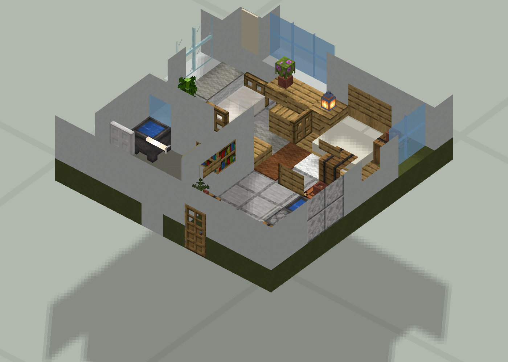

# Haibara’s Architect 0.7


2026-11-03：完整工程已恢复；114 项本地单元测试通过，[GitHub Windows / Linux 自动验证](https://github.com/aihaibara0816/Haibara-s-Architect-0.7/actions/runs/41593392313) 均通过。下载与版本说明见 [Releases](https://github.com/aihaibara0816/Haibara-s-Architect-0.7/releases)。


**把建筑研究、场景布局、完整内饰、植被装饰与工业设施经验，接成可复查、可重复运行的工作流。**


这是可供阅读、运行和继续改进的学习版。正式名称为 **Haibara’s Architect**；历史 HAF / HAFusion 标签和 `hafusion` 模块名保留兼容。


0.7 把案例学习落到六个规则领域、六类有限尺寸的场景配方、Room06 独立适配器和统一 CLI。这里的学习是研究、规则、代码与回归验证的积累，没有训练或提供模型权重。几何内核 0.4、规划合同 0.6 和历史 run 保留自己的版本。





| 从哪里开始 | 内容 |

|---|---|

| [快速开始](docs/quickstart.md) | 生成阅览室与庭园、工业小样；导出旧案例 |

| [完整工作流](docs/workflow.md) | 从研究、用途与地形到内饰、植物、NBT 和归档 |

| [案例与研究图鉴](docs/archive07.md) | 70 条归档、图片、逐条 ZIP、成功与待返工问题 |

| [历代演进](docs/version-history.md) | 0.1–0.7 各自研究的建筑类型与细节 |

| [六个规则领域](docs/skills07.md) | 建筑复原、场景、内饰、植被、工业、编排 |

| [模型接入](docs/model-integration.md) | JSON 工具调用、宿主绑定边界、显式执行 |

| [归档覆盖](docs/archive-coverage.md) | 已收录的成果、源码与尚待验证的范围 |

| [验证记录](docs/validation07.md) | 本次实际运行、历史证据、待游戏/视觉检查 |

| [0.7 恢复检查](docs/recovery07.md) | 18 个分片、1,602 文件完整性、114 项测试与本轮运行结果 |


## 生成一个小场景


Python 3.10+，在完整仓库根目录运行。以下场景配方只需标准库。


```sh

python -X utf8 tools/haf.py --version

python -X utf8 tools/haf.py scene-plan examples/habitat07/reading-garden.json

python -X utf8 tools/haf.py scene-build examples/habitat07/reading-garden.json --runs-root runs/tutorial07 --run garden-001

python -X utf8 tools/haf.py scene-verify --runs-root runs/tutorial07 --run garden-001

```


产物包括 `scene.nbt`、请求、构件归属、计划及校验清单。相同 seed、稳定 ID 与相同输入可以重放；新增构件不会重抽其他构件的随机选择。生成目录不可覆盖。


NBT 含显式空气，导入会覆盖其包围体积；先在新的测试区域检查。程序不会自动打开或修改游戏存档。文件/几何通过不等于视觉、碰撞、照明和用户审美通过。


## 0.7 接入了什么


- 场景与装饰：树、花盆、完整阅览室、厂房单跨、管廊、固定顶储罐六种配方；支持给定高程网格、承托检查、水域/禁放区、最终通路检查。

- 内饰源工程：Room06 的建造和 audit 通过 `build-study` 在独立目录执行；已有家具、门床和植物种子对照证据。

- 资料归档：70 个条目；补齐日式场景、骑楼与城中村、工业及铁路版本，提供[时间线](docs/case-timeline.md)、源码快照、产物与图片。
- 工作流规则：**完整功能空间、家具活动组、嵌灯、植物层次、地形先行、工业接口、受约束随机与最终拼合验收，均标明消费者和能力边界。

- 模型接入：0.6 提案修订保留；新增 0.7 场景工具，模型只能向宿主批准的基线添加受支持模块。


这些是有限配方和案例适配器；尚无任意建筑生成、自动地形测量、铁路寻路、完整工业生产模拟或无人值守审美闭环。个人 Skill 的本次安装受环境限制未完成；仓库规则可通过 CLI 读取，不能据此声称个人 Skill 已同步。


## 目录


| 目录 | 用途 |

|---|---|

| `knowledge/`、`docs/knowledge07/` | 可供模型读取的六领域规则与统一阶段 |

| `hafusion/habitat07.py` | 场景几何、稳定随机、承托与 NBT 验证 |

| `hafusion/archive07.py` | 归档导出、哈希检查、Room06 隔离适配 |

| `archive/`、`downloads/` | 整理后的案例、图片、历史研究及 ZIP |

| `adapters/room06/` | 已取回的专用源工程；不是通用室内模型 |

| `examples/habitat07/` | 场景输入与模型工具示例 |

| `cases/`、`ha03/`、`support/` | 11 个既有适配器及几何基础设施 |

| `history/`、`release/`、`releases/` | 历史版本与当时验证记录 |


贡献约定见 [AGENTS.md](AGENTS.md)，来源与再分发边界见 [ATTRIBUTION.md](ATTRIBUTION.md) 和 [LICENSE-NOTICE.md](LICENSE-NOTICE.md)。


qaq

