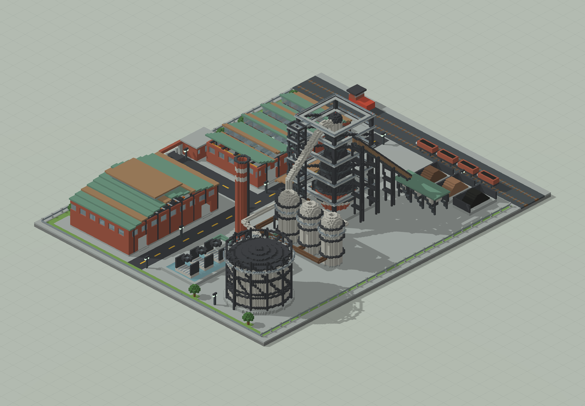
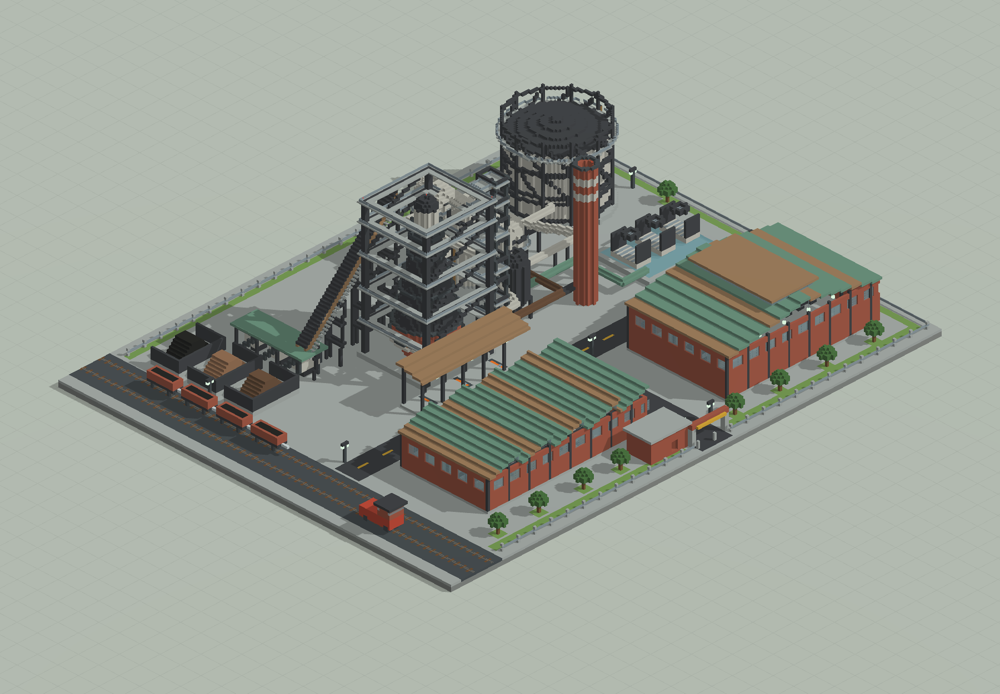
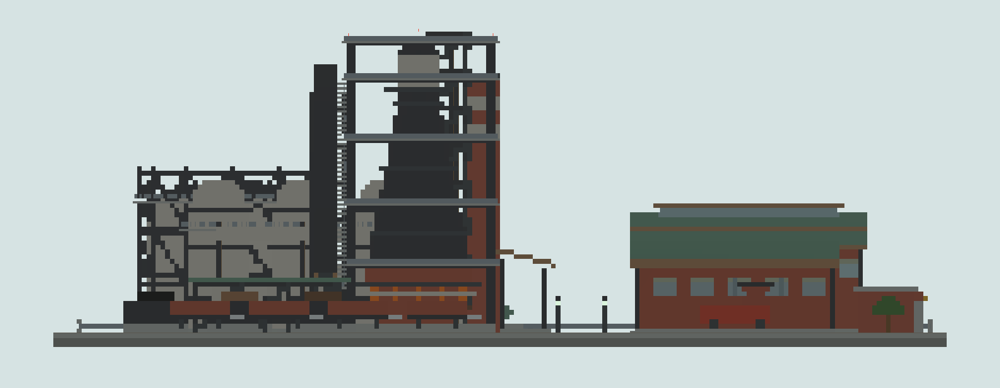
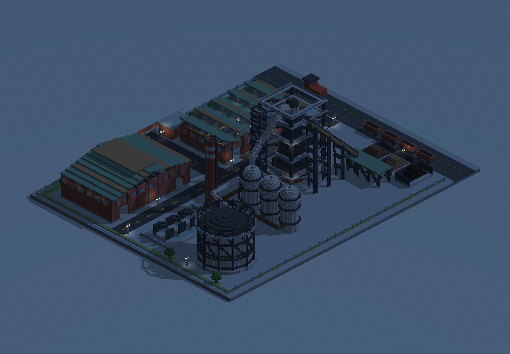
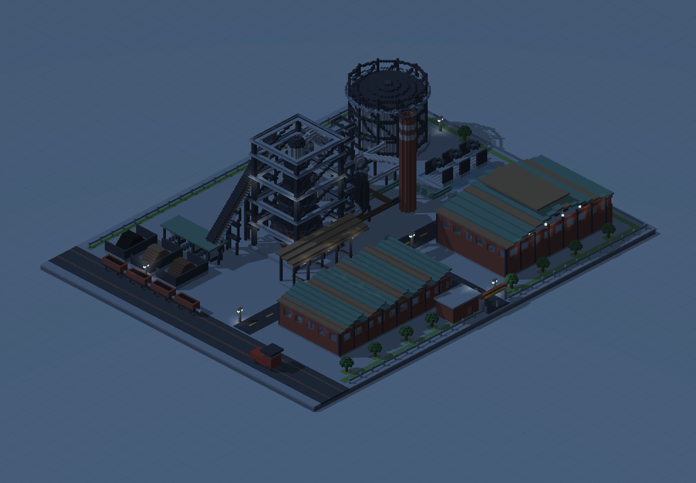
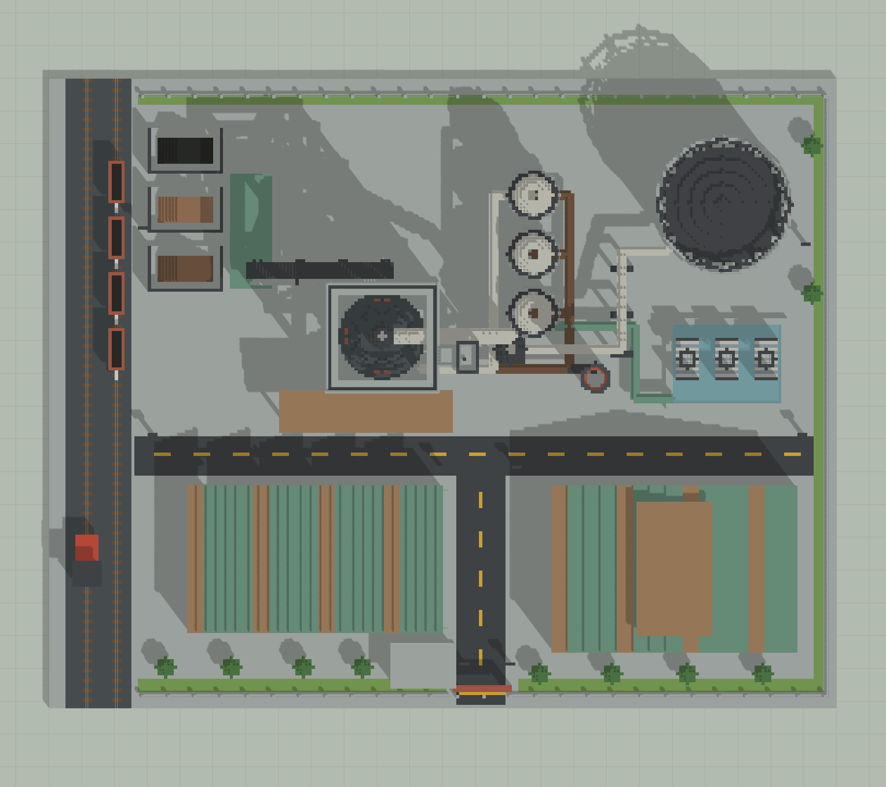

# 广钢式工业区 · 一号钢厂

240×192 的钢厂场景，11 类设施。

版本：`G03`。可建造性：`archived_output`；游戏验收：`pending`。

## 结论与边界

原版静态工业表达；不能将外形与管道连接当作真实生产模拟。

项目源码为历史快照，未自动迁移成主线生成器。本次仅核对文件、哈希与 NBT 可读性；原报告的几何检查、重放和实机截图按其历史范围保留。

## 文件

[原报告文字](research.txt) · [来源记录](sources.json) · [完整图片目录](gallery.md)

### 产物

- [artifacts/Guanggang01.nbt](artifacts/Guanggang01.nbt)
- [artifacts/Guanggang01.schem](artifacts/Guanggang01.schem)
- [project/runs/G03/Guanggang01.nbt](project/runs/G03/Guanggang01.nbt)
- [project/runs/G03/Guanggang01.schem](project/runs/G03/Guanggang01.schem)

### 预览

