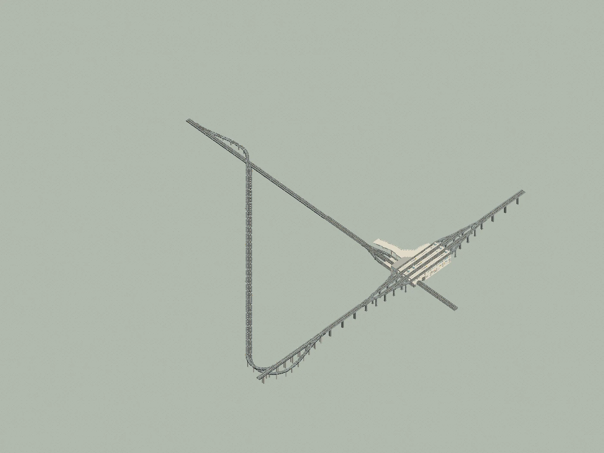
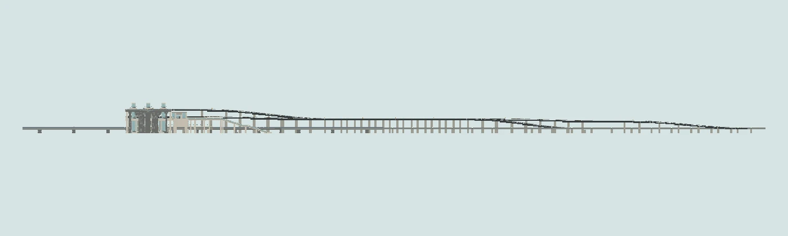

# 广州东 · 车站与双联络线完整结构

1034×1045×42 的站场与双联络线完整结构。

版本：`B03`。可建造性：`archived_output`；游戏验收：`pending`。

## 结论与边界

完整站场还依赖 Yuushya、Quark、Connected Glass 等原站模组；按接口坐标放置。

项目源码为历史快照，未自动迁移成主线生成器。本次仅核对文件、哈希与 NBT 可读性；原报告的几何检查、重放和实机截图按其历史范围保留。

## 文件

[原报告文字](research.txt) · [来源记录](sources.json) · [完整图片目录](gallery.md)

### 产物

- [artifacts/GuangzhouEast_Complete.nbt](artifacts/GuangzhouEast_Complete.nbt)

### 预览

