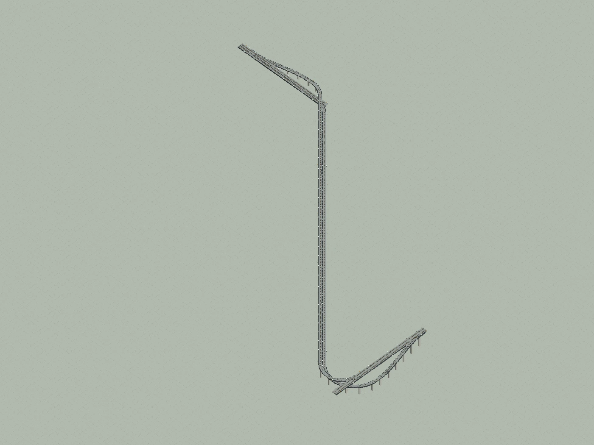
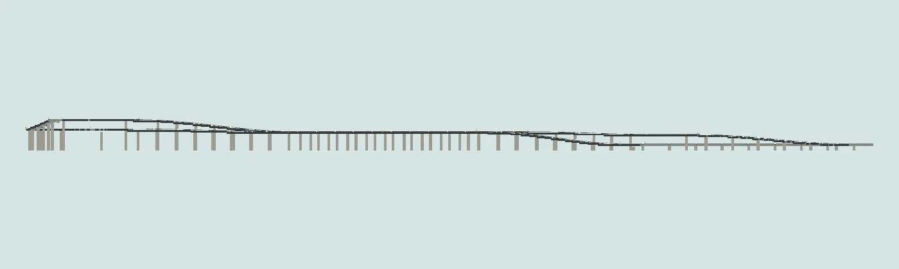

# 广州东 · 独立双联络线

621×899×34 的独立联络线；与完整结构分别提供。

版本：`B03`。可建造性：`archived_output`；游戏验收：`pending`。

## 结论与边界

独立线以原版与 Create 为主；实车扫掠净空、信号与接轨仍待实机验证。

项目源码为历史快照，未自动迁移成主线生成器。本次仅核对文件、哈希与 NBT 可读性；原报告的几何检查、重放和实机截图按其历史范围保留。

## 文件

[原报告文字](research.txt) · [来源记录](sources.json) · [完整图片目录](gallery.md)

### 产物

- [artifacts/GuangzhouEast_LinkOnly.nbt](artifacts/GuangzhouEast_LinkOnly.nbt)

### 预览

