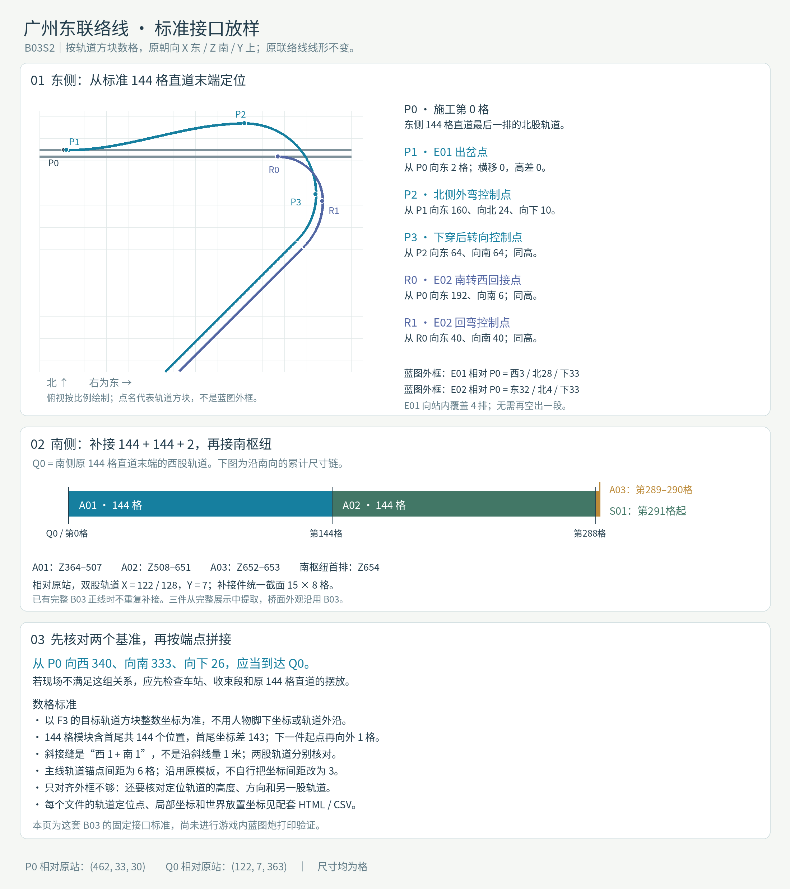

# 广州东分段联络线

广州东双联络线打印指南：7 段联络线与南侧 144+144+2 格补接段。

版本：`B03S2`。可建造性：`archived_output`；游戏验收：`pending`。

## 结论与边界

完整文本保留原始未完成与否定反馈；本次不自动升级验收状态。

项目源码为历史快照，未自动迁移成主线生成器。本次仅核对文件、哈希与 NBT 可读性；原报告的几何检查、重放和实机截图按其历史范围保留。

## 文件

[原报告文字](research.txt) · [来源记录](sources.json) · [完整图片目录](gallery.md)

### 产物

- [project/approach_parts/A01_南侧补接直道_144格.nbt](project/approach_parts/A01_南侧补接直道_144格.nbt)
- [project/approach_parts/A02_南侧补接直道_144格.nbt](project/approach_parts/A02_南侧补接直道_144格.nbt)
- [project/approach_parts/A03_南侧补接直道_2格.nbt](project/approach_parts/A03_南侧补接直道_2格.nbt)
- [project/print_parts/E01_东枢纽_西转南.nbt](project/print_parts/E01_东枢纽_西转南.nbt)
- [project/print_parts/E02_东枢纽_南转西.nbt](project/print_parts/E02_东枢纽_南转西.nbt)
- [project/print_parts/M01_中间直道_东段.nbt](project/print_parts/M01_中间直道_东段.nbt)
- [project/print_parts/M02_中间直道_中段.nbt](project/print_parts/M02_中间直道_中段.nbt)
- [project/print_parts/M03_中间直道_南段.nbt](project/print_parts/M03_中间直道_南段.nbt)
- [project/print_parts/S01_南枢纽_西转南.nbt](project/print_parts/S01_南枢纽_西转南.nbt)
- [project/print_parts/S02_南枢纽_南转西.nbt](project/print_parts/S02_南枢纽_南转西.nbt)
- [project/project/runs/B03/GuangzhouEast_Complete.nbt](project/project/runs/B03/GuangzhouEast_Complete.nbt)
- [project/project/runs/B03/GuangzhouEast_LinkOnly.nbt](project/project/runs/B03/GuangzhouEast_LinkOnly.nbt)
- [project/whole_groups/东枢纽_整组.nbt](project/whole_groups/东枢纽_整组.nbt)
- [project/whole_groups/中间直道_整组.nbt](project/whole_groups/中间直道_整组.nbt)
- [project/whole_groups/南枢纽_整组.nbt](project/whole_groups/南枢纽_整组.nbt)

### 预览

