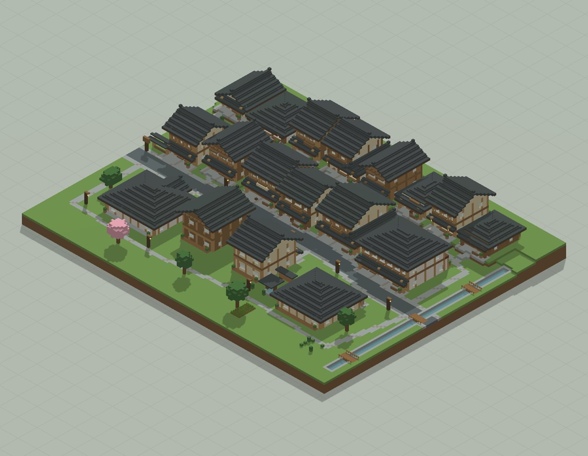
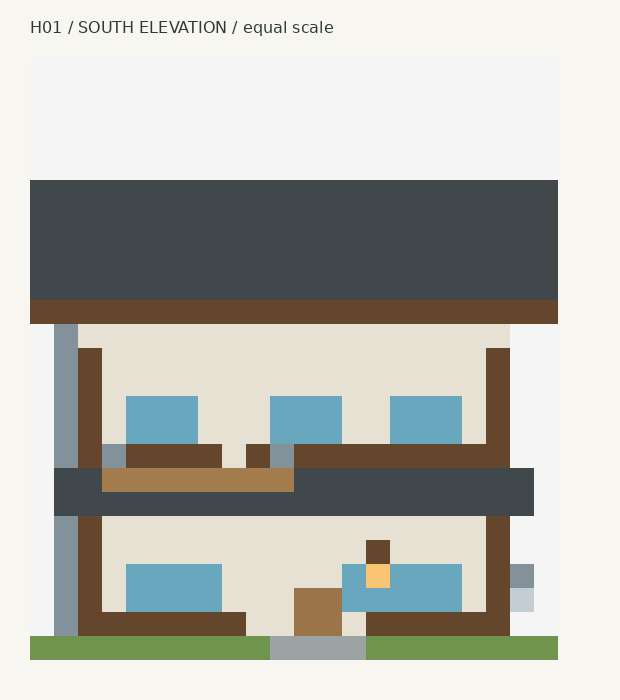
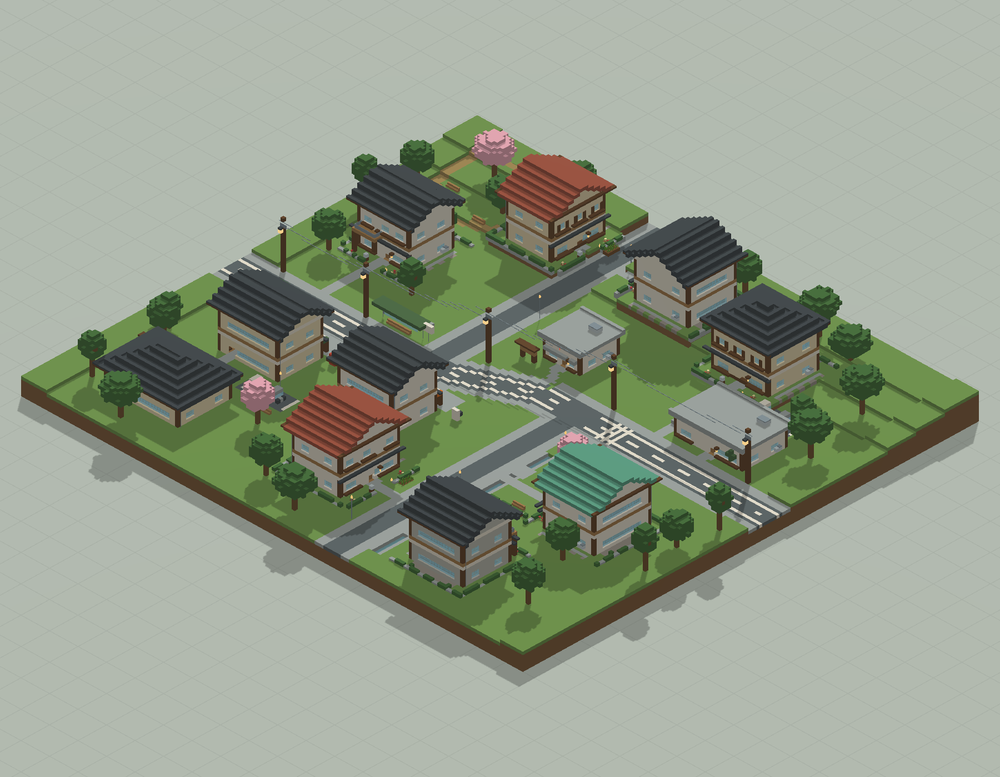
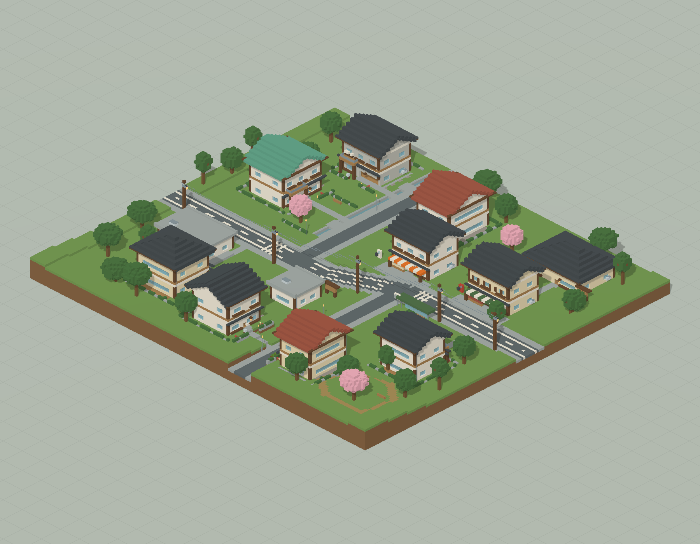
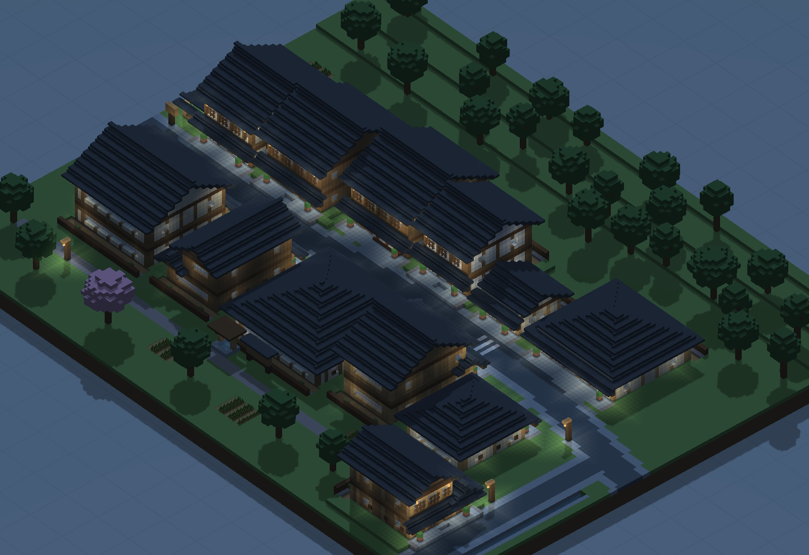
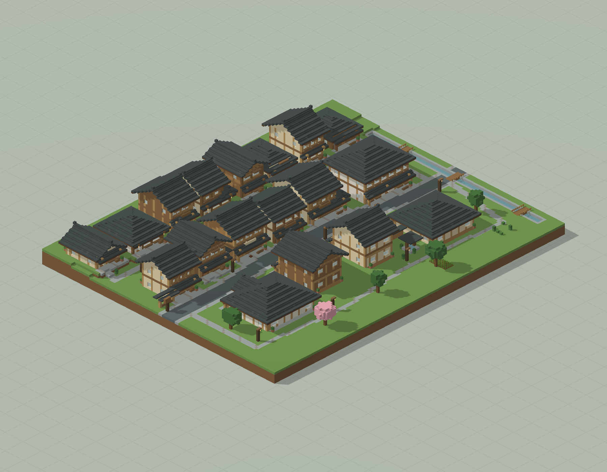

# 山溪日式街区

坡地、溪流、街道和建筑的共同布局；不把概念自动当作存档地形

版本：`JapanTown12`。可建造性：`archived_output`；游戏验收：`pending unless explicit source evidence`。

## 结论与边界

完整文本保留原始未完成与否定反馈；本次不自动升级验收状态。

项目源码为历史快照，未自动迁移成主线生成器。本次仅核对文件、哈希与 NBT 可读性；原报告的几何检查、重放和实机截图按其历史范围保留。

## 文件

[原报告文字](research.txt) · [来源记录](sources.json) · [完整图片目录](gallery.md)

### 产物

- [artifacts/JapanTown12_World_1.21.1.zip](artifacts/JapanTown12_World_1.21.1.zip)
- [project/cases/japan_town12/review/diagrams/J03/exploded_diagram.nbt](project/cases/japan_town12/review/diagrams/J03/exploded_diagram.nbt)
- [project/cases/japan_town12/review/diagrams/J04/exploded_diagram.nbt](project/cases/japan_town12/review/diagrams/J04/exploded_diagram.nbt)
- [project/cases/japan_town12/review/diagrams/J05/exploded_diagram.nbt](project/cases/japan_town12/review/diagrams/J05/exploded_diagram.nbt)
- [project/cases/japan_town12/review/diagrams/J09/exploded_diagram.nbt](project/cases/japan_town12/review/diagrams/J09/exploded_diagram.nbt)
- [project/cases/japan_town12/review/diagrams/J13/exploded_diagram.nbt](project/cases/japan_town12/review/diagrams/J13/exploded_diagram.nbt)
- [project/cases/japan_town12/review/diagrams/J14/exploded_diagram.nbt](project/cases/japan_town12/review/diagrams/J14/exploded_diagram.nbt)
- [project/cases/japan_town12/runs/J01/building.nbt](project/cases/japan_town12/runs/J01/building.nbt)
- [project/cases/japan_town12/runs/J02/building.nbt](project/cases/japan_town12/runs/J02/building.nbt)
- [project/cases/japan_town12/runs/J03/building.nbt](project/cases/japan_town12/runs/J03/building.nbt)
- [project/cases/japan_town12/runs/J03_replay/building.nbt](project/cases/japan_town12/runs/J03_replay/building.nbt)
- [project/cases/japan_town12/runs/J04/building.nbt](project/cases/japan_town12/runs/J04/building.nbt)
- [project/cases/japan_town12/runs/J04_replay/building.nbt](project/cases/japan_town12/runs/J04_replay/building.nbt)
- [project/cases/japan_town12/runs/J05/building.nbt](project/cases/japan_town12/runs/J05/building.nbt)
- [project/cases/japan_town12/runs/J05_replay/building.nbt](project/cases/japan_town12/runs/J05_replay/building.nbt)
- [project/cases/japan_town12/runs/J06/building.nbt](project/cases/japan_town12/runs/J06/building.nbt)
- [project/cases/japan_town12/runs/J07/building.nbt](project/cases/japan_town12/runs/J07/building.nbt)
- [project/cases/japan_town12/runs/J08/building.nbt](project/cases/japan_town12/runs/J08/building.nbt)
- [project/cases/japan_town12/runs/J09/building.nbt](project/cases/japan_town12/runs/J09/building.nbt)
- [project/cases/japan_town12/runs/J09_replay/building.nbt](project/cases/japan_town12/runs/J09_replay/building.nbt)
- [project/cases/japan_town12/runs/J10/building.nbt](project/cases/japan_town12/runs/J10/building.nbt)
- [project/cases/japan_town12/runs/J11/building.nbt](project/cases/japan_town12/runs/J11/building.nbt)
- [project/cases/japan_town12/runs/J12/building.nbt](project/cases/japan_town12/runs/J12/building.nbt)
- [project/cases/japan_town12/runs/J13/building.nbt](project/cases/japan_town12/runs/J13/building.nbt)
- [project/cases/japan_town12/runs/J13_replay/building.nbt](project/cases/japan_town12/runs/J13_replay/building.nbt)
- [project/cases/japan_town12/runs/J14/building.nbt](project/cases/japan_town12/runs/J14/building.nbt)
- [project/cases/japan_town12/runs/J14_replay/building.nbt](project/cases/japan_town12/runs/J14_replay/building.nbt)
- [project/cases/japan_town12/runs/J15/building.nbt](project/cases/japan_town12/runs/J15/building.nbt)
- [project/research/interior_lab04/I01/InteriorLab.nbt](project/research/interior_lab04/I01/InteriorLab.nbt)
- [project/research/interior_lab04/I02/InteriorLab.nbt](project/research/interior_lab04/I02/InteriorLab.nbt)
- [project/research/interior_lab04/I03/InteriorLab.nbt](project/research/interior_lab04/I03/InteriorLab.nbt)
- [project/research/interior_lab04/I04/InteriorLab.nbt](project/research/interior_lab04/I04/InteriorLab.nbt)
- [project/research/interior_lab04/I05/InteriorLab.nbt](project/research/interior_lab04/I05/InteriorLab.nbt)
- [project/research/interior_lab04/I06/InteriorLab.nbt](project/research/interior_lab04/I06/InteriorLab.nbt)

### 预览

