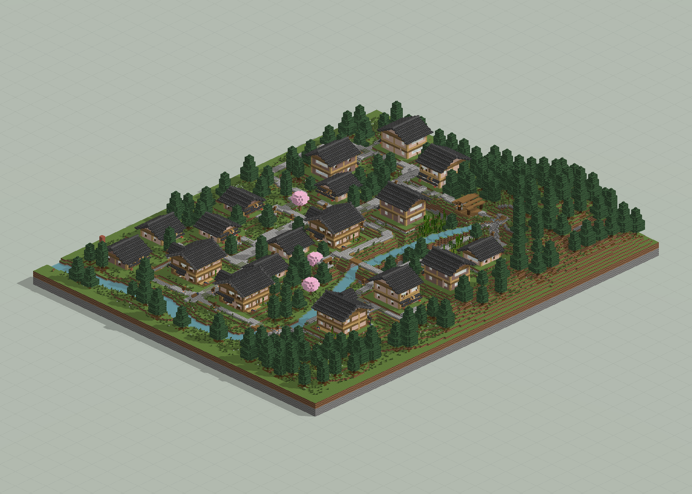
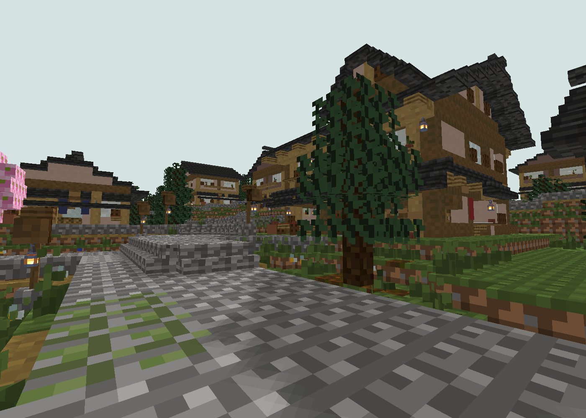

# 木漏日町 · 山溪与十八栋

山溪地形先行的 18 栋聚落；保留地形输入、树木与公共节点。

版本：`T07`。可建造性：`archived_output`；游戏验收：`pending`。

## 结论与边界

室外连通检查允许跳跃，不能解释为全部平地可步行。

项目源码为历史快照，未自动迁移成主线生成器。本次仅核对文件、哈希与 NBT 可读性；原报告的几何检查、重放和实机截图按其历史范围保留。

## 文件

[原报告文字](research.txt) · [来源记录](sources.json) · [完整图片目录](gallery.md)

### 产物

- [artifacts/Komorebi09.nbt](artifacts/Komorebi09.nbt)
- [artifacts/Komorebi09_World_1.21.1.zip](artifacts/Komorebi09_World_1.21.1.zip)
- [artifacts/Terrain_Input.nbt](artifacts/Terrain_Input.nbt)
- [project/input/Machiya08_M08.nbt](project/input/Machiya08_M08.nbt)
- [project/runs/J03/Komorebi09.nbt](project/runs/J03/Komorebi09.nbt)
- [project/runs/J03_Replay/Komorebi09.nbt](project/runs/J03_Replay/Komorebi09.nbt)
- [project/runs/J03_SeedB/Komorebi09.nbt](project/runs/J03_SeedB/Komorebi09.nbt)
- [project/runs/T07/Komorebi09.nbt](project/runs/T07/Komorebi09.nbt)
- [project/runs/T07/Terrain_Input.nbt](project/runs/T07/Terrain_Input.nbt)
- [project/runs/T07_Replay/Komorebi09.nbt](project/runs/T07_Replay/Komorebi09.nbt)
- [project/runs/T07_Replay/Terrain_Input.nbt](project/runs/T07_Replay/Terrain_Input.nbt)
- [project/runs/T07_SeedB/Komorebi09.nbt](project/runs/T07_SeedB/Komorebi09.nbt)
- [project/runs/T07_SeedB/Terrain_Input.nbt](project/runs/T07_SeedB/Terrain_Input.nbt)

### 预览

**全览大图 · 离线模型预览**

**山溪街巷细节 · T07**

