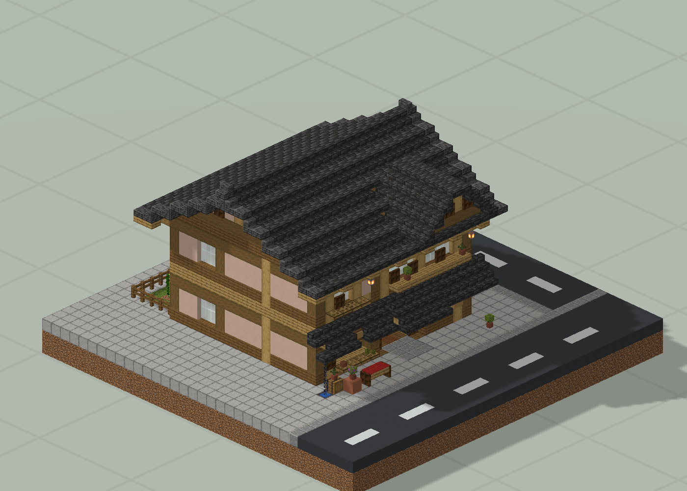
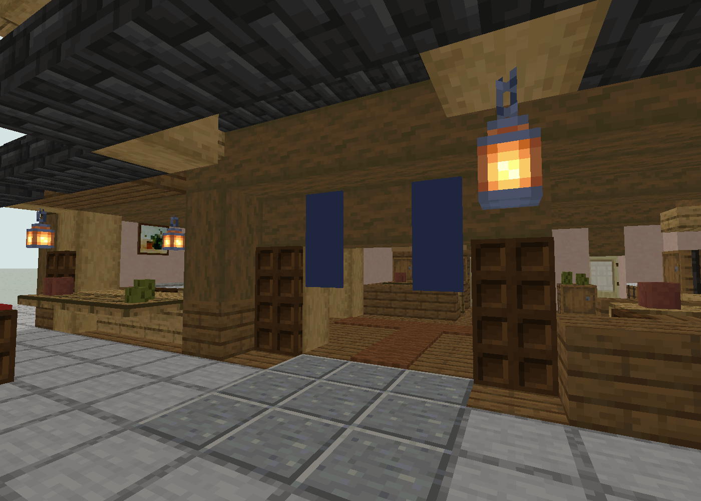

# 日和小食 · 町家门面与屋顶返工

两层居酒屋与住宅；开放门面、分层屋顶和 11 个座位。

版本：`M08`。可建造性：`archived_output`；游戏验收：`pending`。

## 结论与边界

小型街屋应先验证门面、屋顶和室内功能，再复制到街区。

项目源码为历史快照，未自动迁移成主线生成器。本次仅核对文件、哈希与 NBT 可读性；原报告的几何检查、重放和实机截图按其历史范围保留。

## 文件

[原报告文字](research.txt) · [来源记录](sources.json) · [完整图片目录](gallery.md)

### 产物

- [artifacts/Machiya08.nbt](artifacts/Machiya08.nbt)
- [project/runs/M03/Machiya08.nbt](project/runs/M03/Machiya08.nbt)
- [project/runs/M04/Machiya08.nbt](project/runs/M04/Machiya08.nbt)
- [project/runs/M06/Machiya08.nbt](project/runs/M06/Machiya08.nbt)
- [project/runs/M06_SeedB/Machiya08.nbt](project/runs/M06_SeedB/Machiya08.nbt)
- [project/runs/M08/Machiya08.nbt](project/runs/M08/Machiya08.nbt)
- [project/runs/M08_Replay/Machiya08.nbt](project/runs/M08_Replay/Machiya08.nbt)
- [project/runs/M08_SeedB/Machiya08.nbt](project/runs/M08_SeedB/Machiya08.nbt)

### 预览

**全览大图 · 离线模型预览**

**门面与入口细节 · M08**

