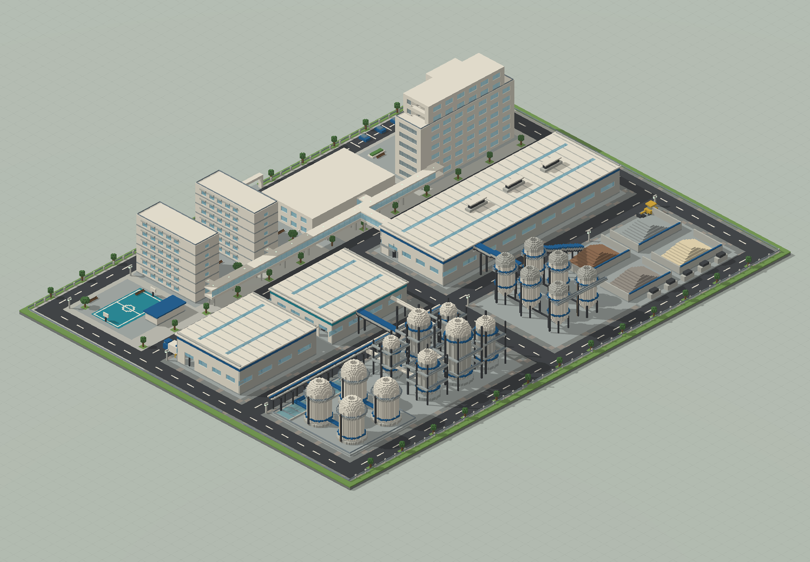
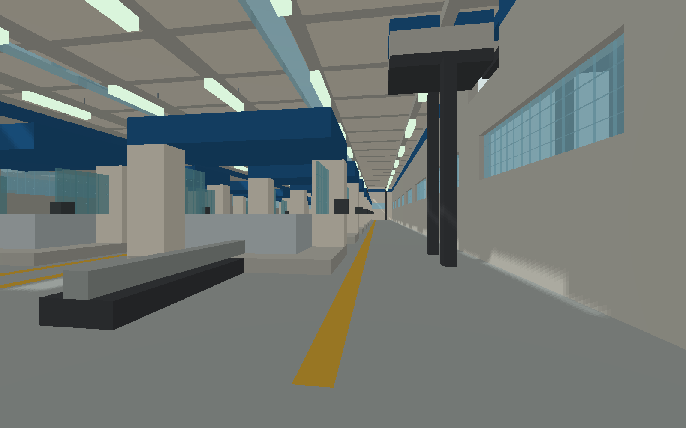

# 新港制造园 · 综合生产基地

448×336；办公楼、生产厂房、宿舍、食堂与连桥，包含 V3 硬地返工。

版本：`E07`。可建造性：`archived_output`；游戏验收：`pending`。

## 结论与边界

保留工业硬地和运输逻辑，机器与生产流程为静态表达。

项目源码为历史快照，未自动迁移成主线生成器。本次仅核对文件、哈希与 NBT 可读性；原报告的几何检查、重放和实机截图按其历史范围保留。

## 文件

[原报告文字](research.txt) · [来源记录](sources.json) · [完整图片目录](gallery.md)

### 产物

- [artifacts/ModernFactory01.schem](artifacts/ModernFactory01.schem)
- [project/runs/E07/ModernFactory01.nbt](project/runs/E07/ModernFactory01.nbt)
- [project/runs/E07/ModernFactory01.schem](project/runs/E07/ModernFactory01.schem)

### 预览

**全览大图 · 离线模型预览**

**生产车间内部细节**

