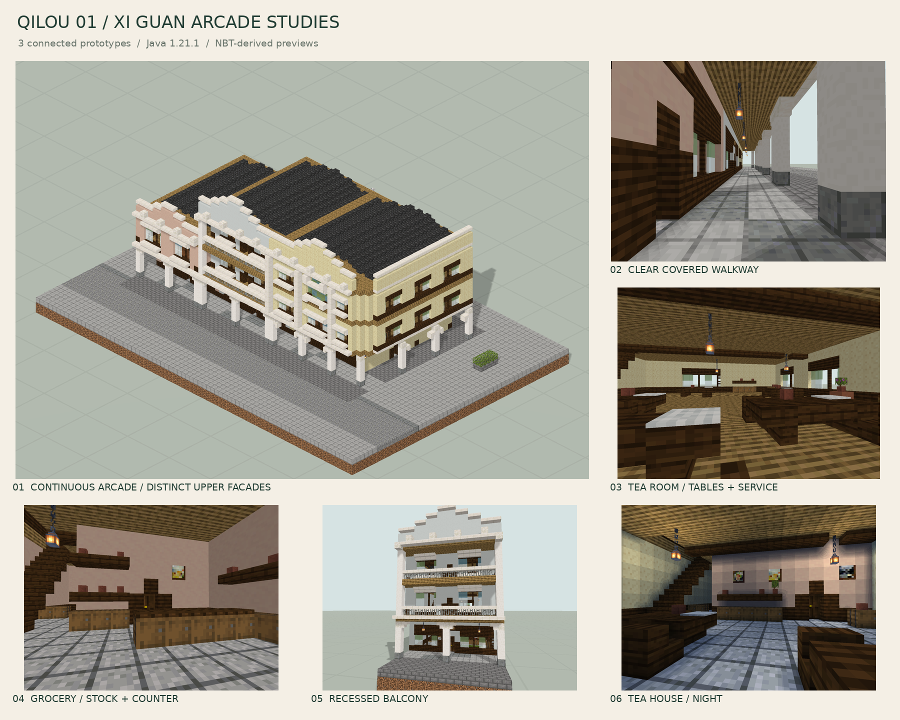
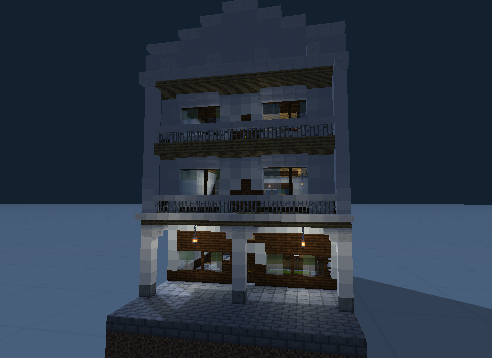
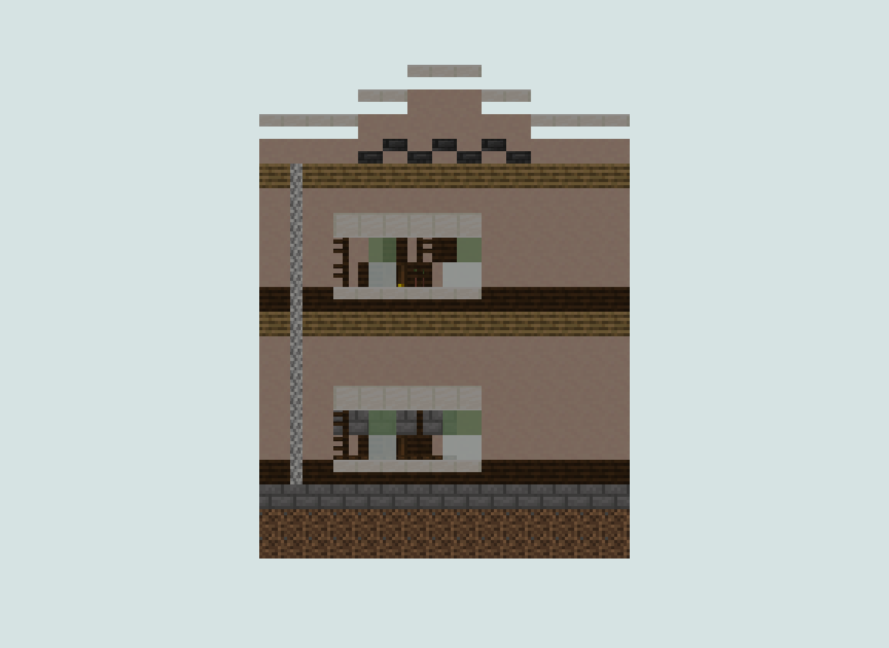
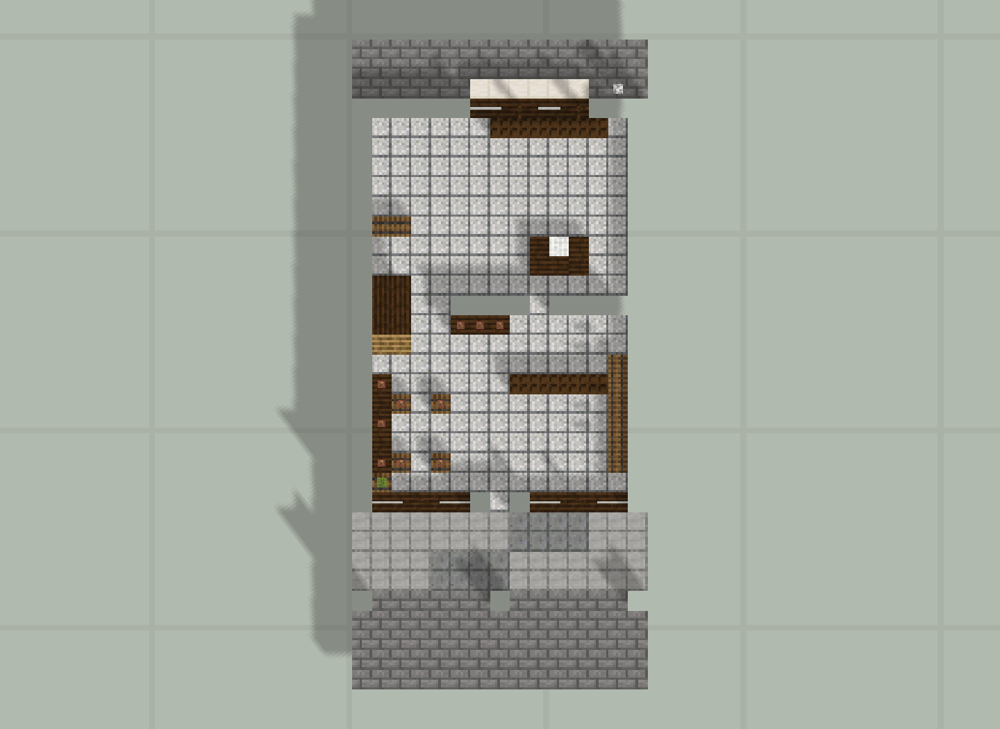
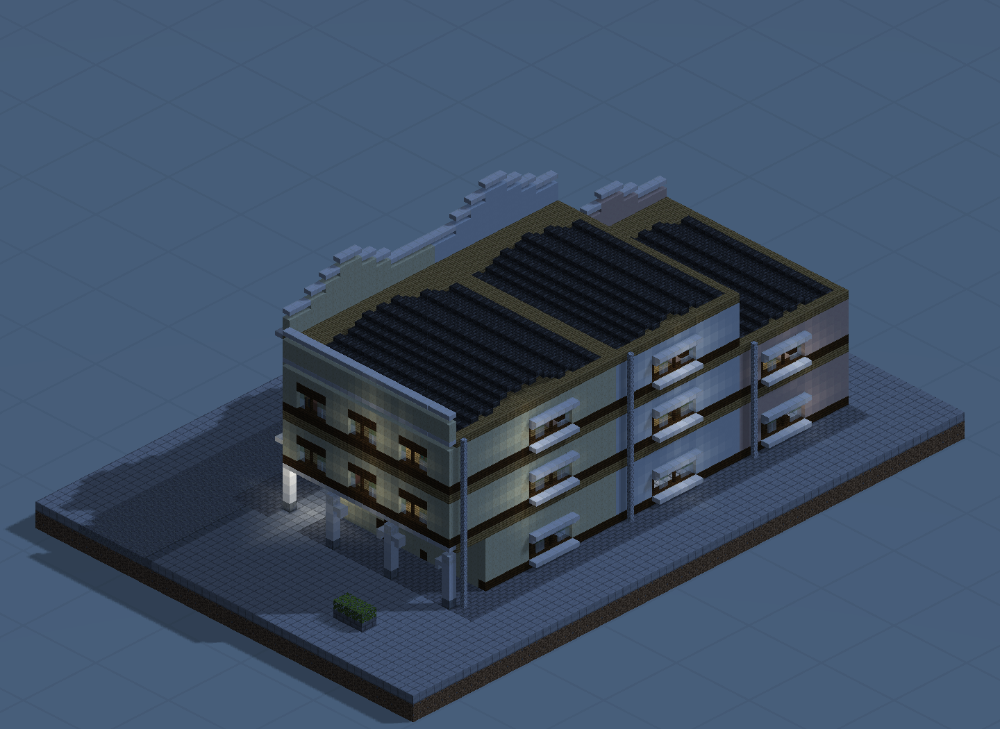
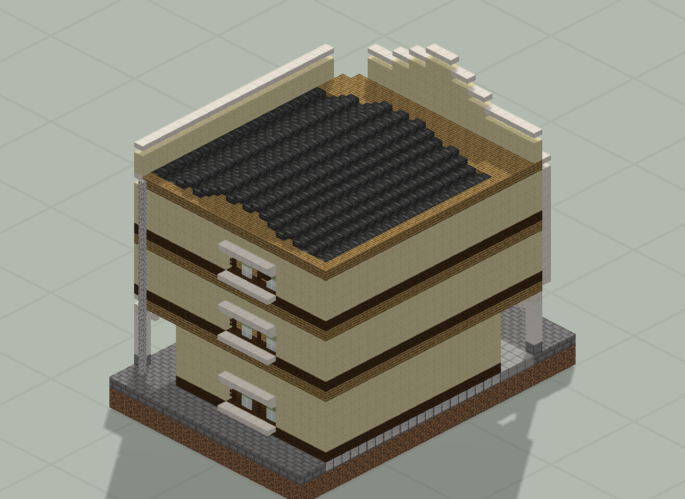

# 檐下西关 · 三栋骑楼小样

合顺杂货、济安药房、榕荫茶居三种骑楼原型。

版本：`Q05`。可建造性：`archived_output`；游戏验收：`pending`。

## 结论与边界

先验证骑楼柱廊、商铺开口和楼层关系；三栋小样不等于完整街区。

项目源码为历史快照，未自动迁移成主线生成器。本次仅核对文件、哈希与 NBT 可读性；原报告的几何检查、重放和实机截图按其历史范围保留。

## 文件

[原报告文字](research.txt) · [来源记录](sources.json) · [完整图片目录](gallery.md)

### 产物

- [project/delivery/Qilou01_World_1.21.1.zip](project/delivery/Qilou01_World_1.21.1.zip)
- [project/runs/Q05/Apothecary.nbt](project/runs/Q05/Apothecary.nbt)
- [project/runs/Q05/Grocery.nbt](project/runs/Q05/Grocery.nbt)
- [project/runs/Q05/Qilou01.nbt](project/runs/Q05/Qilou01.nbt)
- [project/runs/Q05/Teahouse.nbt](project/runs/Q05/Teahouse.nbt)

### 预览

