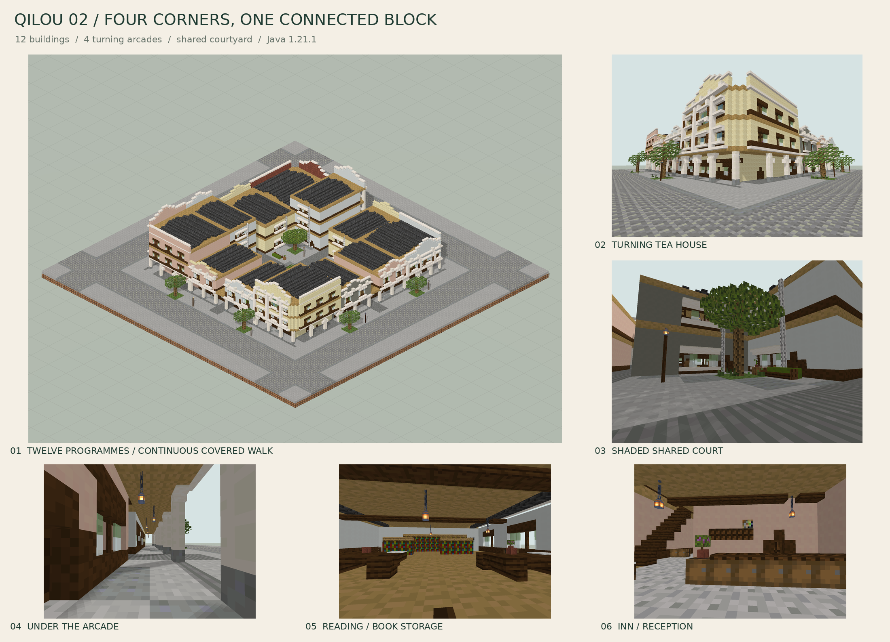
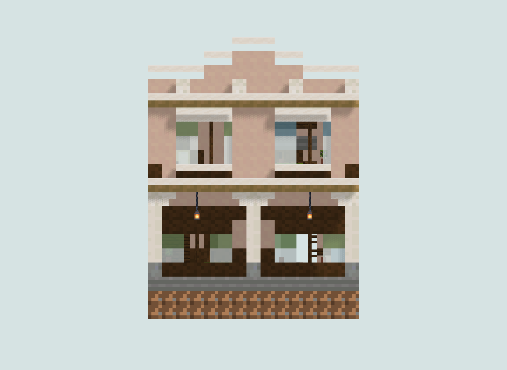
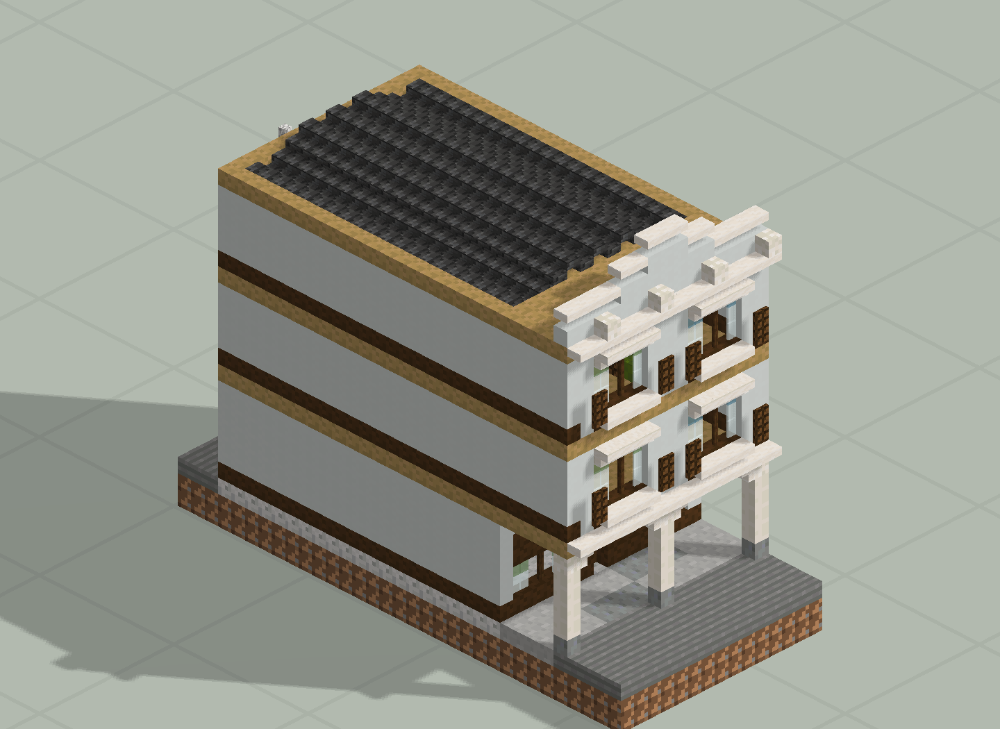
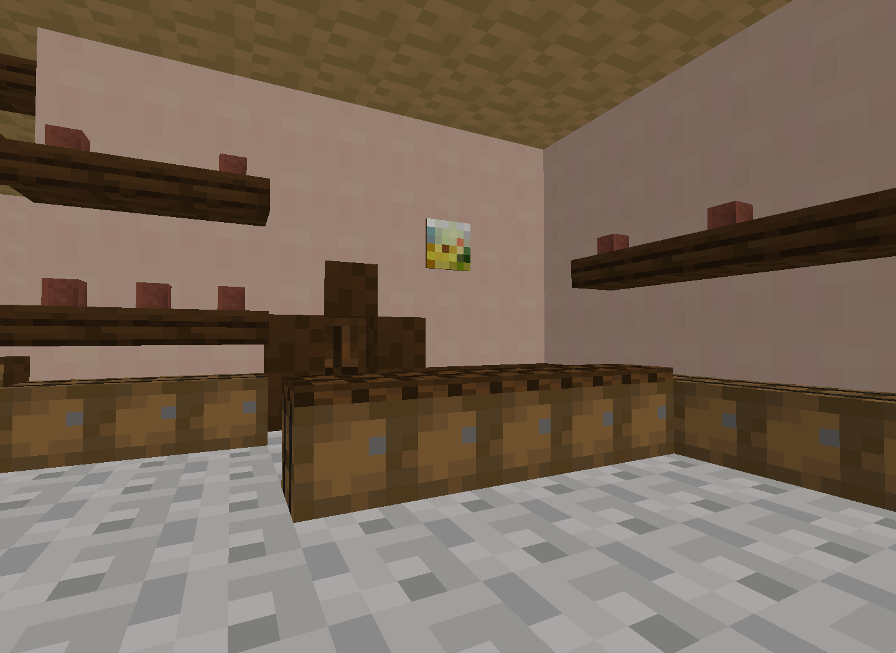
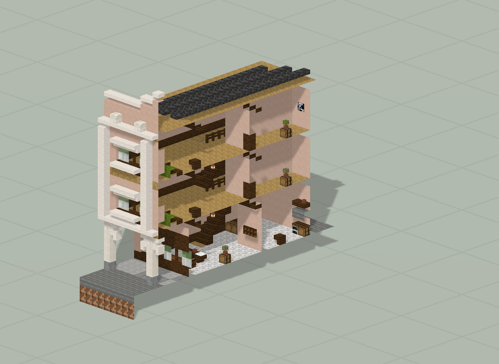
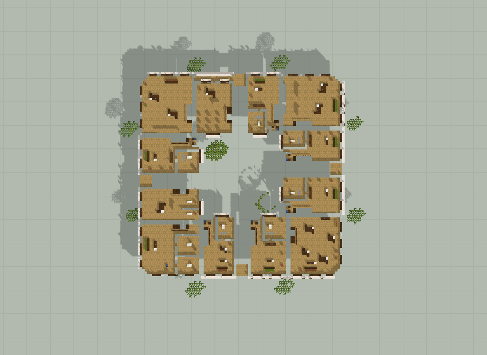

# 檐下西关 · 四角里

12 栋商铺、四个街角与围合院落；144×44×144。

版本：`S06`。可建造性：`archived_output`；游戏验收：`pending`。

## 结论与边界

连续柱廊与四向穿院通道形成第一轮街区连接。

项目源码为历史快照，未自动迁移成主线生成器。本次仅核对文件、哈希与 NBT 可读性；原报告的几何检查、重放和实机截图按其历史范围保留。

## 文件

[原报告文字](research.txt) · [来源记录](sources.json) · [完整图片目录](gallery.md)

### 产物

- [project/delivery/Qilou02_World_1.21.1.zip](project/delivery/Qilou02_World_1.21.1.zip)
- [project/runs/S06/Apothecary.nbt](project/runs/S06/Apothecary.nbt)
- [project/runs/S06/Bakery.nbt](project/runs/S06/Bakery.nbt)
- [project/runs/S06/Barber.nbt](project/runs/S06/Barber.nbt)
- [project/runs/S06/Bookshop.nbt](project/runs/S06/Bookshop.nbt)
- [project/runs/S06/Clinic.nbt](project/runs/S06/Clinic.nbt)
- [project/runs/S06/Grain.nbt](project/runs/S06/Grain.nbt)
- [project/runs/S06/Grocery.nbt](project/runs/S06/Grocery.nbt)
- [project/runs/S06/Hardware.nbt](project/runs/S06/Hardware.nbt)
- [project/runs/S06/Inn.nbt](project/runs/S06/Inn.nbt)
- [project/runs/S06/Post.nbt](project/runs/S06/Post.nbt)
- [project/runs/S06/Qilou02.nbt](project/runs/S06/Qilou02.nbt)
- [project/runs/S06/Teahouse.nbt](project/runs/S06/Teahouse.nbt)
- [project/runs/S06/Textile.nbt](project/runs/S06/Textile.nbt)

### 预览

