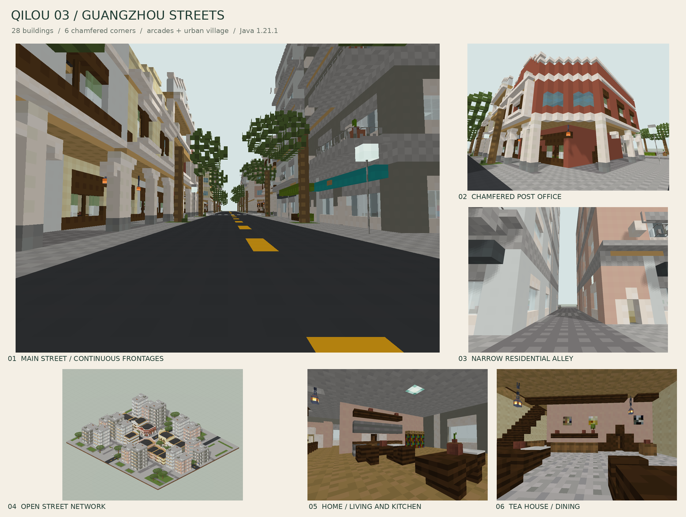
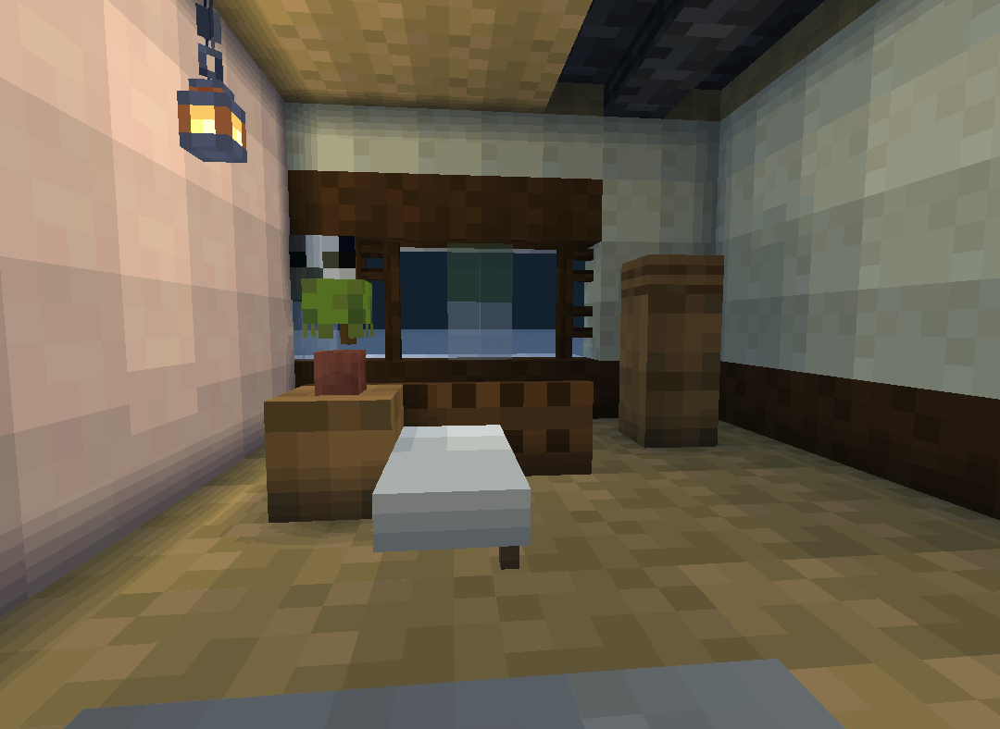
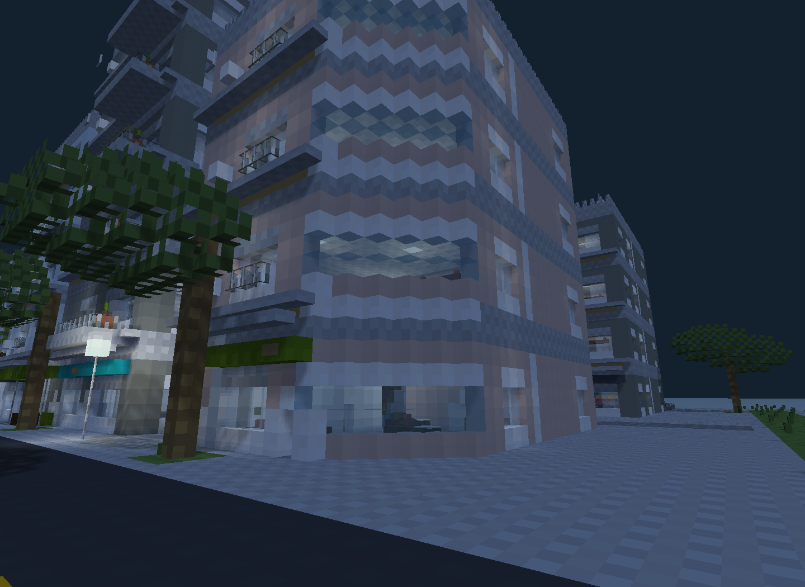
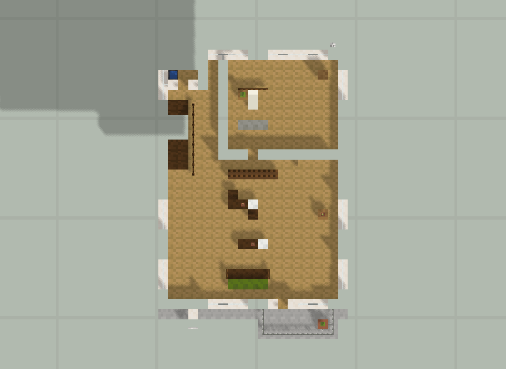
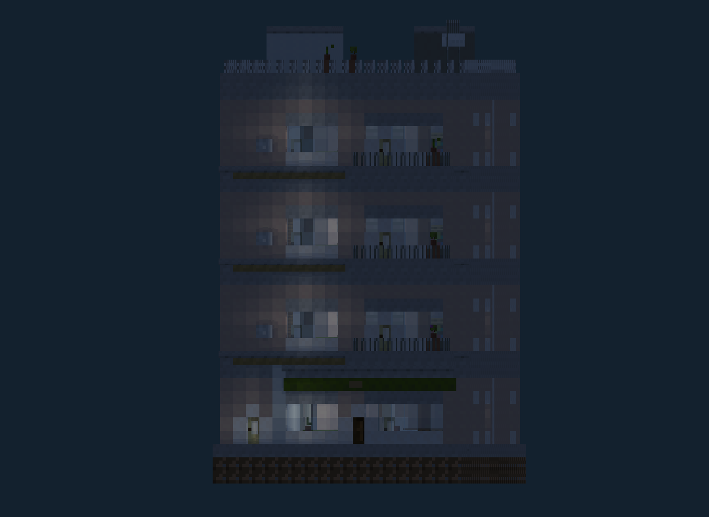
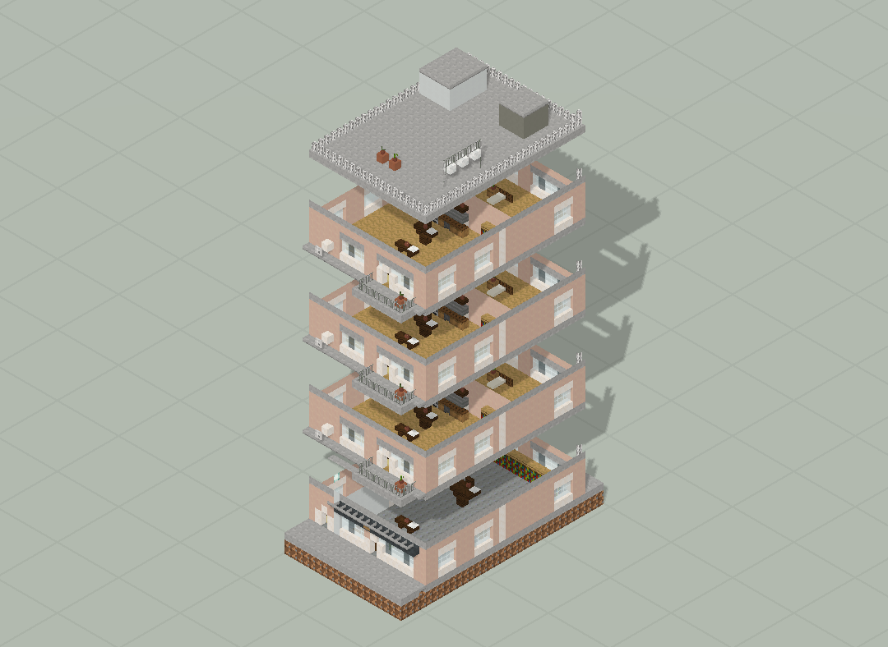

# 檐下榕里 · 广州街巷

12 栋骑楼与 16 栋城中村混合；244×58×216。

版本：`G05`。可建造性：`archived_output`；游戏验收：`pending`。

## 结论与边界

从围合院落走向十字路口、后巷和多级道路，检查入口与楼梯连通。

项目源码为历史快照，未自动迁移成主线生成器。本次仅核对文件、哈希与 NBT 可读性；原报告的几何检查、重放和实机截图按其历史范围保留。

## 文件

[原报告文字](research.txt) · [来源记录](sources.json) · [完整图片目录](gallery.md)

### 产物

- [project/delivery/Qilou03_World_1.21.1.zip](project/delivery/Qilou03_World_1.21.1.zip)
- [project/runs/G05/Apothecary.nbt](project/runs/G05/Apothecary.nbt)
- [project/runs/G05/Bakery.nbt](project/runs/G05/Bakery.nbt)
- [project/runs/G05/Barber.nbt](project/runs/G05/Barber.nbt)
- [project/runs/G05/Bookshop.nbt](project/runs/G05/Bookshop.nbt)
- [project/runs/G05/Clinic.nbt](project/runs/G05/Clinic.nbt)
- [project/runs/G05/Grain.nbt](project/runs/G05/Grain.nbt)
- [project/runs/G05/Grocery.nbt](project/runs/G05/Grocery.nbt)
- [project/runs/G05/Hardware.nbt](project/runs/G05/Hardware.nbt)
- [project/runs/G05/Inn.nbt](project/runs/G05/Inn.nbt)
- [project/runs/G05/Post.nbt](project/runs/G05/Post.nbt)
- [project/runs/G05/Qilou03.nbt](project/runs/G05/Qilou03.nbt)
- [project/runs/G05/Teahouse.nbt](project/runs/G05/Teahouse.nbt)
- [project/runs/G05/Textile.nbt](project/runs/G05/Textile.nbt)
- [project/runs/G05/V01.nbt](project/runs/G05/V01.nbt)
- [project/runs/G05/V02.nbt](project/runs/G05/V02.nbt)
- [project/runs/G05/V03.nbt](project/runs/G05/V03.nbt)
- [project/runs/G05/V04.nbt](project/runs/G05/V04.nbt)
- [project/runs/G05/V05.nbt](project/runs/G05/V05.nbt)
- [project/runs/G05/V06.nbt](project/runs/G05/V06.nbt)
- [project/runs/G05/V07.nbt](project/runs/G05/V07.nbt)
- [project/runs/G05/V08.nbt](project/runs/G05/V08.nbt)
- [project/runs/G05/V09.nbt](project/runs/G05/V09.nbt)
- [project/runs/G05/V10.nbt](project/runs/G05/V10.nbt)
- [project/runs/G05/V11.nbt](project/runs/G05/V11.nbt)
- [project/runs/G05/V12.nbt](project/runs/G05/V12.nbt)
- [project/runs/G05/V13.nbt](project/runs/G05/V13.nbt)
- [project/runs/G05/V14.nbt](project/runs/G05/V14.nbt)
- [project/runs/G05/V15.nbt](project/runs/G05/V15.nbt)
- [project/runs/G05/V16.nbt](project/runs/G05/V16.nbt)

### 预览

