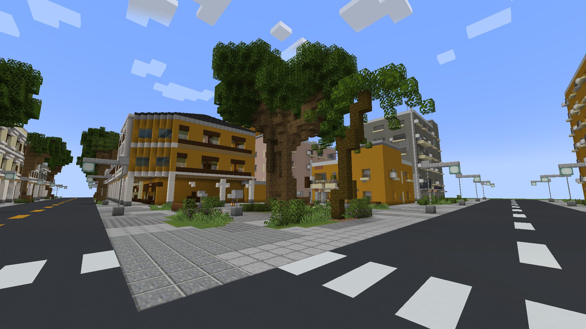
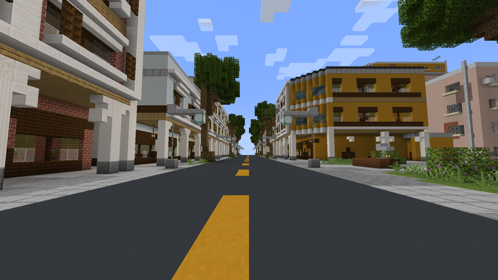
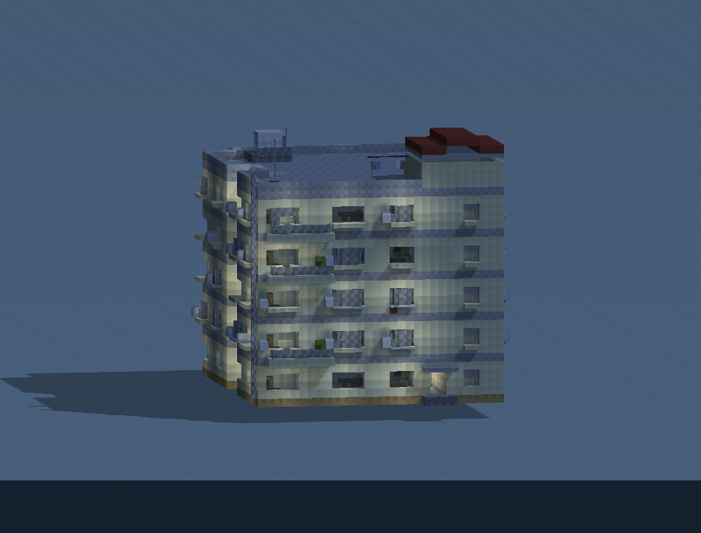
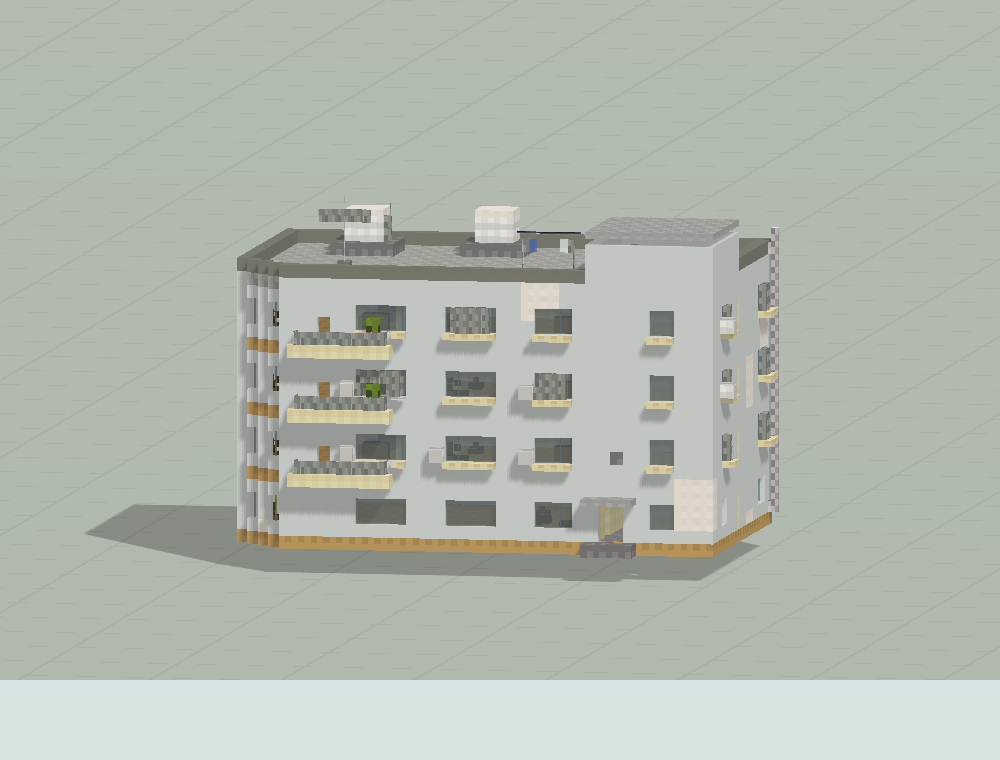
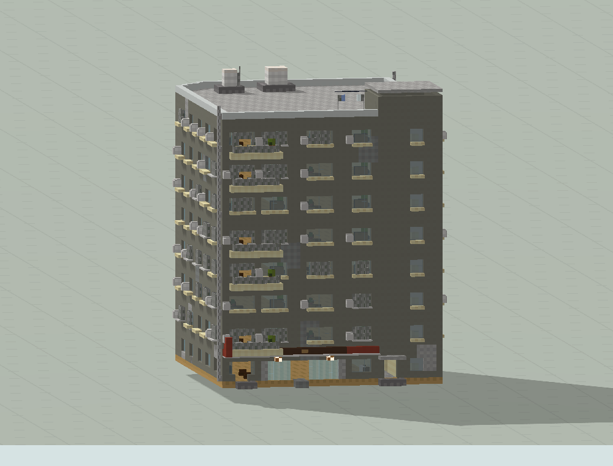
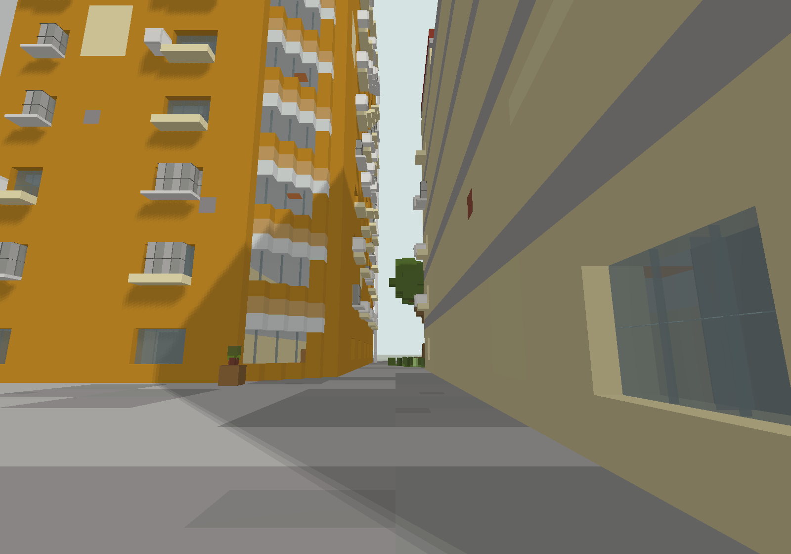

# 榕灰里 · 骑楼与城中村街区

44 栋建筑：12 栋骑楼、32 栋城中村，356×84×250；保留白天与夜间实机截图。

版本：`R19h`。可建造性：`archived_output`；游戏验收：`historical_vanilla_1.21.1_load_and_screenshots`。

## 结论与边界

已有原版 Java 1.21.1 加载与 F2 截图记录，仍不等于逐户功能、所有交互全部验收。

项目源码为历史快照，未自动迁移成主线生成器。本次仅核对文件、哈希与 NBT 可读性；原报告的几何检查、重放和实机截图按其历史范围保留。

## 文件

[原报告文字](research.txt) · [来源记录](sources.json) · [完整图片目录](gallery.md)

### 产物

- [project/deliverables/Qilou04_World_1.21.1.zip](project/deliverables/Qilou04_World_1.21.1.zip)
- [project/runs/R19h/A1.nbt](project/runs/R19h/A1.nbt)
- [project/runs/R19h/A2.nbt](project/runs/R19h/A2.nbt)
- [project/runs/R19h/A3.nbt](project/runs/R19h/A3.nbt)
- [project/runs/R19h/A4.nbt](project/runs/R19h/A4.nbt)
- [project/runs/R19h/A5.nbt](project/runs/R19h/A5.nbt)
- [project/runs/R19h/B1.nbt](project/runs/R19h/B1.nbt)
- [project/runs/R19h/B2.nbt](project/runs/R19h/B2.nbt)
- [project/runs/R19h/B3.nbt](project/runs/R19h/B3.nbt)
- [project/runs/R19h/B4.nbt](project/runs/R19h/B4.nbt)
- [project/runs/R19h/B5.nbt](project/runs/R19h/B5.nbt)
- [project/runs/R19h/C1.nbt](project/runs/R19h/C1.nbt)
- [project/runs/R19h/C2.nbt](project/runs/R19h/C2.nbt)
- [project/runs/R19h/C3.nbt](project/runs/R19h/C3.nbt)
- [project/runs/R19h/C4.nbt](project/runs/R19h/C4.nbt)
- [project/runs/R19h/C5.nbt](project/runs/R19h/C5.nbt)
- [project/runs/R19h/C6.nbt](project/runs/R19h/C6.nbt)
- [project/runs/R19h/C7.nbt](project/runs/R19h/C7.nbt)
- [project/runs/R19h/C8.nbt](project/runs/R19h/C8.nbt)
- [project/runs/R19h/C9.nbt](project/runs/R19h/C9.nbt)
- [project/runs/R19h/D1.nbt](project/runs/R19h/D1.nbt)
- [project/runs/R19h/D2.nbt](project/runs/R19h/D2.nbt)
- [project/runs/R19h/D3.nbt](project/runs/R19h/D3.nbt)
- [project/runs/R19h/D4.nbt](project/runs/R19h/D4.nbt)
- [project/runs/R19h/D5.nbt](project/runs/R19h/D5.nbt)
- [project/runs/R19h/D6.nbt](project/runs/R19h/D6.nbt)
- [project/runs/R19h/D7.nbt](project/runs/R19h/D7.nbt)
- [project/runs/R19h/E1.nbt](project/runs/R19h/E1.nbt)
- [project/runs/R19h/E2.nbt](project/runs/R19h/E2.nbt)
- [project/runs/R19h/E3.nbt](project/runs/R19h/E3.nbt)
- [project/runs/R19h/E4.nbt](project/runs/R19h/E4.nbt)
- [project/runs/R19h/E5.nbt](project/runs/R19h/E5.nbt)
- [project/runs/R19h/E6.nbt](project/runs/R19h/E6.nbt)
- [project/runs/R19h/N01.nbt](project/runs/R19h/N01.nbt)
- [project/runs/R19h/N02.nbt](project/runs/R19h/N02.nbt)
- [project/runs/R19h/N03.nbt](project/runs/R19h/N03.nbt)
- [project/runs/R19h/N05.nbt](project/runs/R19h/N05.nbt)
- [project/runs/R19h/N06.nbt](project/runs/R19h/N06.nbt)
- [project/runs/R19h/N07.nbt](project/runs/R19h/N07.nbt)
- [project/runs/R19h/N08.nbt](project/runs/R19h/N08.nbt)
- [project/runs/R19h/Qilou04.nbt](project/runs/R19h/Qilou04.nbt)
- [project/runs/R19h/S01.nbt](project/runs/R19h/S01.nbt)
- [project/runs/R19h/S03.nbt](project/runs/R19h/S03.nbt)
- [project/runs/R19h/S04.nbt](project/runs/R19h/S04.nbt)
- [project/runs/R19h/S07.nbt](project/runs/R19h/S07.nbt)
- [project/runs/R19h/S08.nbt](project/runs/R19h/S08.nbt)

### 预览

