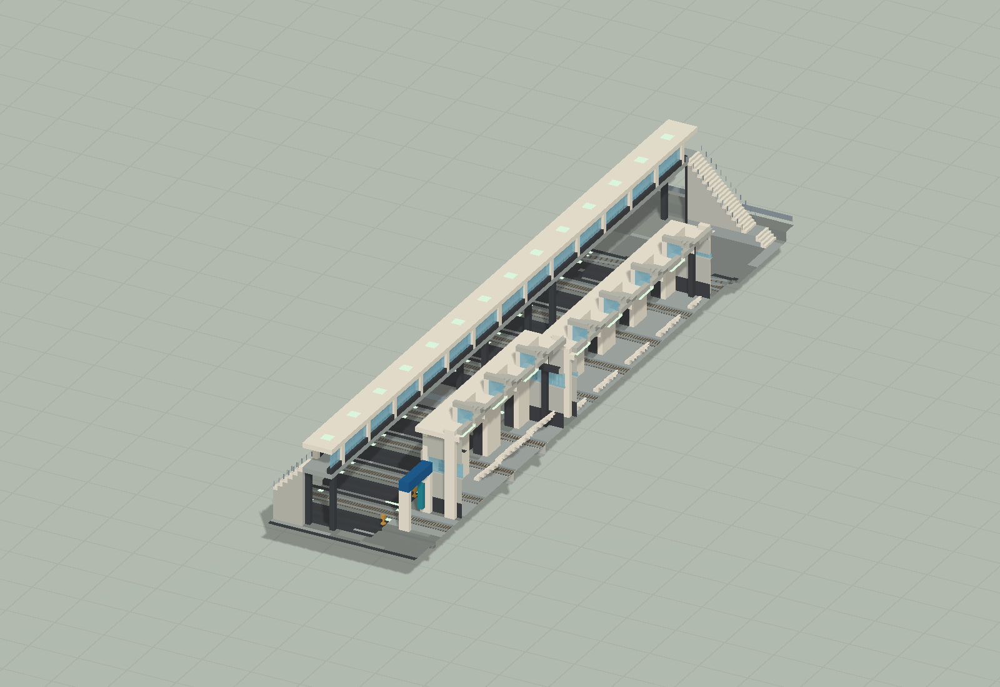
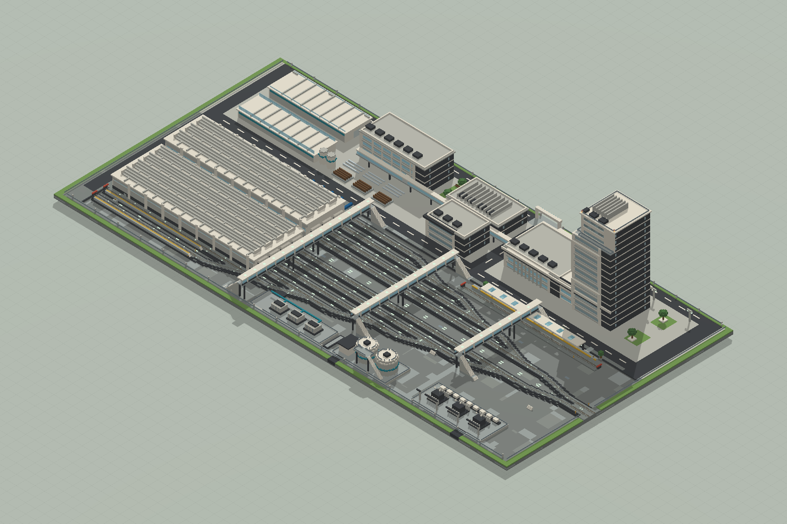
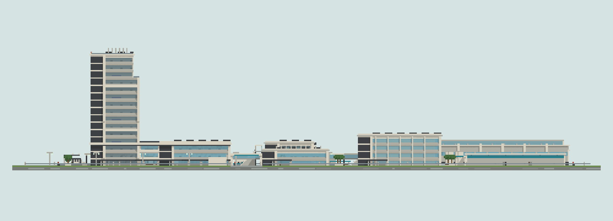
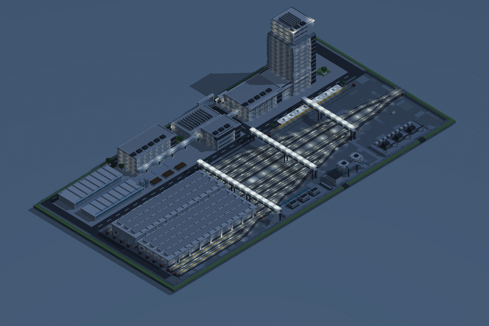
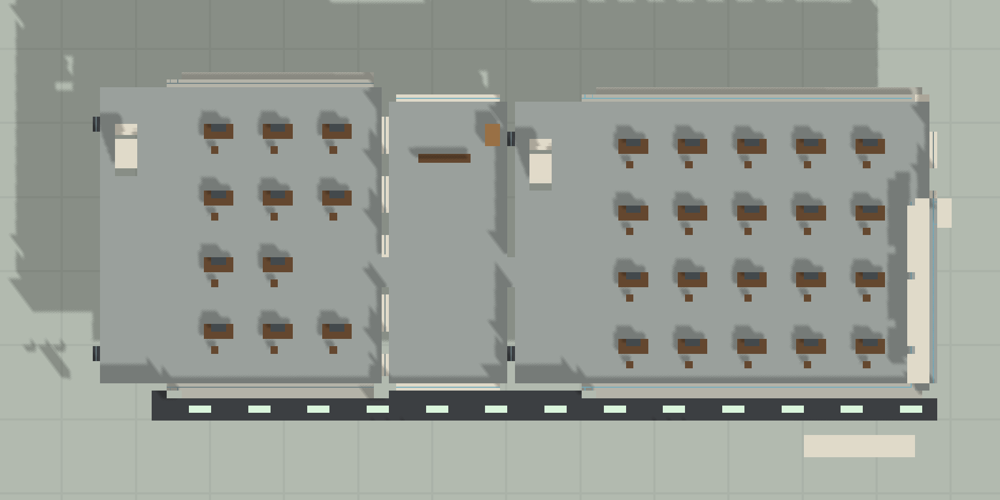
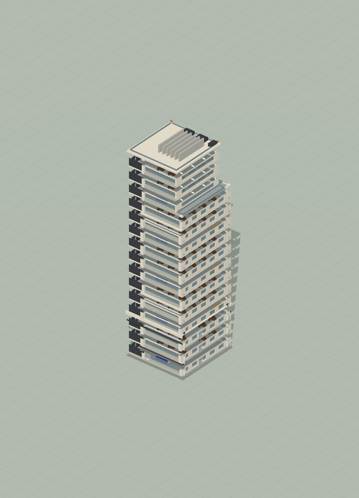

# 新港列车所 · 检修与研发基地

480×240；10 条主要股道、检修设施与研发塔楼，使用 Create 6.0.10 轨道。

版本：`R15`。可建造性：`archived_output`；游戏验收：`pending`。

## 结论与边界

轨道数据存在不等于实车联调完成，仍待实机列车、信号与净空验证。

项目源码为历史快照，未自动迁移成主线生成器。本次仅核对文件、哈希与 NBT 可读性；原报告的几何检查、重放和实机截图按其历史范围保留。

## 文件

[原报告文字](research.txt) · [来源记录](sources.json) · [完整图片目录](gallery.md)

### 产物

- [artifacts/RailDepot01.nbt](artifacts/RailDepot01.nbt)
- [artifacts/RailDepot01.schem](artifacts/RailDepot01.schem)
- [project/input/baseline_R12/RailDepot01.nbt](project/input/baseline_R12/RailDepot01.nbt)
- [project/input/iteration_records/R13/RailDepot01.nbt](project/input/iteration_records/R13/RailDepot01.nbt)
- [project/input/source/canton_east_railway_station.nbt](project/input/source/canton_east_railway_station.nbt)
- [project/input/source/cover.nbt](project/input/source/cover.nbt)
- [project/input/source/first_floor.nbt](project/input/source/first_floor.nbt)
- [project/runs/R15/RailDepot01.nbt](project/runs/R15/RailDepot01.nbt)
- [project/runs/R15/RailDepot01.schem](project/runs/R15/RailDepot01.schem)

### 预览

