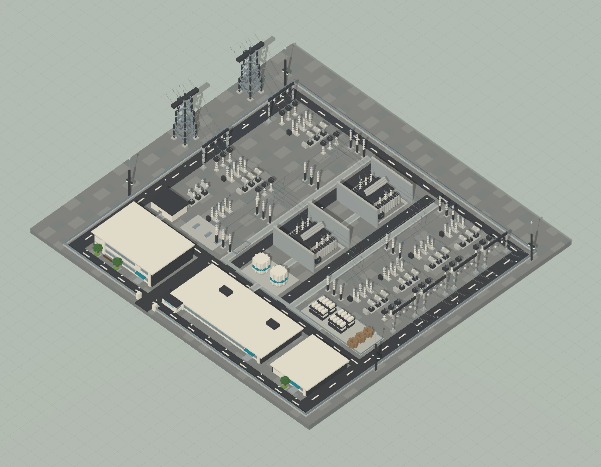
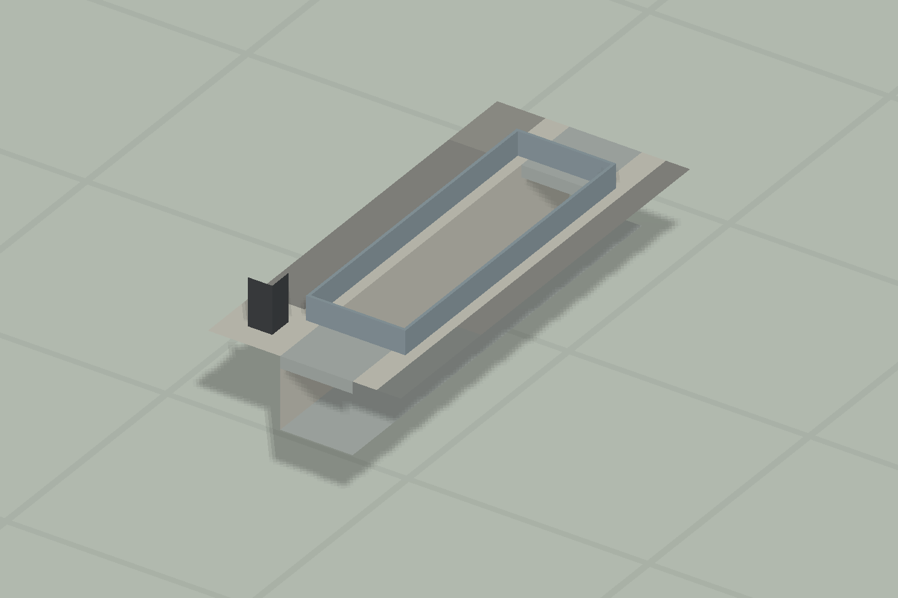
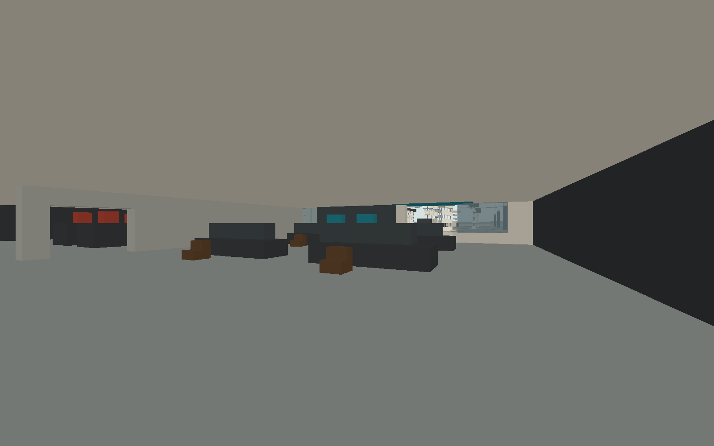
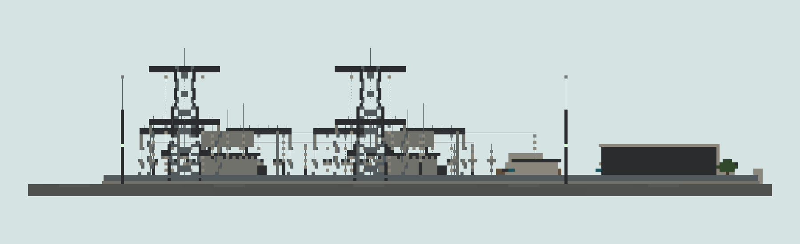
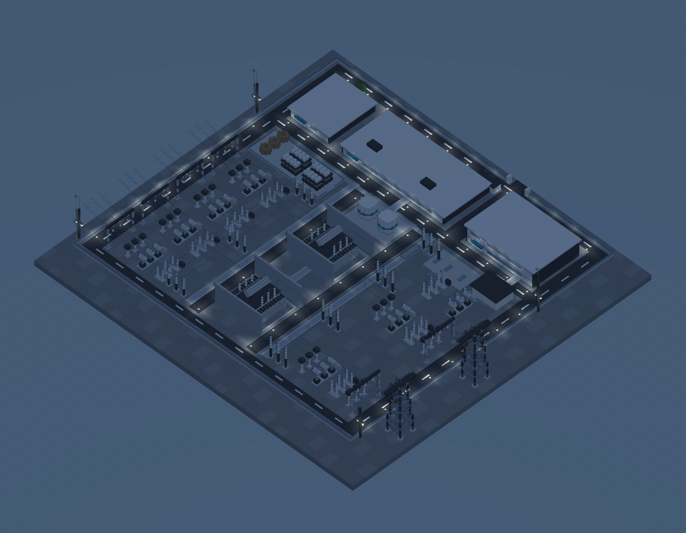

# 变电设施小样

新港枢纽变电站 S04；256×240×64，双主变与 16 类模块。

版本：`S04`。可建造性：`archived_output`；游戏验收：`pending`。

## 结论与边界

原版静态变电站；网页检查不等于 Minecraft 实机或电力仿真通过。

项目源码为历史快照，未自动迁移成主线生成器。本次仅核对文件、哈希与 NBT 可读性；原报告的几何检查、重放和实机截图按其历史范围保留。

## 文件

[原报告文字](research.txt) · [来源记录](sources.json) · [完整图片目录](gallery.md)

### 产物

- [artifacts/Substation01.nbt](artifacts/Substation01.nbt)
- [artifacts/Substation01_World.zip](artifacts/Substation01_World.zip)
- [project/deliverables/Substation01.nbt](project/deliverables/Substation01.nbt)
- [project/deliverables/Substation01.schem](project/deliverables/Substation01.schem)
- [project/deliverables/Substation01_World.zip](project/deliverables/Substation01_World.zip)
- [project/runs/S04/Substation01.nbt](project/runs/S04/Substation01.nbt)
- [project/runs/S04/Substation01.schem](project/runs/S04/Substation01.schem)

### 预览

