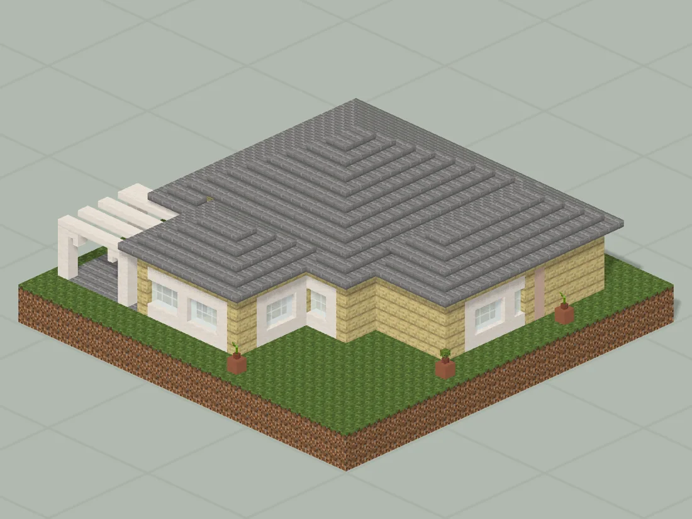
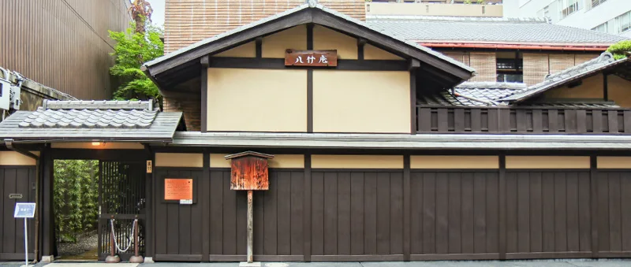
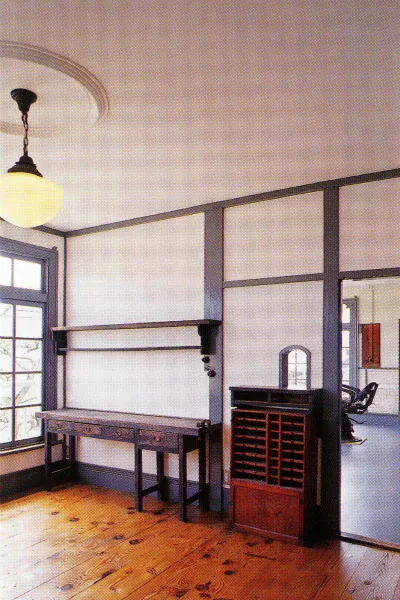
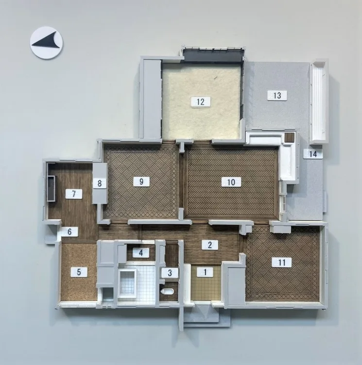
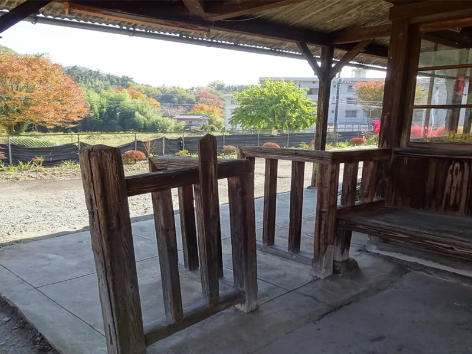

# 大正诊所样板

已下载的诊所研究与功能空间历史版本；后续风格深化见 Taisho11

版本：`Taisho10-local`。可建造性：`archived_output`；游戏验收：`pending unless explicit source evidence`。

## 结论与边界

完整文本保留原始未完成与否定反馈；本次不自动升级验收状态。

项目源码为历史快照，未自动迁移成主线生成器。本次仅核对文件、哈希与 NBT 可读性；原报告的几何检查、重放和实机截图按其历史范围保留。

## 文件

[原报告文字](research.txt) · [来源记录](sources.json) · [完整图片目录](gallery.md)

### 产物

- [artifacts/C01.nbt](artifacts/C01.nbt)
- [artifacts/H01.nbt](artifacts/H01.nbt)
- [artifacts/S01.nbt](artifacts/S01.nbt)
- [artifacts/Taisho10.nbt](artifacts/Taisho10.nbt)
- [artifacts/Taisho10_World_1.21.1.zip](artifacts/Taisho10_World_1.21.1.zip)

### 预览

