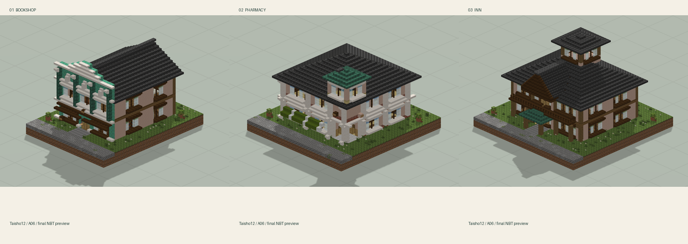
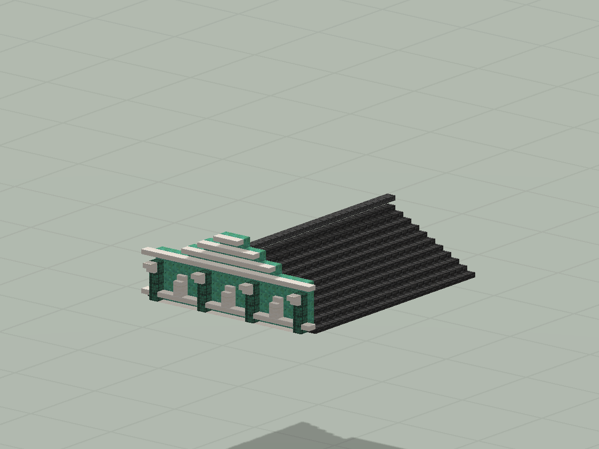
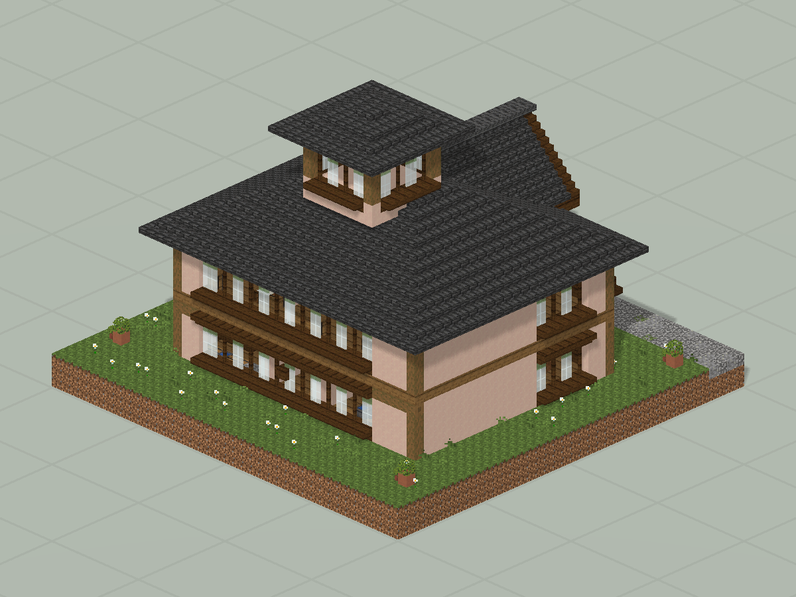
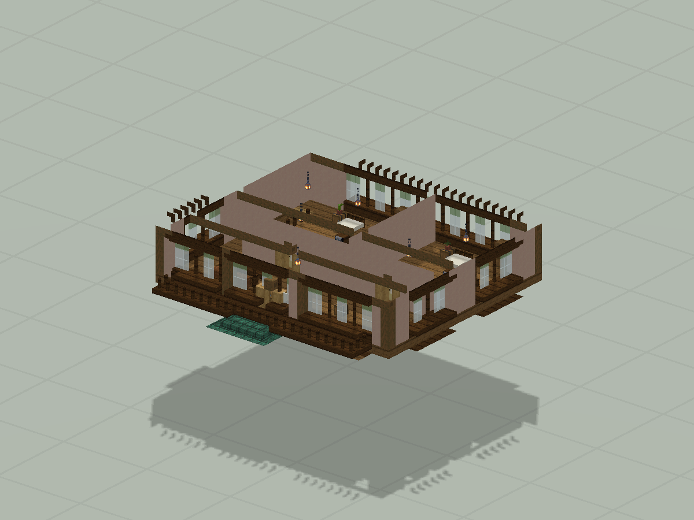
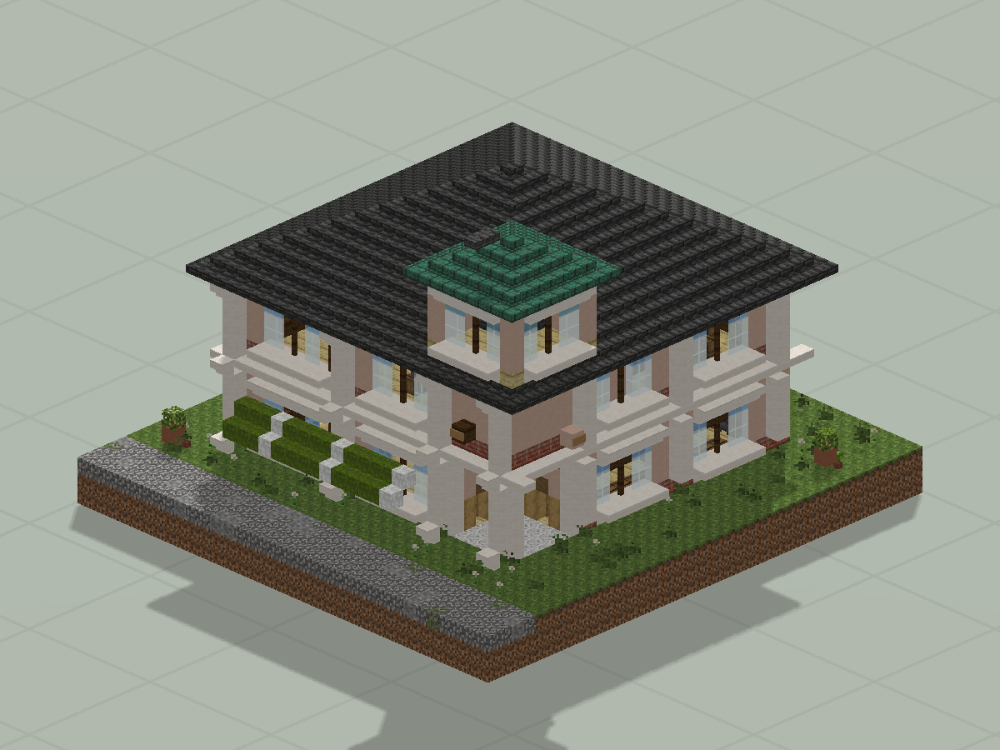
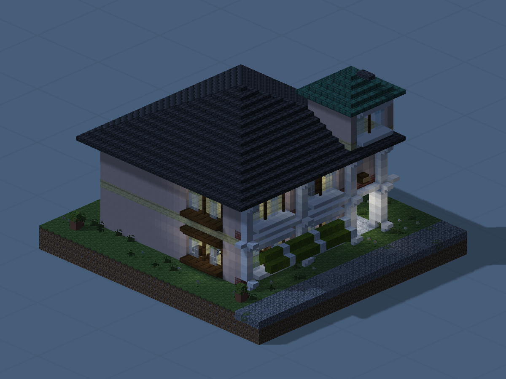

# 三种街屋 · 书肆、药局与旅馆

青葉書肆、白鷺薬局、松風館三种建筑原型。

版本：`A06`。可建造性：`archived_output`；游戏验收：`pending`。

## 结论与边界

建筑原型仍偏孤立；地形、街巷与公共空间需要继续整合。

项目源码为历史快照，未自动迁移成主线生成器。本次仅核对文件、哈希与 NBT 可读性；原报告的几何检查、重放和实机截图按其历史范围保留。

## 文件

[原报告文字](research.txt) · [来源记录](sources.json) · [完整图片目录](gallery.md)

### 产物

- [project/delivery/Taisho12_World_1.21.1.zip](project/delivery/Taisho12_World_1.21.1.zip)
- [project/runs/A06/Bookshop.nbt](project/runs/A06/Bookshop.nbt)
- [project/runs/A06/Inn.nbt](project/runs/A06/Inn.nbt)
- [project/runs/A06/Pharmacy.nbt](project/runs/A06/Pharmacy.nbt)
- [project/runs/A06/Taisho12.nbt](project/runs/A06/Taisho12.nbt)
- [project/structures/bookshop.nbt](project/structures/bookshop.nbt)
- [project/structures/inn.nbt](project/structures/inn.nbt)
- [project/structures/pharmacy.nbt](project/structures/pharmacy.nbt)
- [project/structures/taisho12.nbt](project/structures/taisho12.nbt)

### 预览

