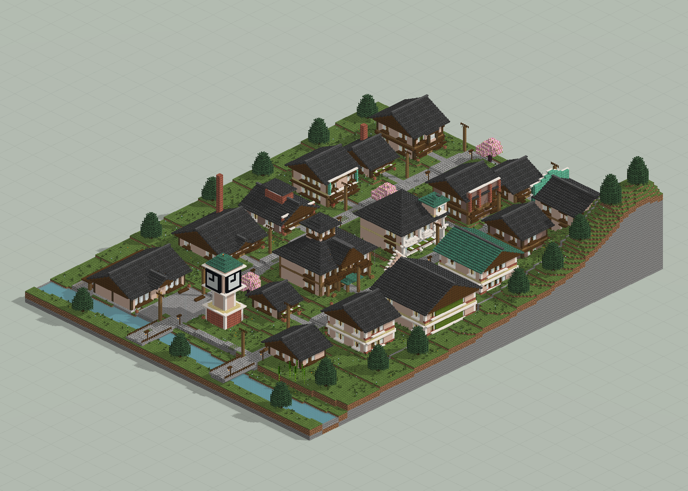
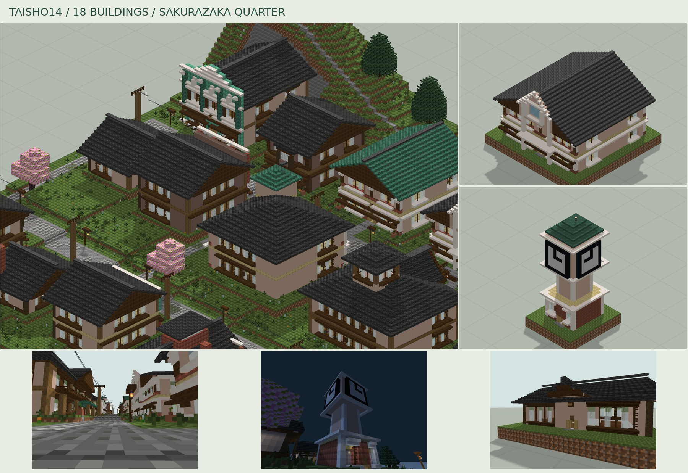

# 櫻坂风貌街

18 栋建筑、两条坡街与学校、图书馆、钟楼、车站等公共节点。

版本：`Q03`。可建造性：`archived_output`；游戏验收：`pending`。

## 结论与边界

街区规模扩大后仍需检查每栋入口、楼梯与坡道衔接。

项目源码为历史快照，未自动迁移成主线生成器。本次仅核对文件、哈希与 NBT 可读性；原报告的几何检查、重放和实机截图按其历史范围保留。

## 文件

[原报告文字](research.txt) · [来源记录](sources.json) · [完整图片目录](gallery.md)

### 产物

- [project/delivery/Taisho14_World_1.21.1.zip](project/delivery/Taisho14_World_1.21.1.zip)
- [project/runs/Q03/Bakery.nbt](project/runs/Q03/Bakery.nbt)
- [project/runs/Q03/Bath.nbt](project/runs/Q03/Bath.nbt)
- [project/runs/Q03/Bookshop.nbt](project/runs/Q03/Bookshop.nbt)
- [project/runs/Q03/Clinic.nbt](project/runs/Q03/Clinic.nbt)
- [project/runs/Q03/Clock.nbt](project/runs/Q03/Clock.nbt)
- [project/runs/Q03/Florist.nbt](project/runs/Q03/Florist.nbt)
- [project/runs/Q03/Inn.nbt](project/runs/Q03/Inn.nbt)
- [project/runs/Q03/Library.nbt](project/runs/Q03/Library.nbt)
- [project/runs/Q03/Pharmacy.nbt](project/runs/Q03/Pharmacy.nbt)
- [project/runs/Q03/Photo.nbt](project/runs/Q03/Photo.nbt)
- [project/runs/Q03/Post.nbt](project/runs/Q03/Post.nbt)
- [project/runs/Q03/Residence.nbt](project/runs/Q03/Residence.nbt)
- [project/runs/Q03/Sake.nbt](project/runs/Q03/Sake.nbt)
- [project/runs/Q03/School.nbt](project/runs/Q03/School.nbt)
- [project/runs/Q03/Station.nbt](project/runs/Q03/Station.nbt)
- [project/runs/Q03/Taisho14.nbt](project/runs/Q03/Taisho14.nbt)
- [project/runs/Q03/Tea.nbt](project/runs/Q03/Tea.nbt)
- [project/runs/Q03/Textile.nbt](project/runs/Q03/Textile.nbt)
- [project/runs/Q03/Workshop.nbt](project/runs/Q03/Workshop.nbt)

### 预览

**全览大图 · 离线模型预览**

**街区与细节拼图**

