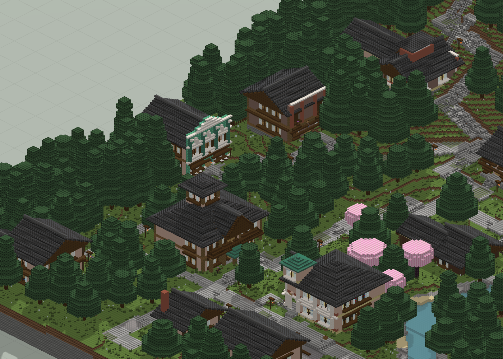
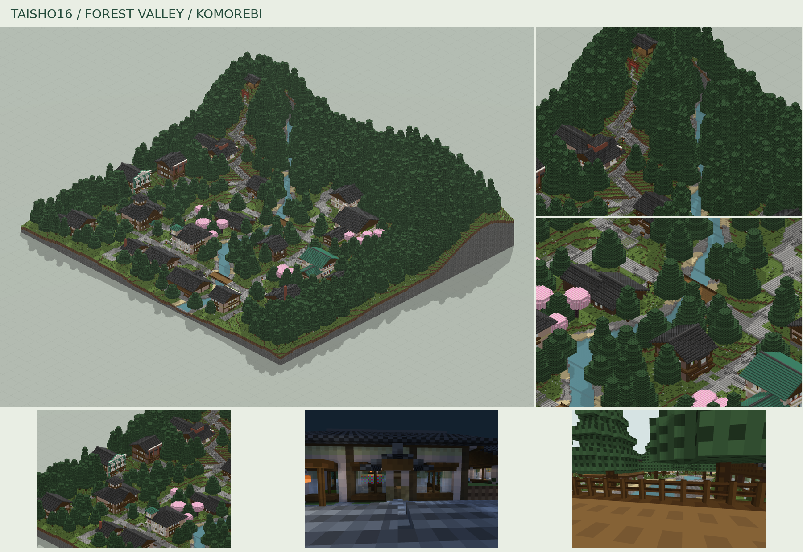

# 木漏日溪谷

320×288 的溪谷聚落，18 栋主体建筑；7/5/3 级道路与更密的林地。

版本：`V09`。可建造性：`archived_output`；游戏验收：`pending`。

## 结论与边界

承接 Taisho15 的否定反馈，替换失效钟楼；未完成全面多种子与实机验证。

项目源码为历史快照，未自动迁移成主线生成器。本次仅核对文件、哈希与 NBT 可读性；原报告的几何检查、重放和实机截图按其历史范围保留。

## 文件

[原报告文字](research.txt) · [来源记录](sources.json) · [完整图片目录](gallery.md)

### 产物

- [project/delivery/Taisho16_World_1.21.1.zip](project/delivery/Taisho16_World_1.21.1.zip)
- [project/runs/V09/Bakery.nbt](project/runs/V09/Bakery.nbt)
- [project/runs/V09/Bath.nbt](project/runs/V09/Bath.nbt)
- [project/runs/V09/Bookshop.nbt](project/runs/V09/Bookshop.nbt)
- [project/runs/V09/Clinic.nbt](project/runs/V09/Clinic.nbt)
- [project/runs/V09/Florist.nbt](project/runs/V09/Florist.nbt)
- [project/runs/V09/Hall.nbt](project/runs/V09/Hall.nbt)
- [project/runs/V09/Inn.nbt](project/runs/V09/Inn.nbt)
- [project/runs/V09/Library.nbt](project/runs/V09/Library.nbt)
- [project/runs/V09/Pharmacy.nbt](project/runs/V09/Pharmacy.nbt)
- [project/runs/V09/Photo.nbt](project/runs/V09/Photo.nbt)
- [project/runs/V09/Post.nbt](project/runs/V09/Post.nbt)
- [project/runs/V09/Residence.nbt](project/runs/V09/Residence.nbt)
- [project/runs/V09/Sake.nbt](project/runs/V09/Sake.nbt)
- [project/runs/V09/School.nbt](project/runs/V09/School.nbt)
- [project/runs/V09/Station.nbt](project/runs/V09/Station.nbt)
- [project/runs/V09/Taisho16.nbt](project/runs/V09/Taisho16.nbt)
- [project/runs/V09/Tea.nbt](project/runs/V09/Tea.nbt)
- [project/runs/V09/Terrain_Input.nbt](project/runs/V09/Terrain_Input.nbt)
- [project/runs/V09/Textile.nbt](project/runs/V09/Textile.nbt)
- [project/runs/V09/Workshop.nbt](project/runs/V09/Workshop.nbt)

### 预览

**原 HTML 首屏主视图 · 山脚街屋与院落东南视角**

**街区与细节拼图**

