# Haibara’s Architect 0.7 案例与研究图鉴

收录 **70 个条目**，包括历史建筑、日式场景、骑楼与城中村、工业与铁路实验、内饰和研究专题。它们不是 70 个通用生成器。

入口：[按时间线浏览](case-timeline.md) · [覆盖与缺口](archive-coverage.md) · [机器索引](../archive/catalog.json) · [工作流程](workflow.md)

学习包提供源码、证据、产物与代表预览；补录案例的完整生成图片目录位于对应案例文件夹。第三方参考照片、Minecraft 材质与大体积重复网页不随包分发。原报告中的通过仅代表当时注明的范围。

| 案例 | 版本 | 主线状态 | 学习包 |
|---|---|---|---|
| [广州塔](#canton) | V6 / HAF 0.1 r02 | archived_output | [ZIP](../downloads/study-canton.zip) |
| [广州琶洲微信总部](#pazhou) | V3b / v3b_04_final | archived_output | [ZIP](../downloads/study-pazhou.zip) |
| [深圳特区报业大厦](#shenzhen-press) | V2 | legacy_adapter | [ZIP](../downloads/study-shenzhen_press.zip) |
| [广州周大福金融中心](#guangzhou-ctf) | 整栋 V1_r05；Detail V2 局部研究 | legacy_adapter | [ZIP](../downloads/study-guangzhou_ctf.zip) |
| [首尔南山塔与公园](#namsan-tower) | V1_r02 | legacy_adapter | [ZIP](../downloads/study-namsan_tower.zip) |
| [伊丽莎白塔（大本钟）](#elizabeth-tower) | V1_r02 | legacy_adapter | [ZIP](../downloads/study-elizabeth_tower.zip) |
| [白金汉宫](#buckingham-palace) | V1_r02 | legacy_adapter | [ZIP](../downloads/study-buckingham_palace.zip) |
| [南山云科技大厦](#nanshan-cloud) | V2_r01 | legacy_adapter | [ZIP](../downloads/study-nanshan_cloud.zip) |
| [广州新海关大厦](#guangzhou-customs) | V3_r02 | legacy_adapter | [ZIP](../downloads/study-guangzhou_customs.zip) |
| [广州中山纪念堂](#guangzhou-memorial) | V2_r02 | legacy_adapter | [ZIP](../downloads/study-guangzhou_memorial.zip) |
| [广州珠江帝景苑](#zhujiang-dijing) | V1_r03 | legacy_adapter | [ZIP](../downloads/study-zhujiang_dijing.zip) |
| [广州南站](#guangzhou-south) | V1_r02 | legacy_adapter | [ZIP](../downloads/study-guangzhou_south.zip) |
| [市民服务中心（原创）](#civic-center) | v03_r16_ceiling_landscape | legacy_adapter | [ZIP](../downloads/study-civic_center.zip) |
| [广州国际金融中心（西塔）](#guangzhou-ifc) | V1_r02 | archived_output | [ZIP](../downloads/study-guangzhou_ifc.zip) |
| [上海东方明珠](#oriental-pearl) | v1_r04_final | archived_output | [ZIP](../downloads/study-oriental_pearl.zip) |
| [上海环球金融中心](#swfc) | v1_r02_final | archived_output | [ZIP](../downloads/study-swfc.zip) |
| [大阪城希尔顿逸林酒店](#osaka) | v1_r04_final | archived_output | [ZIP](../downloads/study-osaka.zip) |
| [广岛 JP 大厦](#grand-gate) | v1_r04_final | archived_output | [ZIP](../downloads/study-grand_gate.zip) |
| [广州中信广场](#guangzhou-citic) | V2_r02 | archived_output | [ZIP](../downloads/study-guangzhou_citic.zip) |
| [千禧年代住区](#millennium-estate) | V3_r01 | archived_output | [ZIP](../downloads/study-millennium_estate.zip) |
| [榕荫里 · 20 栋城中村](#urban-village20) | V4_r02 | archived_output | [ZIP](../downloads/study-urban_village20.zip) |
| [田埂里 · 13 栋初版](#rural13) | V4 | archived_output | [ZIP](../downloads/study-rural13.zip) |
| [田埂里 · 18 栋田园深化](#tiangengli18) | P4_B4 | archived_output | [ZIP](../downloads/study-tiangengli18.zip) |
| [家具与植物组景](#interior-detail05) | InteriorDetail05 | archived_output | [ZIP](../downloads/study-interior-detail05.zip) |
| [榕角里街角楼](#corner01) | Corner01 | archived_output | [ZIP](../downloads/study-corner01.zip) |
| [功能装饰与园林样板](#decoration03) | HAF-Decoration-Library-03 | research_only | [ZIP](../downloads/study-decoration03.zip) |
| [工业设施类型图鉴](#industrial-atlas) | Industrial01(1) | research_only | [ZIP](../downloads/study-industrial-atlas.zip) |
| [民国建筑语汇研究](#minguo01) | Minguo01 | research_only | [ZIP](../downloads/study-minguo01.zip) |
| [日式细部研究](#japan-detail01) | JapanDetail01 | research_only | [ZIP](../downloads/study-japan-detail01.zip) |
| [东南联络线研究](#southeast-link) | Dongguanxi_SE_Link_Study | research_only | [ZIP](../downloads/study-southeast-link.zip) |
| [功能聚落与随机变化](#village07) | Village07 | archived_output | [ZIP](../downloads/study-village07.zip) |
| [榕角里单间试住](#room06) | R03 / rules 0.4.3 | isolated_adapter | [ZIP](../downloads/study-room06.zip) |
| [历史专题 · architect](#study-architect) | HAF05 archived study | research_only | [ZIP](../downloads/study-study-architect.zip) |
| [历史专题 · decoration](#study-decoration) | HAF05 archived study | research_only | [ZIP](../downloads/study-study-decoration.zip) |
| [历史专题 · detail](#study-detail) | HAF05 archived study | research_only | [ZIP](../downloads/study-study-detail.zip) |
| [历史专题 · exterior](#study-exterior) | HAF05 archived study | research_only | [ZIP](../downloads/study-study-exterior.zip) |
| [历史专题 · facade](#study-facade) | HAF05 archived study | research_only | [ZIP](../downloads/study-study-facade.zip) |
| [历史专题 · foundation](#study-foundation) | HAF05 archived study | research_only | [ZIP](../downloads/study-study-foundation.zip) |
| [历史专题 · interior](#study-interior) | HAF05 archived study | research_only | [ZIP](../downloads/study-study-interior.zip) |
| [历史专题 · interior_library](#study-interior-library) | HAF05 archived study | research_only | [ZIP](../downloads/study-study-interior_library.zip) |
| [历史专题 · lab](#study-lab) | HAF05 archived study | research_only | [ZIP](../downloads/study-study-lab.zip) |
| [历史专题 · layout](#study-layout) | HAF05 archived study | research_only | [ZIP](../downloads/study-study-layout.zip) |
| [历史专题 · models](#study-models) | HAF05 archived study | research_only | [ZIP](../downloads/study-study-models.zip) |
| [历史专题 · plan](#study-plan) | HAF05 archived study | research_only | [ZIP](../downloads/study-study-plan.zip) |
| [历史专题 · schem](#study-schem) | HAF05 archived study | research_only | [ZIP](../downloads/study-study-schem.zip) |
| [历史专题 · spatial](#study-spatial) | HAF05 archived study | research_only | [ZIP](../downloads/study-study-spatial.zip) |
| [历史专题 · web](#study-web) | HAF05 archived study | research_only | [ZIP](../downloads/study-study-web.zip) |
| [日式街区研究](#japan-town01) | JapanTown01 | research_only | [ZIP](../downloads/study-japan-town01.zip) |
| [完整内饰实验](#interior04) | Interior04 | archived_output | [ZIP](../downloads/study-interior04.zip) |
| [山溪日式街区](#japan-town12) | JapanTown12 | archived_output | [ZIP](../downloads/study-japan-town12.zip) |
| [日和小食 · 町家门面与屋顶返工](#machiya08) | M08 | archived_output | [ZIP](../downloads/study-machiya08.zip) |
| [木漏日町 · 山溪与十八栋](#komorebi09) | T07 | archived_output | [ZIP](../downloads/study-komorebi09.zip) |
| [大正诊所样板](#taisho10) | Taisho10-local | archived_output | [ZIP](../downloads/study-taisho10.zip) |
| [大正喫茶与阅读空间](#taisho11) | Taisho11 | archived_output | [ZIP](../downloads/study-taisho11.zip) |
| [三种街屋 · 书肆、药局与旅馆](#taisho12) | A06 | archived_output | [ZIP](../downloads/study-taisho12.zip) |
| [櫻坂通り街区](#taisho13) | Taisho13 | archived_output | [ZIP](../downloads/study-taisho13.zip) |
| [櫻坂风貌街](#taisho14) | Q03 | archived_output | [ZIP](../downloads/study-taisho14.zip) |
| [櫻坂山溪町](#taisho15) | O09 | archived_output | [ZIP](../downloads/study-taisho15.zip) |
| [木漏日溪谷](#taisho16) | V09 | archived_output | [ZIP](../downloads/study-taisho16.zip) |
| [檐下西关 · 三栋骑楼小样](#qilou01) | Q05 | archived_output | [ZIP](../downloads/study-qilou01.zip) |
| [檐下西关 · 四角里](#qilou02) | S06 | archived_output | [ZIP](../downloads/study-qilou02.zip) |
| [檐下榕里 · 广州街巷](#qilou03) | G05 | archived_output | [ZIP](../downloads/study-qilou03.zip) |
| [榕灰里 · 骑楼与城中村街区](#qilou04) | R19h | archived_output | [ZIP](../downloads/study-qilou04.zip) |
| [广钢式工业区 · 一号钢厂](#guanggang01) | G03 | archived_output | [ZIP](../downloads/study-guanggang01.zip) |
| [新港制造园 · 综合生产基地](#modern-factory01) | E07 | archived_output | [ZIP](../downloads/study-modern-factory01.zip) |
| [新港列车所 · 检修与研发基地](#rail-depot01) | R15 | archived_output | [ZIP](../downloads/study-rail-depot01.zip) |
| [变电设施小样](#substation01) | S04 | archived_output | [ZIP](../downloads/study-substation01.zip) |
| [广州东 · 独立双联络线](#guangzhou-east-linkonly) | B03 | archived_output | [ZIP](../downloads/study-guangzhou-east-linkonly.zip) |
| [广州东 · 车站与双联络线完整结构](#guangzhou-east-complete) | B03 | archived_output | [ZIP](../downloads/study-guangzhou-east-complete.zip) |
| [广州东分段联络线](#guangzhou-east) | B03S2 | archived_output | [ZIP](../downloads/study-guangzhou-east.zip) |

## canton

### 广州塔

图片与SKP按构件选用；外框、核心、功能玻璃层、内部环、斜塔冠与多层场地分别建模。融合发生在参数/几何层，不能取整套平均值。

版本：V6 / HAF 0.1 r02。主线状态：`archived_output`；游戏状态：`待实测`。

V1过度螺旋；玻璃铺满把开敞骨架封实；外置横环造成凹凸；单层草地误解二层绿化；台阶各自正确但拼合缺一级。 格构粗细、节点、最低截面拟合与游戏通行仍需核验；案例网格适配不等于通用自动融合。

- 先写占用/镂空高度区间、构件内外次序、平台标高和接口。V2A为SKP+图片，V2B为纯图片；V6缓存成功不等于外形更好。

[下载学习包](../downloads/study-canton.zip)

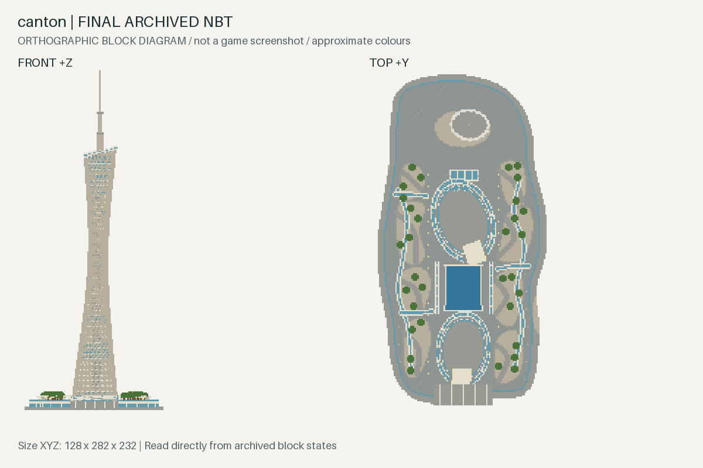

## pazhou

### 广州琶洲微信总部

已落地玻璃分色与幕墙分层；保留原始、分色、分层三个对照。V3b 修复玻璃旁栏杆额外连臂，36 项针对性检查留档。

版本：V3b / v3b_04_final。主线状态：`archived_output`；游戏状态：`待实测`。

两路同参数、同编译规则，39306格完全一致；幕墙、峡谷、平台底面与室内吊顶的研究未充分落到几何。 旧主表“尚未重做幕墙”已过时；V3b 尚无用户整栋认可，裙楼、大堂、峡谷与背面推断仍待核验。

- 材质分色与几何分层分开对照；连接型方块必须检查实际邻居。

[下载学习包](../downloads/study-pazhou.zip)

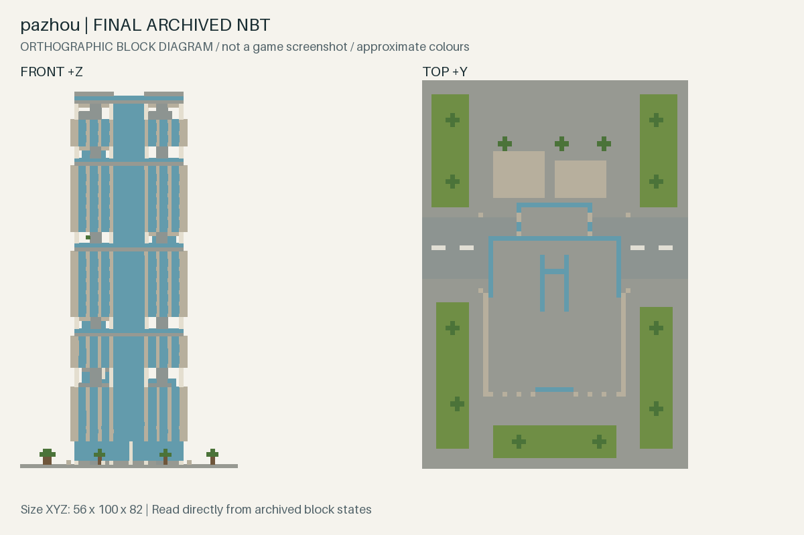

## shenzhen-press

### 深圳特区报业大厦

水平幕墙的玻璃、横带、楼板端、窗后进深分层；背面围护与开口同时保留；种子控制暖冷灯和伪内饰。

版本：V2。主线状态：`legacy_adapter`；游戏状态：`待实测`。

早期背面敞开、塔顶过薄、裙楼简化、照明太均匀。外部样本细节多但左右反转，不能照搬其总体形态。 背面模式及办公室仍估算；不能把伪内饰宣称真实可进入办公室。

- 先锁形体与手性，再借鉴细部；为正背面、屋顶、裙楼分别验收；随机只作用于允许的灯位和陈设位。

[下载学习包](../downloads/study-shenzhen_press.zip)

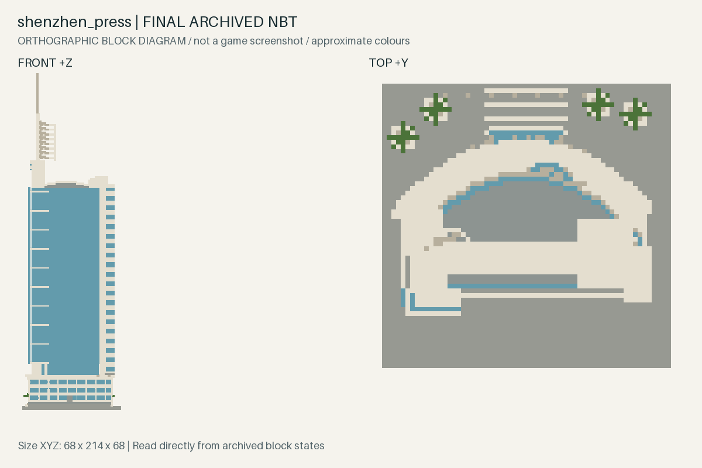

## guangzhou-ctf

### 广州周大福金融中心

竖梃、玻璃与内背景分层；墙柱/铁栏细度按尺度取舍；稳定灯槽避免抽样引起玻璃邻接变化。

版本：整栋 V1_r05；Detail V2 局部研究。主线状态：`legacy_adapter`；游戏状态：`待实测`。

弧面量化角缝、过粗分隔、冷光偏多；冠部灯候选未落地，整栋塔冠专灯实际为0。 整栋斜顶、幕墙与高层夜景仍需改进；Detail V2 不等于完整 V2 建筑。

- 两相反方向检查斜顶；固定夜景灯带与随机窗灯分离；航空灯先算尺寸，3×3格在1:2下宽6米过大。

[下载学习包](../downloads/study-guangzhou_ctf.zip)

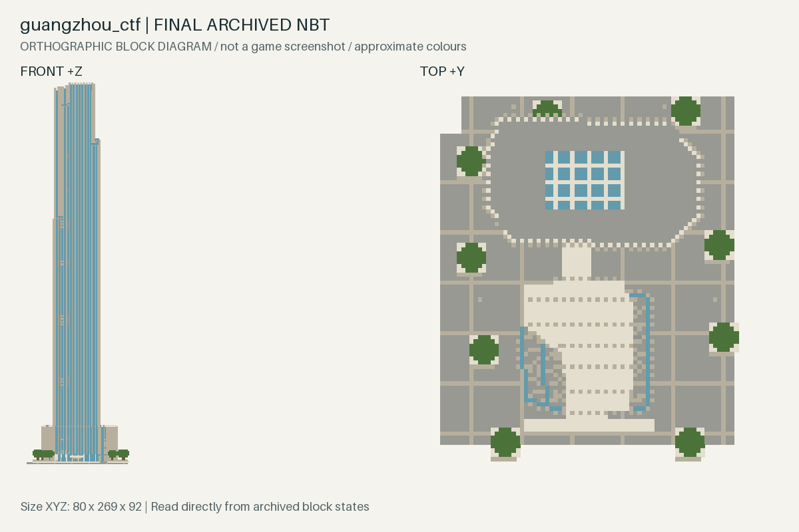

## namsan-tower

### 首尔南山塔与公园

OSM平面、SRTM坡势、照片细部各有适用范围；台地与地形应共同设计；设备环留空、观景舱才围护。

版本：V1_r02。主线状态：`legacy_adapter`；游戏状态：`待实测`。

楼板穿出核心筒形成假灰带；相机被前景遮挡；DEM混有树冠等偏差，不能直接贴楼。 细部高差/植被估算，真实RGB投光及游戏坡道未验证。

- 基座先定承托面并渐变接坡；楼板止于核心内缘；分别限制包围体积与实际占用量。

[下载学习包](../downloads/study-namsan_tower.zip)

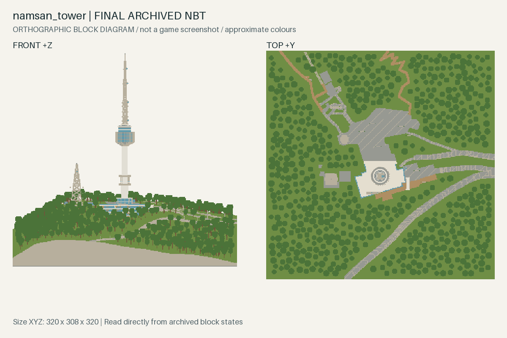

## elizabeth-tower

### 伊丽莎白塔（大本钟）

四面钟盘、钟室、灯笼层、尖顶按独立比例建模；古典线脚使用楼梯/半砖，砂岩与深色屋面形成材质分工。

版本：V1_r02。主线状态：`legacy_adapter`；游戏状态：`待实测`。

钟室和上部比例需修；纯色近似渲染削弱石材/屋面纹理；不能把大本钟与白金汉宫误合为一栋。 仅带截断的议会邻翼；钟针静态，钟室/楼梯可玩性待测，未补真实资源包纹理。

- 固定建筑身份与范围；先看钟盘/钟室/尖顶关系，再加细节；材料ID通过不等于纹理表现通过。

[下载学习包](../downloads/study-elizabeth_tower.zip)

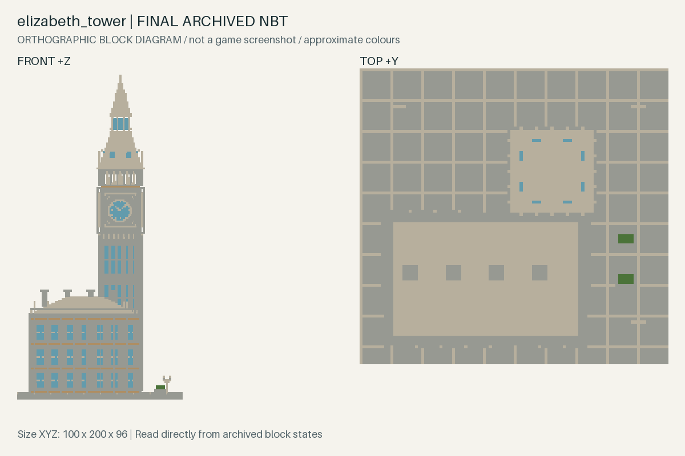

## buckingham-palace

### 白金汉宫

正面开间层级、侧翼/内院、背面凸出与窗型不同；厚墙窗洞、窗后空间和玻璃雨棚需接通。

版本：V1_r02。主线状态：`legacy_adapter`；游戏状态：`待实测`。

重复前立面无法还原背立面；窗后腔体曾与外窗隔断；前景纪念碑会遮挡正面相机。 只做指定建筑群与花园边缘，不是775房间全还原；内饰和园景多为示意。

- 地图辅助平面，不供应高度；正背面各自研究；景观不能遮住本轮需要评审的主建筑。

[下载学习包](../downloads/study-buckingham_palace.zip)

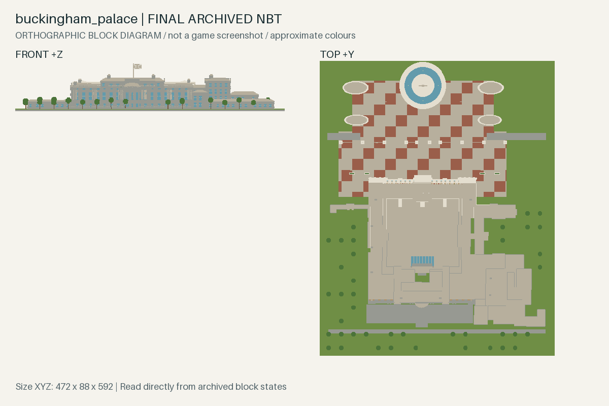

## nanshan-cloud

### 南山云科技大厦

三组错位塔体与阶梯露台分别控制；V2缩露台宽度和挑深，保留塔高，不用加高弥补横向失衡。

版本：V2_r01。主线状态：`legacy_adapter`；游戏状态：`待实测`。

首轮露台过宽过深，吞掉主体比例；仅整体高度正确仍会形不准。 后部塔体和平面未测绘；当地理北未标定时四向只是模型坐标。

- 先量露台/塔宽比、挑深和顶层重复节奏；局部修改锁定其他体块，四个45°相机同框同尺度。

[下载学习包](../downloads/study-nanshan_cloud.zip)

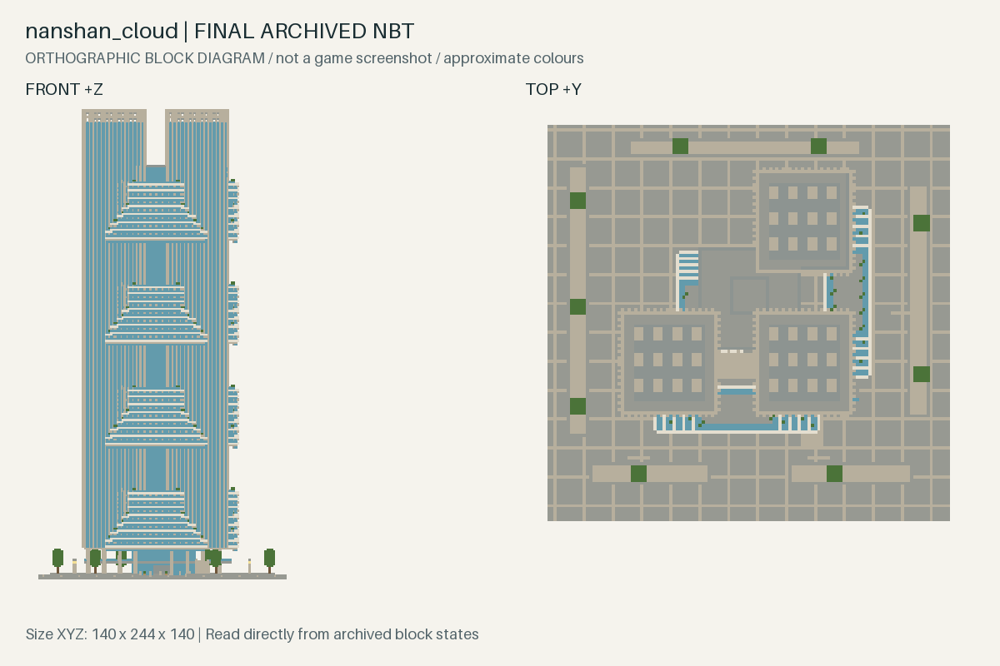

## guangzhou-customs

### 广州新海关大厦

倾斜东北卫星图必须按层解读；反T形裙楼到主楼收缩，中央体量与钟楼宽度关联。

版本：V3_r02。主线状态：`legacy_adapter`；游戏状态：`待实测`。

4张照片不足；把高层屋顶投影当占地，造成单边凸起和主楼过宽；修形后灯光丢失。 钟楼/大堂照明未补；137格是研究包络而非解决了所有高度来源冲突。

- 强制真俯视+分层轮廓；对称只能作为待证假设，不能由建筑类型直接决定；返工单独保护灯光。

[下载学习包](../downloads/study-guangzhou_customs.zip)

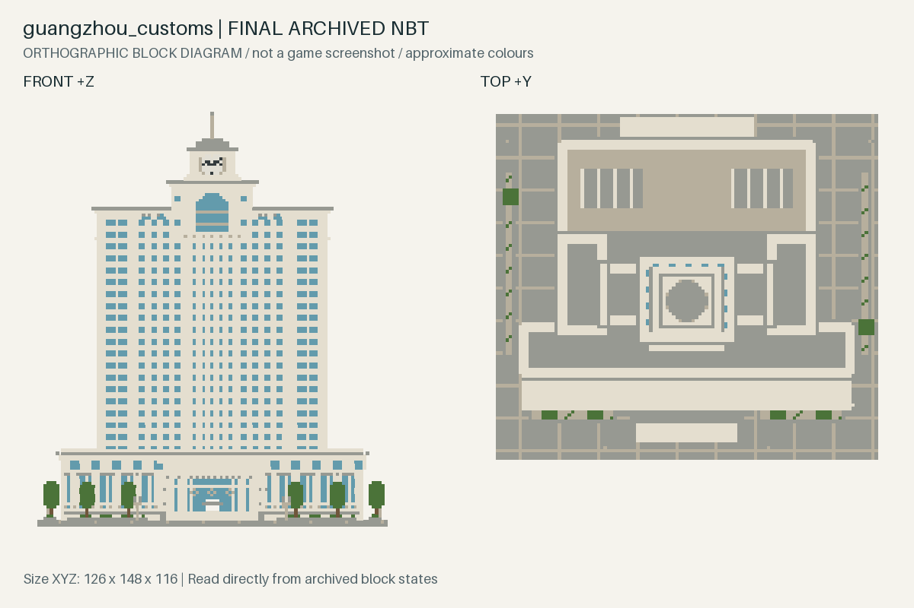

## guangzhou-memorial

### 广州中山纪念堂

匾额先守尺寸，小字用一格金色符号；檐面、屋角、天窗带与柱廊台基需在最终拼合后验收。

版本：V2_r02。主线状态：`legacy_adapter`；游戏状态：`待实测`。

8根柱脚缺完整承托；屋面接缝/斜栅格漏洞；大体素文字失调；文件测试通过仍有可见缺陷。 8项修复检查不等于8栋测试；复杂屋面仍案例几何；礼堂示意布局和游戏碰撞待验。

- 承托要查完整脚印；入口查地坪+净空；共享屋面边界按离散方块验收；旧失败版本必须能触发新检查。

[下载学习包](../downloads/study-guangzhou_memorial.zip)

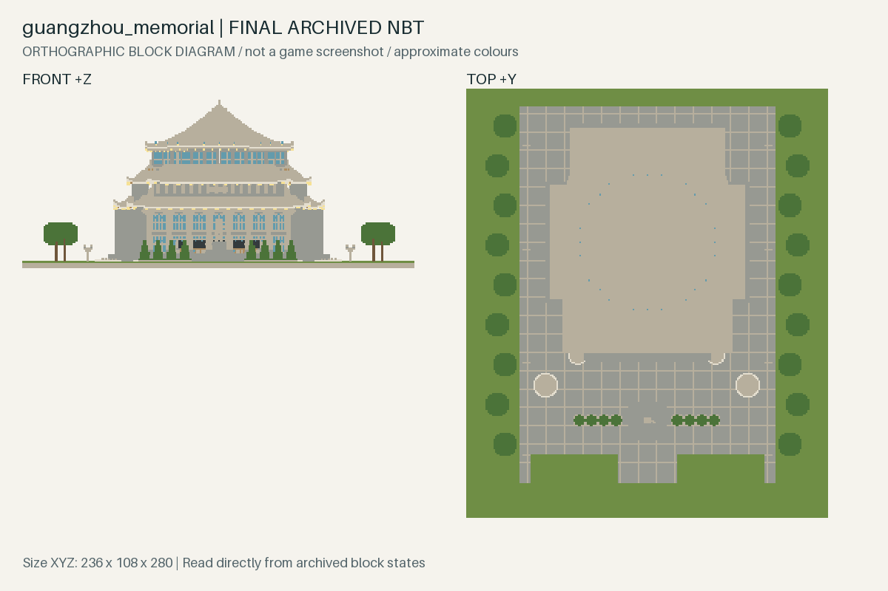

## zhujiang-dijing

### 广州珠江帝景苑

先选定赏湖轩型楼组，不能把全小区不同屋顶混在同楼；阳台、窗后空间、屋顶柱脚分别检查。

版本：V1_r03。主线状态：`legacy_adapter`；游戏状态：`待实测`。

窗洞36个样点被实墙遮挡，31处柱脚缺承托；阳台被挡及纵深过大，r03限制到5格；交付文件反复下载失败。 不代表整个小区；真实楼栋身份、绿化分布与户型细节待核；夜景远景偏弱。

- 窗透明性与栏杆连接分开检查；水不是玻璃片/栏杆的实体邻块；HTML内嵌且短文件名，单独试开下载。

[下载学习包](../downloads/study-zhujiang_dijing.zip)

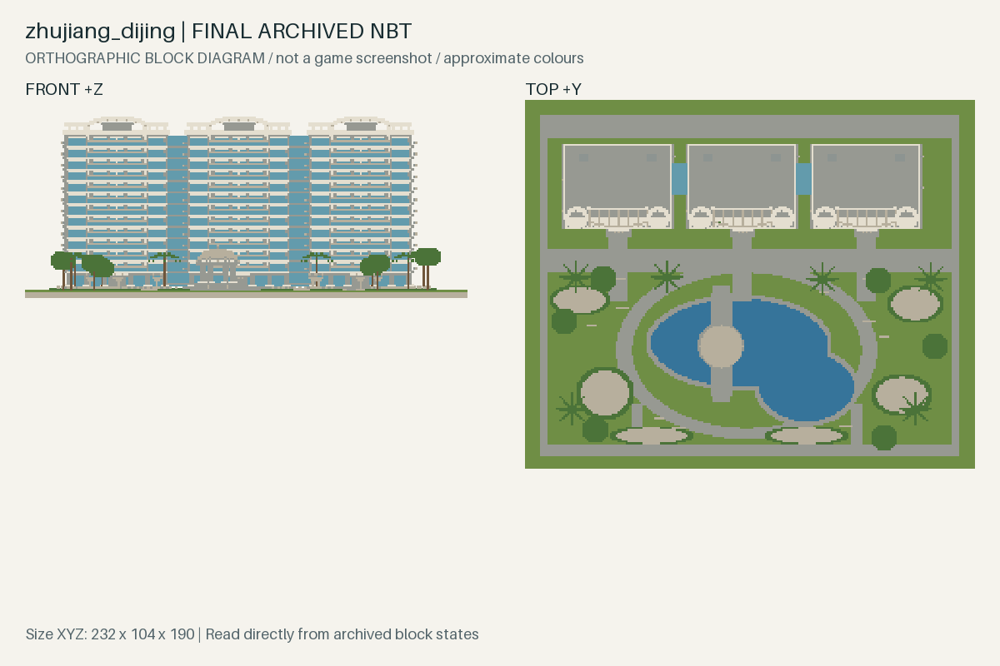

## guangzhou-south

### 广州南站

6跨不等宽拱壳、错位檐边、采光脊、V/Y柱和东西落客高差分开表达；大场地先控制层级、通廊和尺度。

版本：V1_r02。主线状态：`legacy_adapter`；游戏状态：`待实测`。

玻璃开门后外侧竖梃仍堵门；巨型网格写入曾截断；灯数很多但入口/下层夜景依然暗。 轨道和列车装饰性；ETFE/柱网/广场估算；采光脊文字尺寸与含端部包络未完全闭合；游戏未测。

- 入口契约必须在最终NBT检查；原子写入+网格字节长度+图像读回保护大场景预览；主次体量优先于重复细节密度。

[下载学习包](../downloads/study-guangzhou_south.zip)

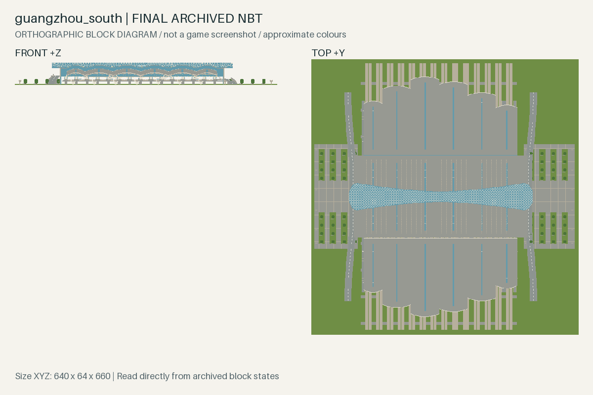

## civic-center

### 市民服务中心（原创）

39 个功能空间、51 根视觉柱、142 组家具；保留 75 组错动窗。最终 1,867 个灯方块、192 处嵌入灯与 22 丛竹。

版本：v03_r16_ceiling_landscape。主线状态：`legacy_adapter`；游戏状态：`待实测`。

早期散落桌椅、公共区不足、凸出灯块、孤立花池；R14/R15路径净空失败。 R16 为案例冻结结果；handoff 仅输出计划，尚未形成任意建筑的功能内饰生成器。游戏内通行和实际光照待验证。

- 保留批准窗口与标高；先动线和净空，再功能家具、灯具及植物；检查整条路径宽度。

[下载学习包](../downloads/study-civic_center.zip)

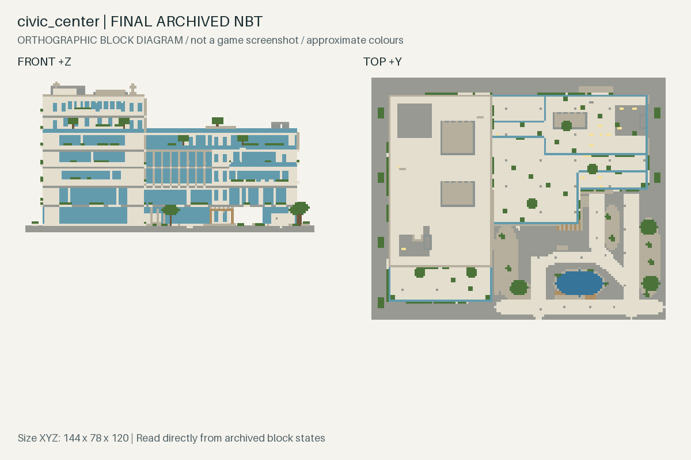

## guangzhou-ifc

### 广州国际金融中心（西塔）

圆角三角形腹部、玻璃后斜网格；92×224×100 格，11 项案例检查。r02 只改 104 个照明位置，非照明差分为 0。

版本：V1_r02。主线状态：`archived_output`；游戏状态：`待实测`。

22 张来源图含重复组，不能算 22 个独立方向。 731 个窗后家具样本不是完整房间；不是 103 层可行走内饰；原分支依赖 HAF 0.3。

- 固定结构后再改变窗后活动；局部变更以差分证明。

[下载学习包](../downloads/study-guangzhou_ifc.zip)

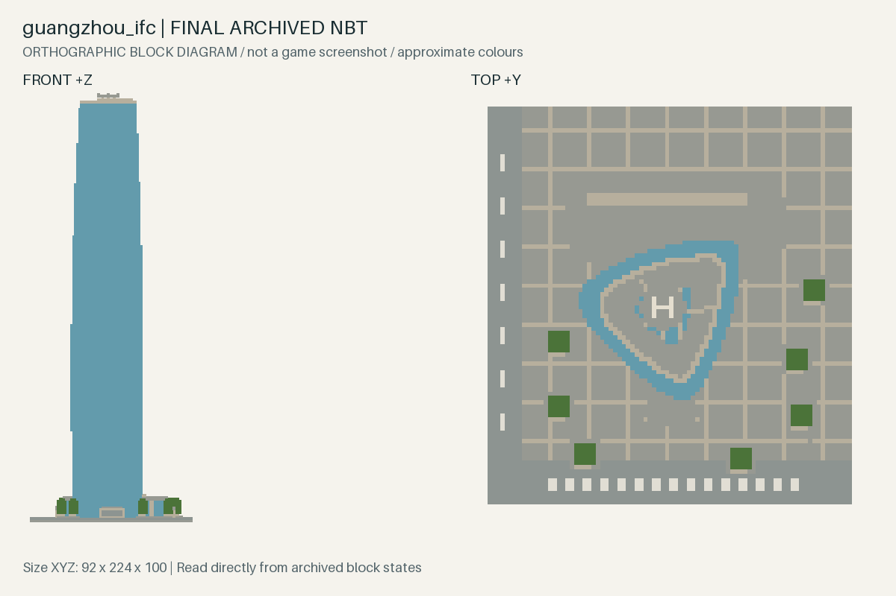

## oriental-pearl

### 上海东方明珠

球体、支腿和主体比例分层表达；89×223×89 格，28,198 非空气方块。

版本：v1_r04_final。主线状态：`archived_output`；游戏状态：`待实测`。

玻璃对照暴露表皮对体积判断的影响。 细三角幕墙、裙楼、真实内饰与彩色泛光仍不完整。

- 先读远景剪影，再检查支撑与球舱，不让玻璃掩盖骨架。

[下载学习包](../downloads/study-oriental_pearl.zip)

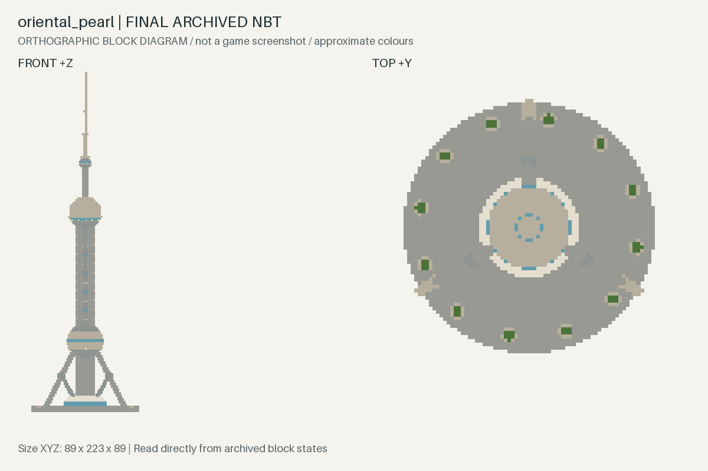

## swfc

### 上海环球金融中心

双弧切面、顶部梯形洞、分层幕墙与底面；73×234×73 格，21 项文件/几何检查留档。

版本：v1_r02_final。主线状态：`archived_output`；游戏状态：`待实测`。

技术检查通过时，视觉状态仍为 needs_revision。 当前视觉仍待修订；21 项检查不能替代建筑还原评价。

- 开洞形状、侧墙厚度与顶部透空要联合检查。

[下载学习包](../downloads/study-swfc.zip)

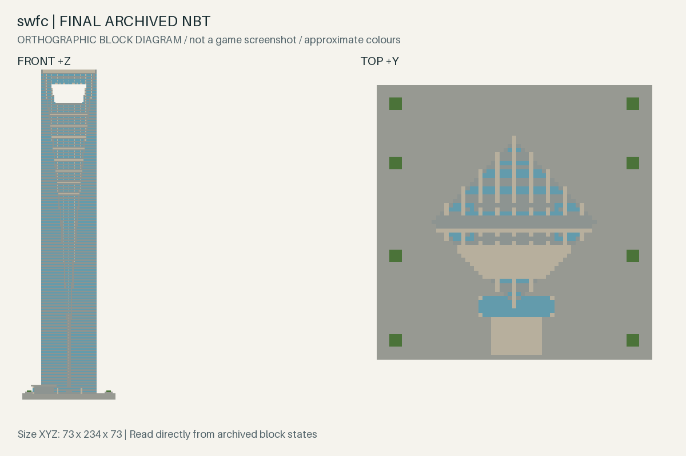

## osaka

### 大阪城希尔顿逸林酒店

前后不对称白色错动墙板、凹入玻璃、电视台基座与悬挑底面；最后修补 6 处低位悬空衬层，23 项检查。

版本：v1_r04_final。主线状态：`archived_output`；游戏状态：`待实测`。

旧 r02_final 与 r01 字节重复，不能当作新几何进展。 未生成 373 间真实客房；河岸仅为场景示意，部分参数仍为常量。

- 按朝向建立不同立面；底面装饰必须带支撑关系。

[下载学习包](../downloads/study-osaka.zip)

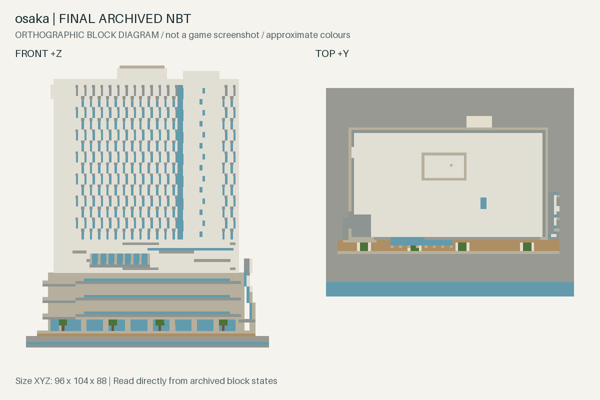

## grand-gate

### 广岛 JP 大厦

19 层、约 88 格主体；幕墙/裙楼/底面三个局部样板和 16 个视图。

版本：v1_r04_final。主线状态：`archived_output`；游戏状态：`待实测`。

GRAND GATE HIROSHIMA 指 2F 餐饮设施，不是整栋建筑名。 商业内饰未完整建成；手工研究与案例适配仍是主要方式。

- 建筑身份先校正，再分层研究商业基座、标准层与悬挑。

[下载学习包](../downloads/study-grand_gate.zip)

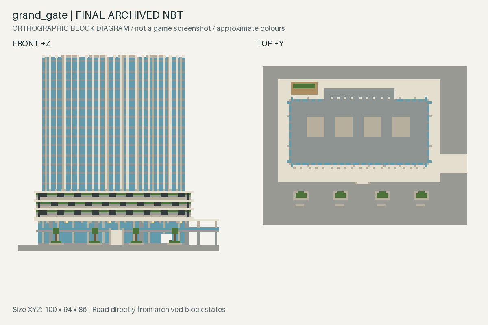

## guangzhou-citic

### 广州中信广场

冻结体块/立面/冠部，灯方块从 737 降至 410；19 个示范功能区、27 组家具、16 根视觉柱。

版本：V2_r02。主线状态：`archived_output`；游戏状态：`待实测`。

用户指出过亮与内饰单薄；降低曝光不能代替灯位修改。 -44.4% 是灯方块数量变化，非照度变化；示范楼层不能称为 80 层真实办公室。

- 普通窗按开间/楼层组分布；入口、商业、冠部和标识灯独立控制。

[下载学习包](../downloads/study-guangzhou_citic.zip)

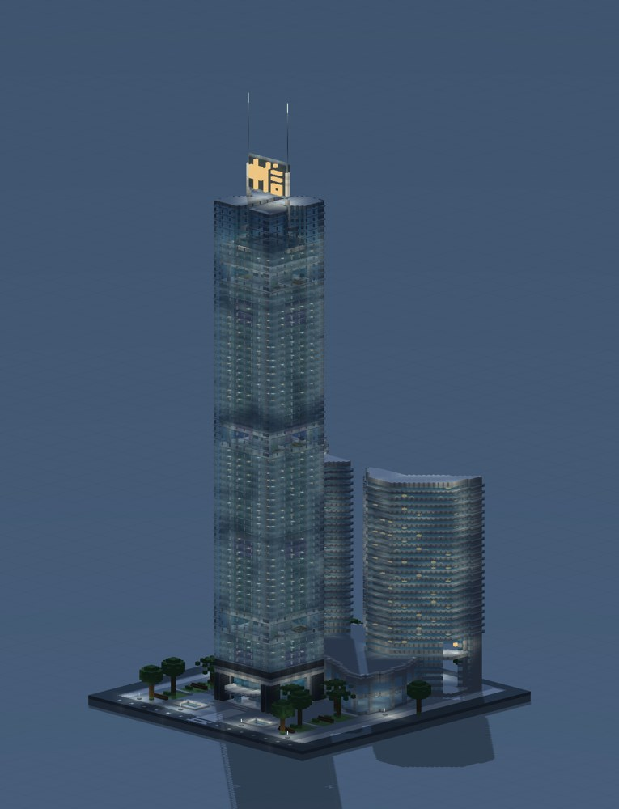

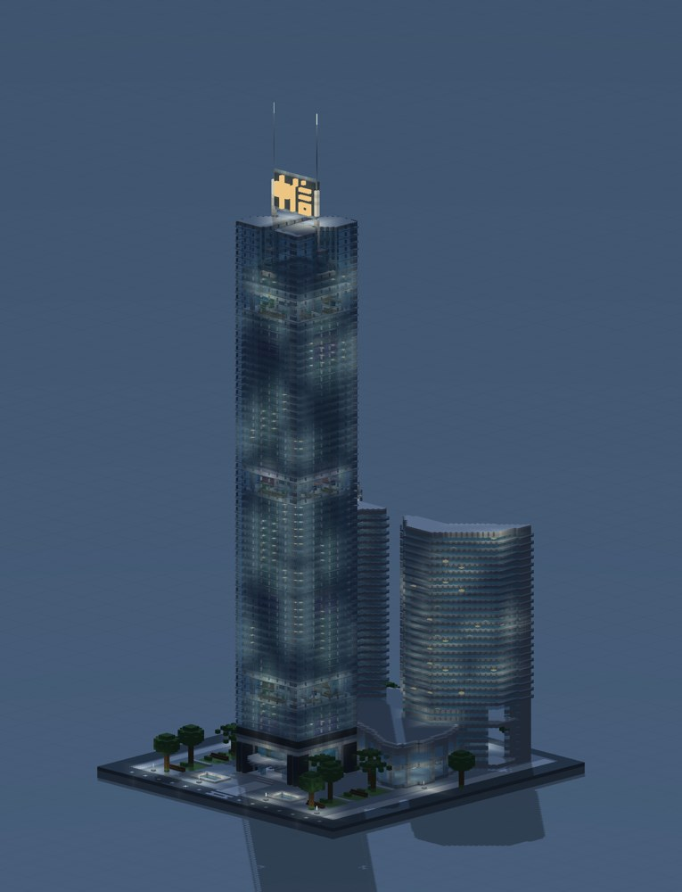

## millennium-estate

### 千禧年代住区

120 户、780 个功能房间、1,620 组家具；84 户亮灯。3,639 个近色方块零散穿插，9 根贴墙落水管。

版本：V3_r01。主线状态：`archived_output`；游戏状态：`待实测`。

大块修补纹理与用户要求不符，V3 已改；不能把“所有随机都要成簇”当通则。 28 项回读检查与 4,750 格限定差分已留档；家具可用性、玩家碰撞仍待游戏验证。

- 墙面近色穿插与修补斑块是两种独立风格；本案采用非成片散点。

[下载学习包](../downloads/study-millennium_estate.zip)

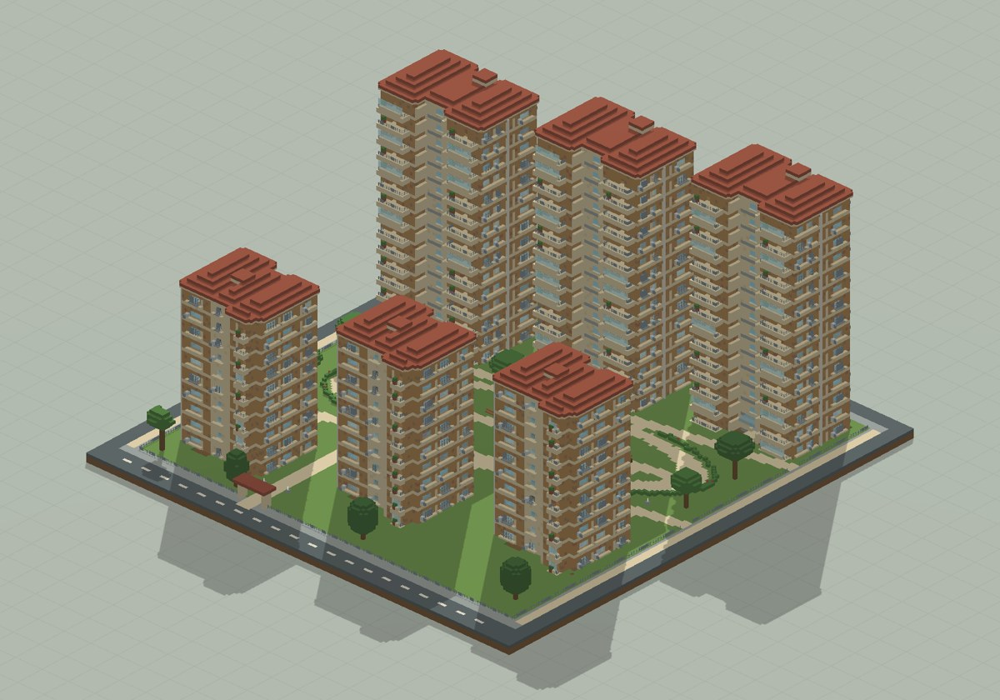

## urban-village20

### 榕荫里 · 20 栋城中村

20 栋、101 层、234 户与 9 店铺；六边形场地裁切、8 格地势落差、E1 长边与 D5 转角阳台。

版本：V4_r02。主线状态：`archived_output`；游戏状态：`待实测`。

只给外圈做装饰，或所有楼重复同样退台，无法表现高密度聚落。 30 项离线检查与 101 张楼层图；V3 方向获认可，V4 最终版尚未见用户验收。

- 边界、进深、街巷和地形先确定；加建与栏窗随住户/楼栋形成差异。

[下载学习包](../downloads/study-urban_village20.zip)

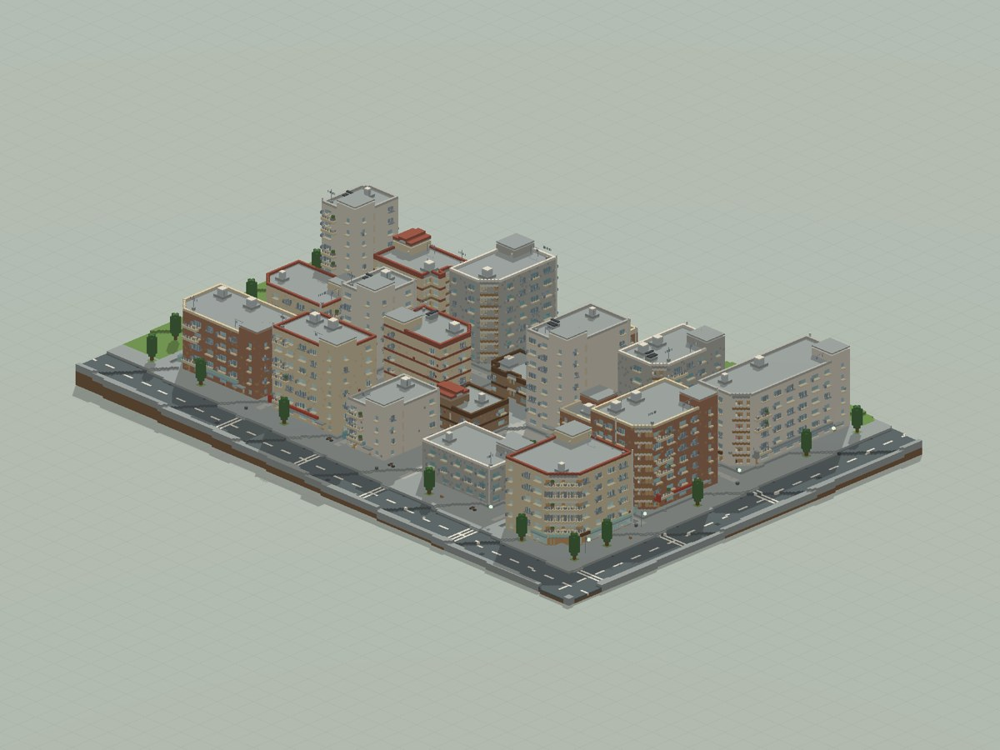

## rural13

### 田埂里 · 13 栋初版

6 栋完成、4 栋旧房、3 栋不同施工状态；476,715 非空气方块、33,931 格作物。

版本：V4。主线状态：`archived_output`；游戏状态：`待实测`。

固定场地与房型组合不等于自动聚落布局。 作为田埂里同一案例家族的前代保留，不计作独立泛化建筑。

- 居住、旧化、建造阶段分开记录；房屋与田地是相互关联的生产场景。

[下载学习包](../downloads/study-rural13.zip)

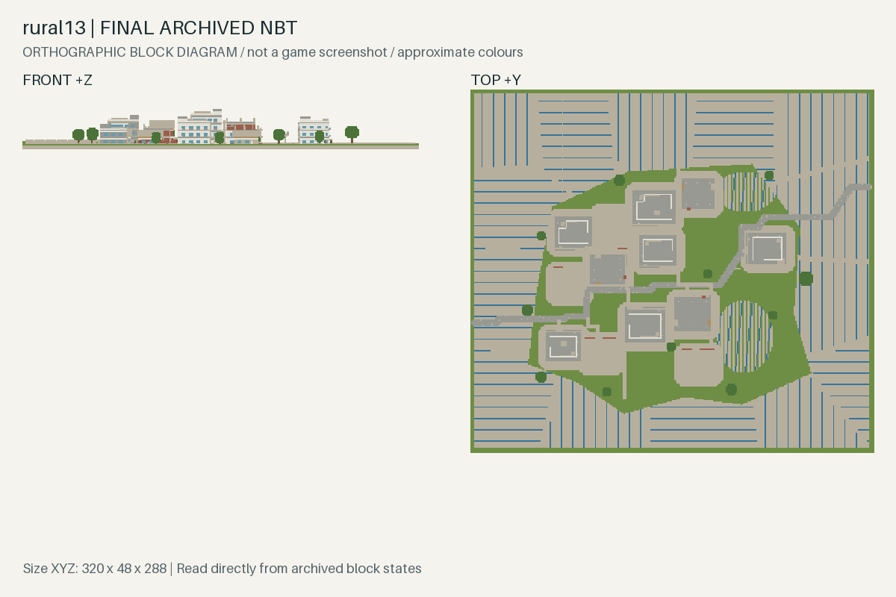

## tiangengli18

### 田埂里 · 18 栋田园深化

18 栋、32 片下沉田（8 水田）、6 座农业棚、3 处菜园、13 棵新增树；水网与下田通路接通。64,791 格原房屋保留，161→173 灯。

版本：P4_B4。主线状态：`archived_output`；游戏状态：`待实测`。

P4 曾出现灌溉不足、支渠不连、修渠碰菜园，以及小路撞树/灯柱/农机；B4 修复。 俯视仍偏矩形分区，边界树列均匀；共用随机数流可能串扰。16,649 格水连通仅是几何拓扑，未实测水更新。

- 先保证水路/田埂/入口/净空，再按功能补农具、果树、竹与休耕地；田内下沉一格保留田埂层次。

[下载学习包](../downloads/study-tiangengli18.zip)

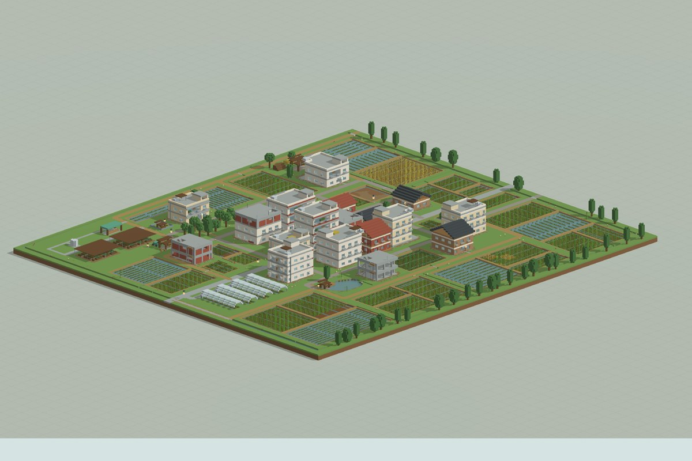

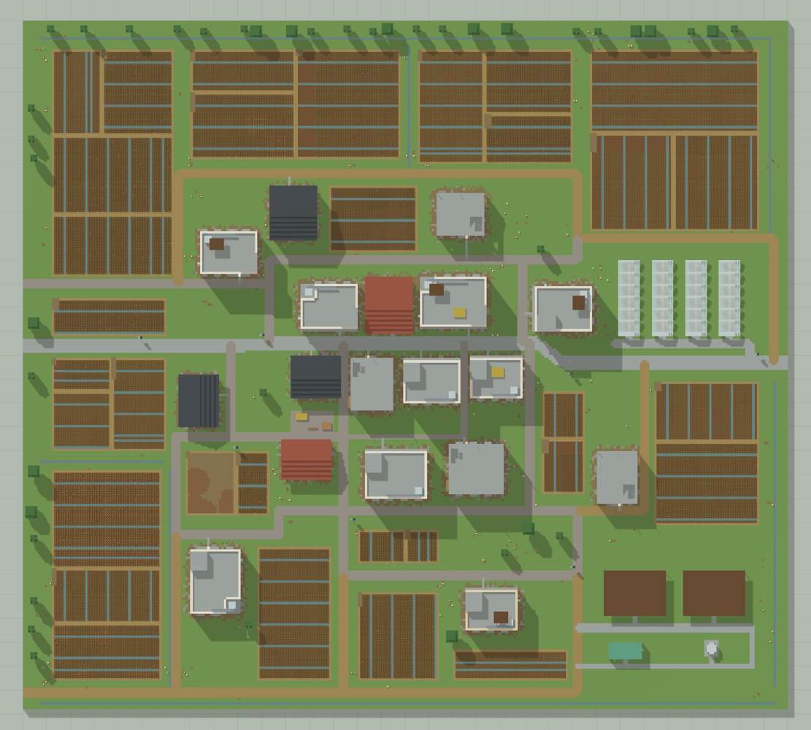

## interior-detail05

### 家具与植物组景

家具细部四展间与独立植物平面研究；植物方案未写入原家具 NBT

版本：InteriorDetail05。主线状态：`archived_output`；游戏状态：`pending unless explicit source evidence`。

完整文本保留原始未完成与否定反馈；本次不自动升级验收状态。

- 家具细部四展间与独立植物平面研究；植物方案未写入原家具 NBT

[下载学习包](../downloads/study-interior-detail05.zip)

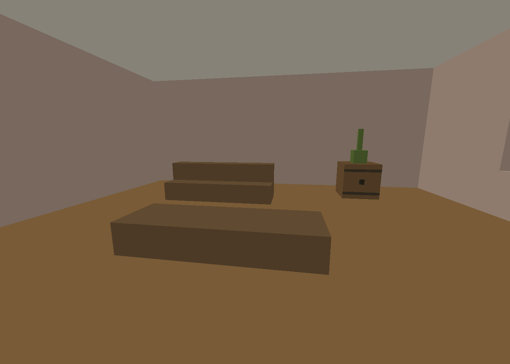

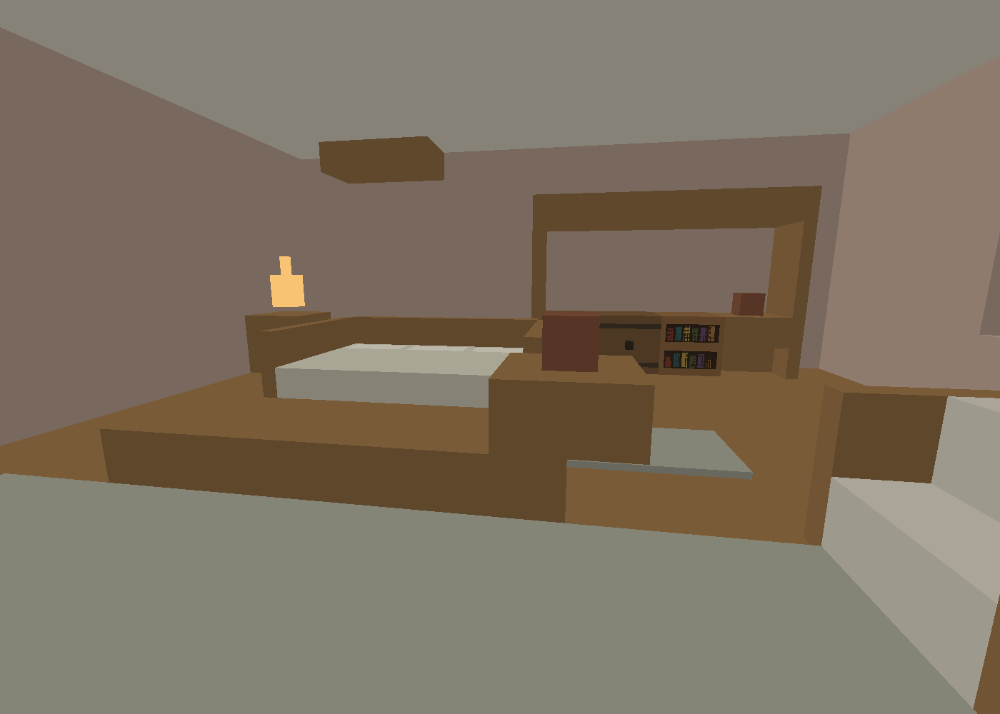

## corner01

### 榕角里街角楼

内饰曾被指出粗糙、单薄和刻意；保留 needs_revision

版本：Corner01。主线状态：`archived_output`；游戏状态：`pending unless explicit source evidence`。

完整文本保留原始未完成与否定反馈；本次不自动升级验收状态。

- 内饰曾被指出粗糙、单薄和刻意；保留 needs_revision

[下载学习包](../downloads/study-corner01.zip)

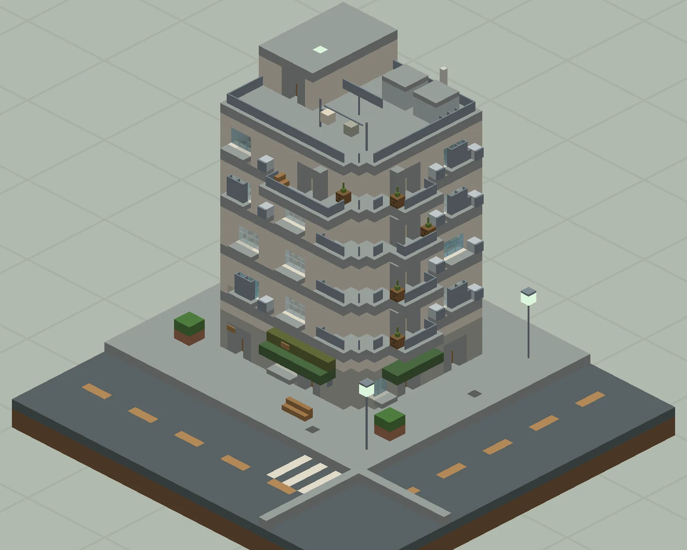

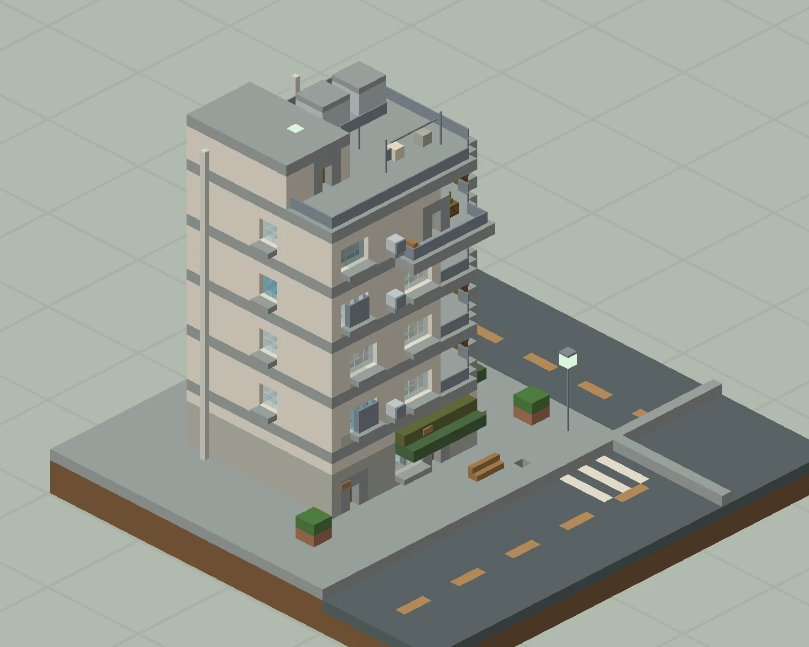

## decoration03

### 功能装饰与园林样板

12 用途、6 园林、照明构造；研究与交互示意

版本：HAF-Decoration-Library-03。主线状态：`research_only`；游戏状态：`pending unless explicit source evidence`。

完整文本保留原始未完成与否定反馈；本次不自动升级验收状态。

- 12 用途、6 园林、照明构造；研究与交互示意

[下载学习包](../downloads/study-decoration03.zip)

## industrial-atlas

### 工业设施类型图鉴

12 类设施、4 类组团；类型研究无 NBT

版本：Industrial01(1)。主线状态：`research_only`；游戏状态：`pending unless explicit source evidence`。

完整文本保留原始未完成与否定反馈；本次不自动升级验收状态。

- 12 类设施、4 类组团；类型研究无 NBT

[下载学习包](../downloads/study-industrial-atlas.zip)

## minguo01

### 民国建筑语汇研究

保留原报告研究范围与来源

版本：Minguo01。主线状态：`research_only`；游戏状态：`pending unless explicit source evidence`。

完整文本保留原始未完成与否定反馈；本次不自动升级验收状态。

- 保留原报告研究范围与来源

[下载学习包](../downloads/study-minguo01.zip)

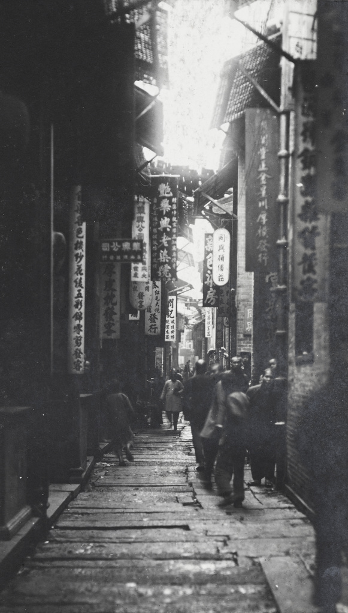

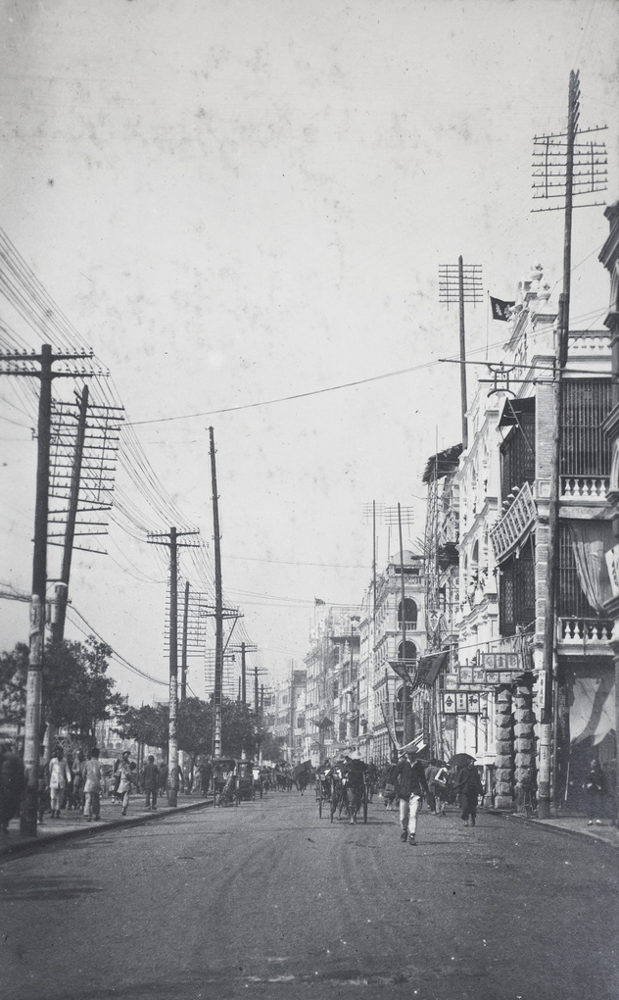

## japan-detail01

### 日式细部研究

构件来源与细节观察，不把教程索引视为复建通过

版本：JapanDetail01。主线状态：`research_only`；游戏状态：`pending unless explicit source evidence`。

完整文本保留原始未完成与否定反馈；本次不自动升级验收状态。

- 构件来源与细节观察，不把教程索引视为复建通过

[下载学习包](../downloads/study-japan-detail01.zip)

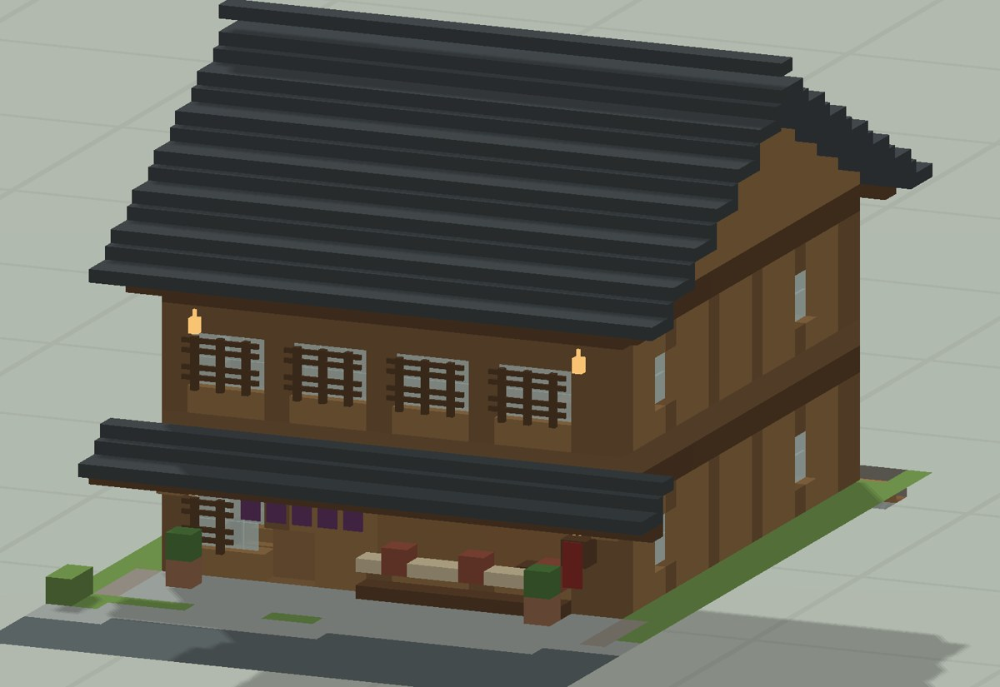

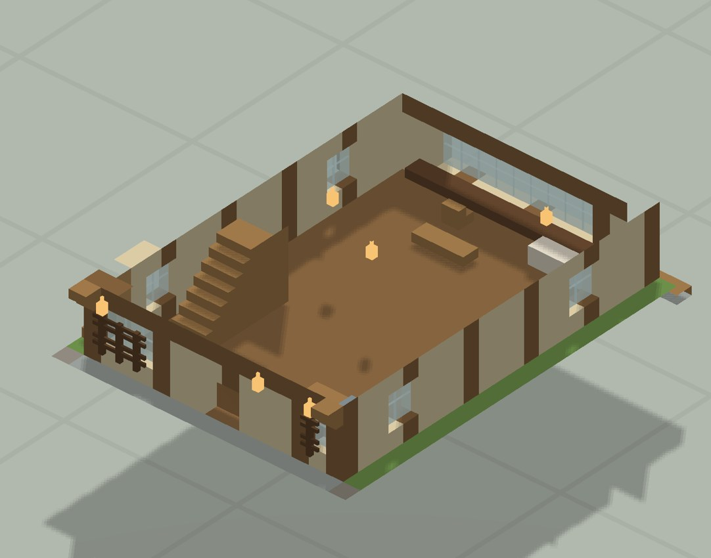

## southeast-link

### 东南联络线研究

铁路线形与接口研究；不与现有三角线实机通过混记

版本：Dongguanxi_SE_Link_Study。主线状态：`research_only`；游戏状态：`pending unless explicit source evidence`。

完整文本保留原始未完成与否定反馈；本次不自动升级验收状态。

- 铁路线形与接口研究；不与现有三角线实机通过混记

[下载学习包](../downloads/study-southeast-link.zip)

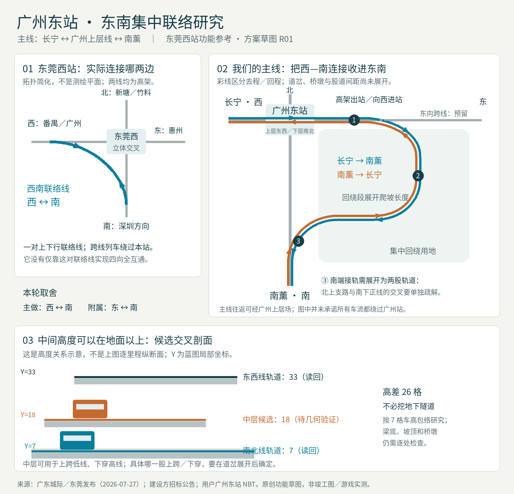

## village07

### 功能聚落与随机变化

聚落道路、院界、用途和建筑变体；按原报告保留范围和待验收项

版本：Village07。主线状态：`archived_output`；游戏状态：`pending unless explicit source evidence`。

完整文本保留原始未完成与否定反馈；本次不自动升级验收状态。

- 聚落道路、院界、用途和建筑变体；按原报告保留范围和待验收项

[下载学习包](../downloads/study-village07.zip)

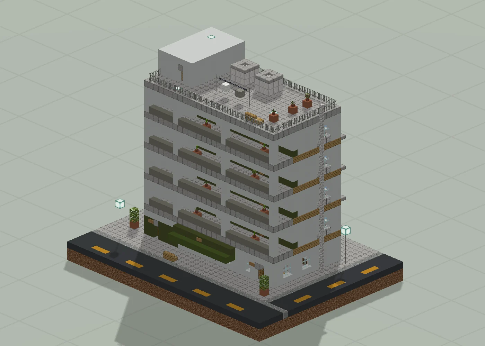

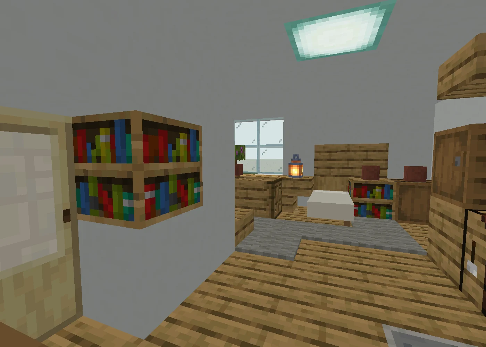

## room06

### 榕角里单间试住

8×8 格含独卫；睡眠、起居、书桌、厨房、储物和三组植物；独立小样，不是 Corner01 整楼返工。

版本：R03 / rules 0.4.3。主线状态：`isolated_adapter`；游戏状态：`pending`。

Corner01 remains needs_revision；原版碰撞、门、睡眠、光照、审美 pending。

- 同壳、同家具的无植物/种子对照；门窗、家具和灯固定
- 离线 15 接近点、床门和实体检查与实机验收分开

[下载学习包](../downloads/study-room06.zip)

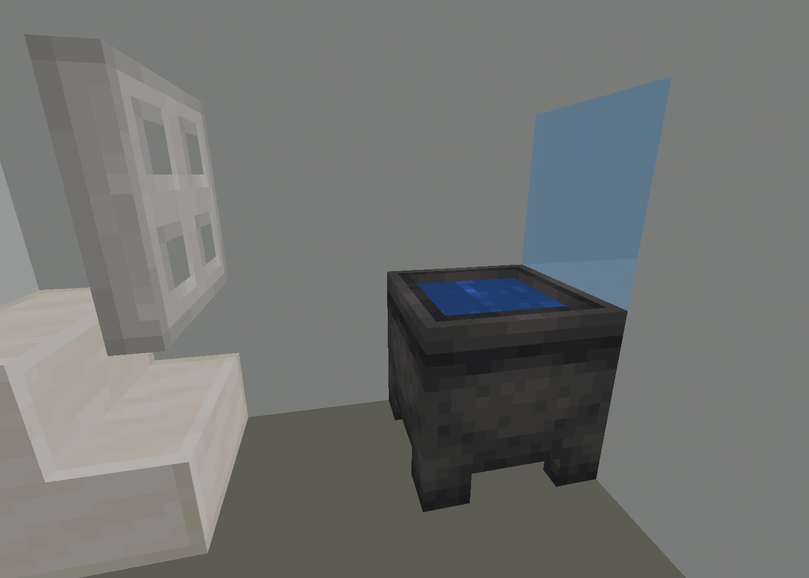

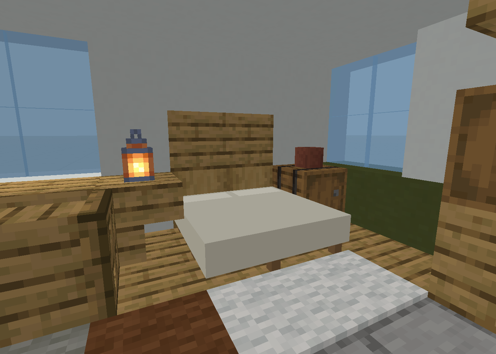

## study-architect

### 历史专题 · architect

历史专题文本与实验代码摘录；不计为主线生成器。

版本：HAF05 archived study。主线状态：`research_only`；游戏状态：`not_applicable`。

以原研究记录为准；本次未重跑历史实验。

- 保留原始研究、失败和能力边界；专题脚本不由模型自动执行。

[下载学习包](../downloads/study-study-architect.zip)

## study-decoration

### 历史专题 · decoration

历史专题文本与实验代码摘录；不计为主线生成器。

版本：HAF05 archived study。主线状态：`research_only`；游戏状态：`not_applicable`。

以原研究记录为准；本次未重跑历史实验。

- 保留原始研究、失败和能力边界；专题脚本不由模型自动执行。

[下载学习包](../downloads/study-study-decoration.zip)

## study-detail

### 历史专题 · detail

历史专题文本与实验代码摘录；不计为主线生成器。

版本：HAF05 archived study。主线状态：`research_only`；游戏状态：`not_applicable`。

以原研究记录为准；本次未重跑历史实验。

- 保留原始研究、失败和能力边界；专题脚本不由模型自动执行。

[下载学习包](../downloads/study-study-detail.zip)

## study-exterior

### 历史专题 · exterior

历史专题文本与实验代码摘录；不计为主线生成器。

版本：HAF05 archived study。主线状态：`research_only`；游戏状态：`not_applicable`。

以原研究记录为准；本次未重跑历史实验。

- 保留原始研究、失败和能力边界；专题脚本不由模型自动执行。

[下载学习包](../downloads/study-study-exterior.zip)

## study-facade

### 历史专题 · facade

历史专题文本与实验代码摘录；不计为主线生成器。

版本：HAF05 archived study。主线状态：`research_only`；游戏状态：`not_applicable`。

以原研究记录为准；本次未重跑历史实验。

- 保留原始研究、失败和能力边界；专题脚本不由模型自动执行。

[下载学习包](../downloads/study-study-facade.zip)

## study-foundation

### 历史专题 · foundation

历史专题文本与实验代码摘录；不计为主线生成器。

版本：HAF05 archived study。主线状态：`research_only`；游戏状态：`not_applicable`。

以原研究记录为准；本次未重跑历史实验。

- 保留原始研究、失败和能力边界；专题脚本不由模型自动执行。

[下载学习包](../downloads/study-study-foundation.zip)

## study-interior

### 历史专题 · interior

历史专题文本与实验代码摘录；不计为主线生成器。

版本：HAF05 archived study。主线状态：`research_only`；游戏状态：`not_applicable`。

以原研究记录为准；本次未重跑历史实验。

- 保留原始研究、失败和能力边界；专题脚本不由模型自动执行。

[下载学习包](../downloads/study-study-interior.zip)

## study-interior-library

### 历史专题 · interior_library

历史专题文本与实验代码摘录；不计为主线生成器。

版本：HAF05 archived study。主线状态：`research_only`；游戏状态：`not_applicable`。

以原研究记录为准；本次未重跑历史实验。

- 保留原始研究、失败和能力边界；专题脚本不由模型自动执行。

[下载学习包](../downloads/study-study-interior_library.zip)

## study-lab

### 历史专题 · lab

历史专题文本与实验代码摘录；不计为主线生成器。

版本：HAF05 archived study。主线状态：`research_only`；游戏状态：`not_applicable`。

以原研究记录为准；本次未重跑历史实验。

- 保留原始研究、失败和能力边界；专题脚本不由模型自动执行。

[下载学习包](../downloads/study-study-lab.zip)

## study-layout

### 历史专题 · layout

历史专题文本与实验代码摘录；不计为主线生成器。

版本：HAF05 archived study。主线状态：`research_only`；游戏状态：`not_applicable`。

以原研究记录为准；本次未重跑历史实验。

- 保留原始研究、失败和能力边界；专题脚本不由模型自动执行。

[下载学习包](../downloads/study-study-layout.zip)

## study-models

### 历史专题 · models

历史专题文本与实验代码摘录；不计为主线生成器。

版本：HAF05 archived study。主线状态：`research_only`；游戏状态：`not_applicable`。

以原研究记录为准；本次未重跑历史实验。

- 保留原始研究、失败和能力边界；专题脚本不由模型自动执行。

[下载学习包](../downloads/study-study-models.zip)

## study-plan

### 历史专题 · plan

历史专题文本与实验代码摘录；不计为主线生成器。

版本：HAF05 archived study。主线状态：`research_only`；游戏状态：`not_applicable`。

以原研究记录为准；本次未重跑历史实验。

- 保留原始研究、失败和能力边界；专题脚本不由模型自动执行。

[下载学习包](../downloads/study-study-plan.zip)

## study-schem

### 历史专题 · schem

历史专题文本与实验代码摘录；不计为主线生成器。

版本：HAF05 archived study。主线状态：`research_only`；游戏状态：`not_applicable`。

以原研究记录为准；本次未重跑历史实验。

- 保留原始研究、失败和能力边界；专题脚本不由模型自动执行。

[下载学习包](../downloads/study-study-schem.zip)

## study-spatial

### 历史专题 · spatial

历史专题文本与实验代码摘录；不计为主线生成器。

版本：HAF05 archived study。主线状态：`research_only`；游戏状态：`not_applicable`。

以原研究记录为准；本次未重跑历史实验。

- 保留原始研究、失败和能力边界；专题脚本不由模型自动执行。

[下载学习包](../downloads/study-study-spatial.zip)

## study-web

### 历史专题 · web

历史专题文本与实验代码摘录；不计为主线生成器。

版本：HAF05 archived study。主线状态：`research_only`；游戏状态：`not_applicable`。

以原研究记录为准；本次未重跑历史实验。

- 保留原始研究、失败和能力边界；专题脚本不由模型自动执行。

[下载学习包](../downloads/study-study-web.zip)

## japan-town01

### 日式街区研究

街区类型与前置设计积累

版本：JapanTown01。主线状态：`research_only`；游戏状态：`pending unless explicit source evidence`。

完整文本保留原始未完成与否定反馈；本次不自动升级验收状态。

- 街区类型与前置设计积累

[下载学习包](../downloads/study-japan-town01.zip)

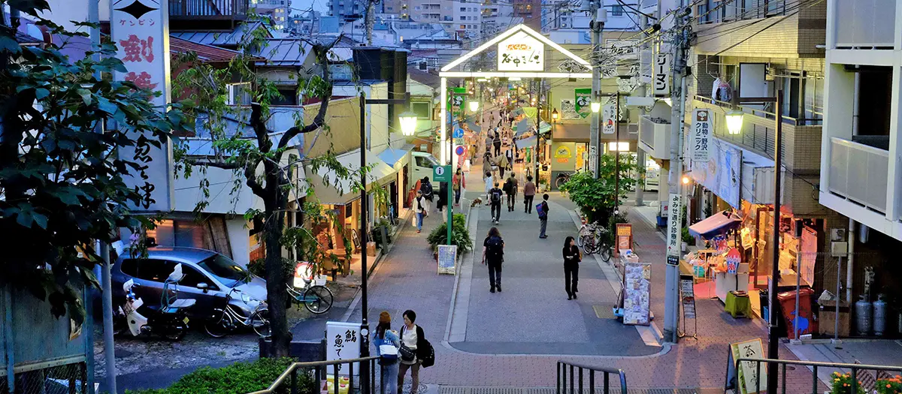

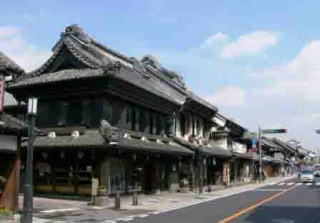

## interior04

### 完整内饰实验

四类完整房间、门框修复与活动组；游戏和审美待验收

版本：Interior04。主线状态：`archived_output`；游戏状态：`pending unless explicit source evidence`。

完整文本保留原始未完成与否定反馈；本次不自动升级验收状态。

- 四类完整房间、门框修复与活动组；游戏和审美待验收

[下载学习包](../downloads/study-interior04.zip)

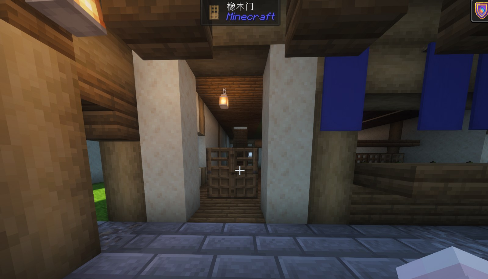

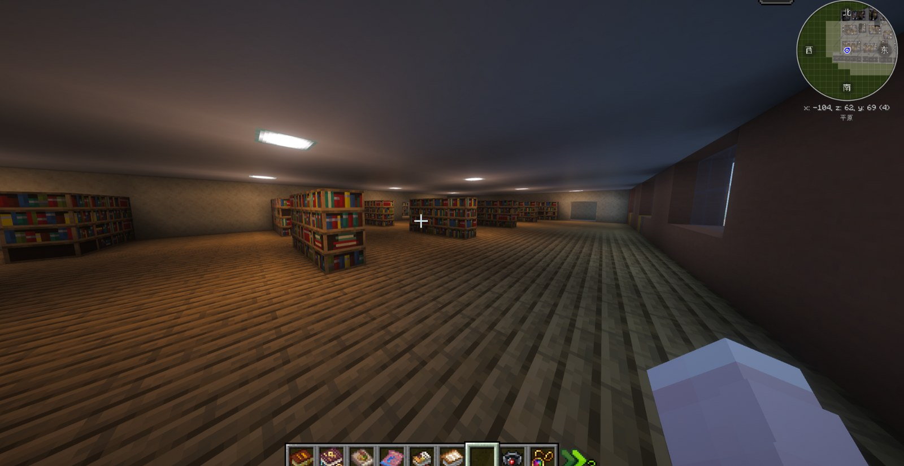

## japan-town12

### 山溪日式街区

坡地、溪流、街道和建筑的共同布局；不把概念自动当作存档地形

版本：JapanTown12。主线状态：`archived_output`；游戏状态：`pending unless explicit source evidence`。

完整文本保留原始未完成与否定反馈；本次不自动升级验收状态。

- 坡地、溪流、街道和建筑的共同布局；不把概念自动当作存档地形

[下载学习包](../downloads/study-japan-town12.zip)
 · [案例文件与完整图片目录](../archive/cases/japan-town12/README.md)

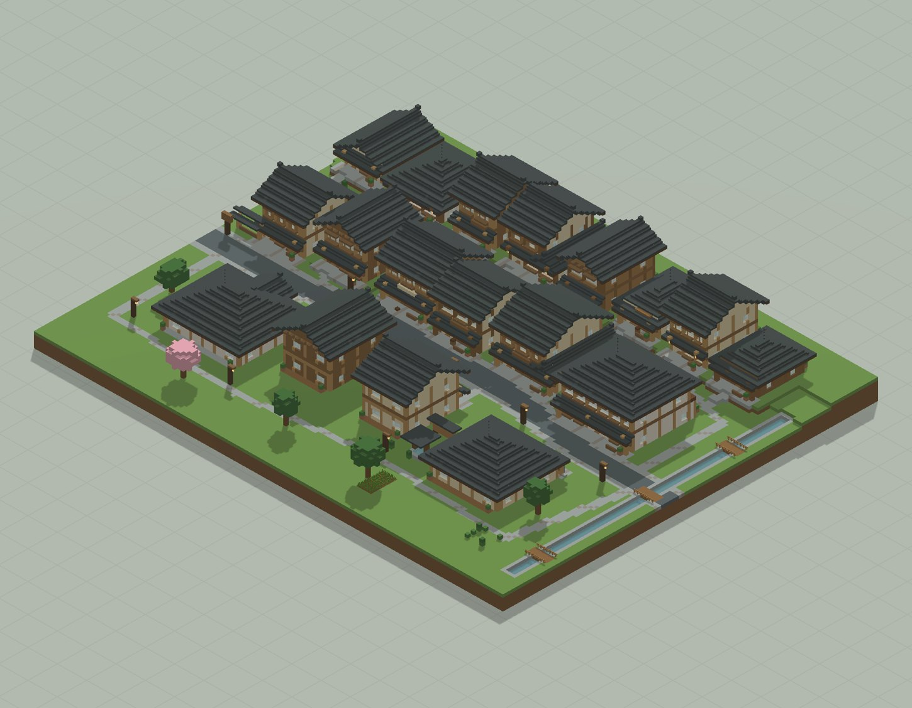

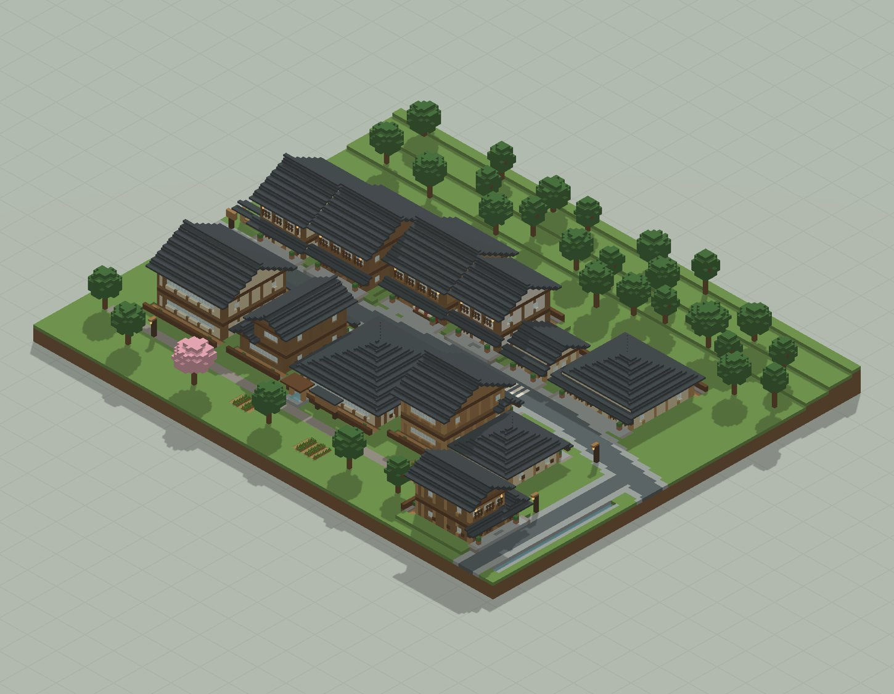

## machiya08

### 日和小食 · 町家门面与屋顶返工

两层居酒屋与住宅；开放门面、分层屋顶和 11 个座位。

版本：M08。主线状态：`archived_output`；游戏状态：`pending`。

小型街屋应先验证门面、屋顶和室内功能，再复制到街区。

- 小型街屋应先验证门面、屋顶和室内功能，再复制到街区。

[下载学习包](../downloads/study-machiya08.zip)
 · [案例文件与完整图片目录](../archive/cases/machiya08/README.md)

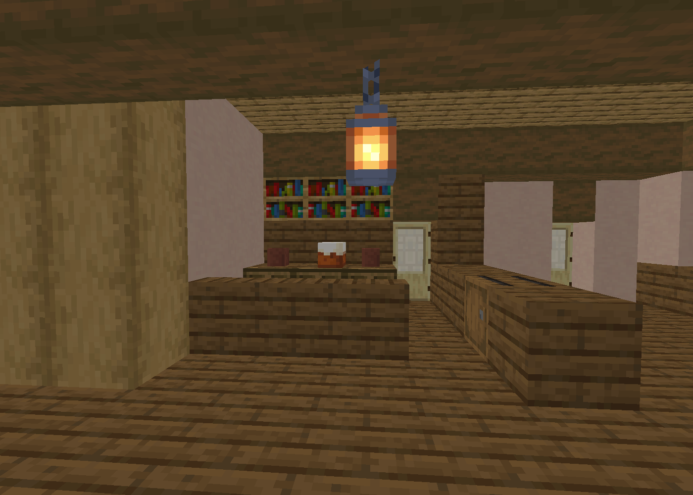

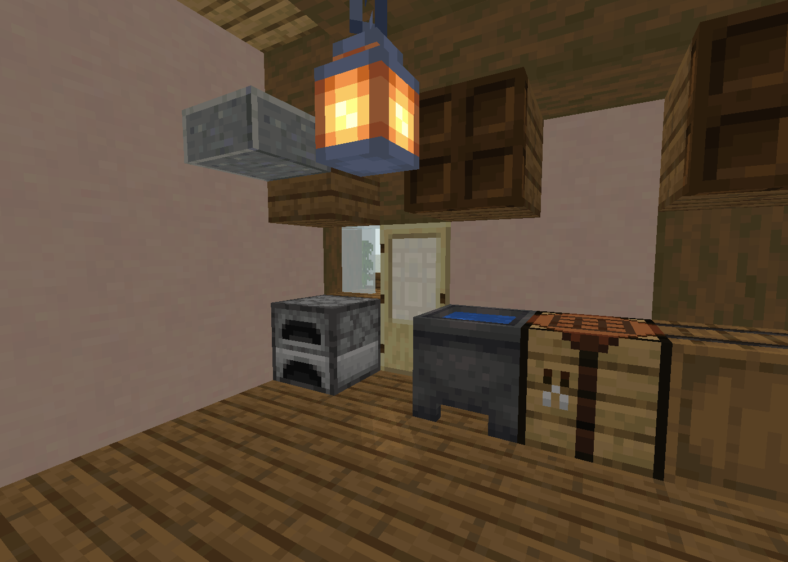

## komorebi09

### 木漏日町 · 山溪与十八栋

山溪地形先行的 18 栋聚落；保留地形输入、树木与公共节点。

版本：T07。主线状态：`archived_output`；游戏状态：`pending`。

室外连通检查允许跳跃，不能解释为全部平地可步行。

- 室外连通检查允许跳跃，不能解释为全部平地可步行。

[下载学习包](../downloads/study-komorebi09.zip)
 · [案例文件与完整图片目录](../archive/cases/komorebi09/README.md)

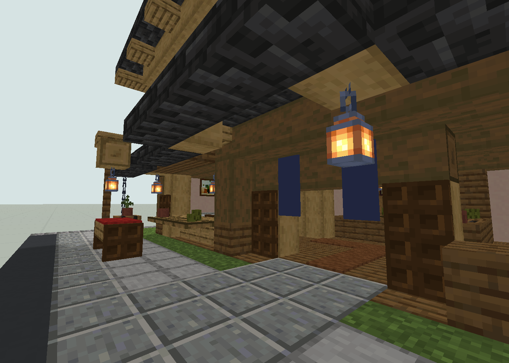

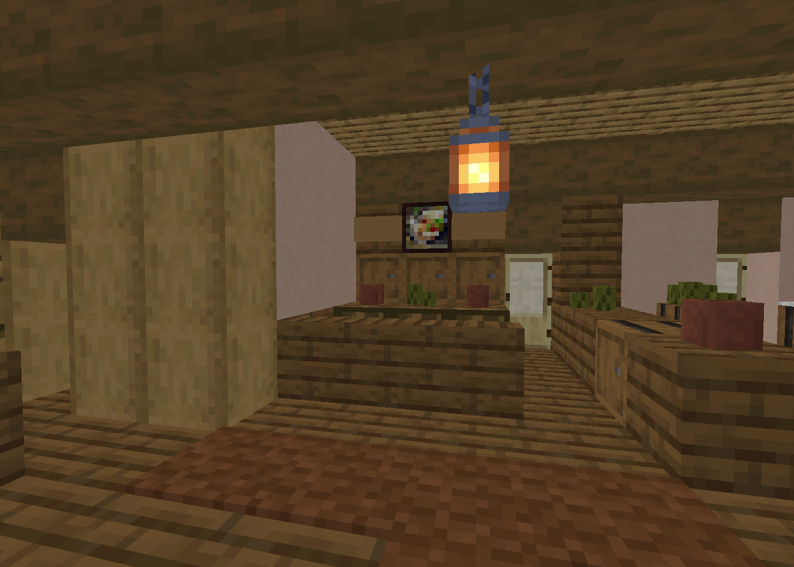

## taisho10

### 大正诊所样板

已下载的诊所研究与功能空间历史版本；后续风格深化见 Taisho11

版本：Taisho10-local。主线状态：`archived_output`；游戏状态：`pending unless explicit source evidence`。

完整文本保留原始未完成与否定反馈；本次不自动升级验收状态。

- 已下载的诊所研究与功能空间历史版本；后续风格深化见 Taisho11

[下载学习包](../downloads/study-taisho10.zip)
 · [案例文件与完整图片目录](../archive/cases/taisho10/README.md)

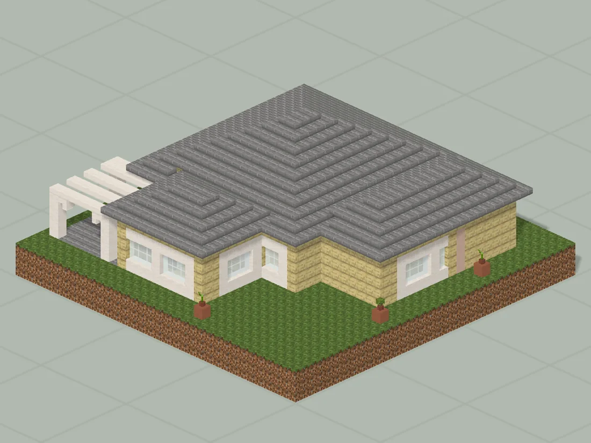

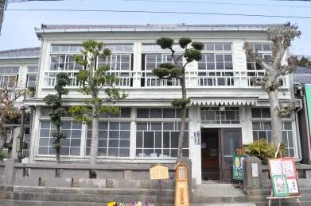

## taisho11

### 大正喫茶与阅读空间

突出窗湾、店面身份、服务和客席关系

版本：Taisho11。主线状态：`archived_output`；游戏状态：`pending unless explicit source evidence`。

完整文本保留原始未完成与否定反馈；本次不自动升级验收状态。

- 突出窗湾、店面身份、服务和客席关系

[下载学习包](../downloads/study-taisho11.zip)

## taisho12

### 三种街屋 · 书肆、药局与旅馆

青葉書肆、白鷺薬局、松風館三种建筑原型。

版本：A06。主线状态：`archived_output`；游戏状态：`pending`。

建筑原型仍偏孤立；地形、街巷与公共空间需要继续整合。

- 建筑原型仍偏孤立；地形、街巷与公共空间需要继续整合。

[下载学习包](../downloads/study-taisho12.zip)
 · [案例文件与完整图片目录](../archive/cases/taisho12/README.md)

## taisho13

### 櫻坂通り街区

街道、店铺、楼上阅读与内饰串联

版本：Taisho13。主线状态：`archived_output`；游戏状态：`pending unless explicit source evidence`。

完整文本保留原始未完成与否定反馈；本次不自动升级验收状态。

- 街道、店铺、楼上阅读与内饰串联

[下载学习包](../downloads/study-taisho13.zip)

## taisho14

### 櫻坂风貌街

18 栋建筑、两条坡街与学校、图书馆、钟楼、车站等公共节点。

版本：Q03。主线状态：`archived_output`；游戏状态：`pending`。

街区规模扩大后仍需检查每栋入口、楼梯与坡道衔接。

- 街区规模扩大后仍需检查每栋入口、楼梯与坡道衔接。

[下载学习包](../downloads/study-taisho14.zip)
 · [案例文件与完整图片目录](../archive/cases/taisho14/README.md)

## taisho15

### 櫻坂山溪町

18 栋建筑与瞭望点；山溪和有机布局的中间实验。

版本：O09。主线状态：`archived_output`；游戏状态：`pending`。

用户否定圆丘地形、稀疏树木、狭窄且缺少层级的道路与钟楼；保留为返工前版本。

- 用户否定圆丘地形、稀疏树木、狭窄且缺少层级的道路与钟楼；保留为返工前版本。

[下载学习包](../downloads/study-taisho15.zip)
 · [案例文件与完整图片目录](../archive/cases/taisho15/README.md)

## taisho16

### 木漏日溪谷

320×288 的溪谷聚落，18 栋主体建筑；7/5/3 级道路与更密的林地。

版本：V09。主线状态：`archived_output`；游戏状态：`pending`。

承接 Taisho15 的否定反馈，替换失效钟楼；未完成全面多种子与实机验证。

- 承接 Taisho15 的否定反馈，替换失效钟楼；未完成全面多种子与实机验证。

[下载学习包](../downloads/study-taisho16.zip)
 · [案例文件与完整图片目录](../archive/cases/taisho16/README.md)

## qilou01

### 檐下西关 · 三栋骑楼小样

合顺杂货、济安药房、榕荫茶居三种骑楼原型。

版本：Q05。主线状态：`archived_output`；游戏状态：`pending`。

先验证骑楼柱廊、商铺开口和楼层关系；三栋小样不等于完整街区。

- 先验证骑楼柱廊、商铺开口和楼层关系；三栋小样不等于完整街区。

[下载学习包](../downloads/study-qilou01.zip)
 · [案例文件与完整图片目录](../archive/cases/qilou01/README.md)

## qilou02

### 檐下西关 · 四角里

12 栋商铺、四个街角与围合院落；144×44×144。

版本：S06。主线状态：`archived_output`；游戏状态：`pending`。

连续柱廊与四向穿院通道形成第一轮街区连接。

- 连续柱廊与四向穿院通道形成第一轮街区连接。

[下载学习包](../downloads/study-qilou02.zip)
 · [案例文件与完整图片目录](../archive/cases/qilou02/README.md)

## qilou03

### 檐下榕里 · 广州街巷

12 栋骑楼与 16 栋城中村混合；244×58×216。

版本：G05。主线状态：`archived_output`；游戏状态：`pending`。

从围合院落走向十字路口、后巷和多级道路，检查入口与楼梯连通。

- 从围合院落走向十字路口、后巷和多级道路，检查入口与楼梯连通。

[下载学习包](../downloads/study-qilou03.zip)
 · [案例文件与完整图片目录](../archive/cases/qilou03/README.md)

## qilou04

### 榕灰里 · 骑楼与城中村街区

44 栋建筑：12 栋骑楼、32 栋城中村，356×84×250；保留白天与夜间实机截图。

版本：R19h。主线状态：`archived_output`；游戏状态：`historical_vanilla_1.21.1_load_and_screenshots`。

已有原版 Java 1.21.1 加载与 F2 截图记录，仍不等于逐户功能、所有交互全部验收。

- 已有原版 Java 1.21.1 加载与 F2 截图记录，仍不等于逐户功能、所有交互全部验收。

[下载学习包](../downloads/study-qilou04.zip)
 · [案例文件与完整图片目录](../archive/cases/qilou04/README.md)

## guanggang01

### 广钢式工业区 · 一号钢厂

240×192 的钢厂场景，11 类设施。

版本：G03。主线状态：`archived_output`；游戏状态：`pending`。

原版静态工业表达；不能将外形与管道连接当作真实生产模拟。

- 原版静态工业表达；不能将外形与管道连接当作真实生产模拟。

[下载学习包](../downloads/study-guanggang01.zip)
 · [案例文件与完整图片目录](../archive/cases/guanggang01/README.md)

## modern-factory01

### 新港制造园 · 综合生产基地

448×336；办公楼、生产厂房、宿舍、食堂与连桥，包含 V3 硬地返工。

版本：E07。主线状态：`archived_output`；游戏状态：`pending`。

保留工业硬地和运输逻辑，机器与生产流程为静态表达。

- 保留工业硬地和运输逻辑，机器与生产流程为静态表达。

[下载学习包](../downloads/study-modern-factory01.zip)
 · [案例文件与完整图片目录](../archive/cases/modern-factory01/README.md)

## rail-depot01

### 新港列车所 · 检修与研发基地

480×240；10 条主要股道、检修设施与研发塔楼，使用 Create 6.0.10 轨道。

版本：R15。主线状态：`archived_output`；游戏状态：`pending`。

轨道数据存在不等于实车联调完成，仍待实机列车、信号与净空验证。

- 轨道数据存在不等于实车联调完成，仍待实机列车、信号与净空验证。

[下载学习包](../downloads/study-rail-depot01.zip)
 · [案例文件与完整图片目录](../archive/cases/rail-depot01/README.md)

## substation01

### 变电设施小样

新港枢纽变电站 S04；256×240×64，双主变与 16 类模块。

版本：S04。主线状态：`archived_output`；游戏状态：`pending`。

原版静态变电站；网页检查不等于 Minecraft 实机或电力仿真通过。

- 已下载的 Substation01 历史报告归档；不冒充较新的线上修订

[下载学习包](../downloads/study-substation01.zip)
 · [案例文件与完整图片目录](../archive/cases/substation01/README.md)

## guangzhou-east-linkonly

### 广州东 · 独立双联络线

621×899×34 的独立联络线；与完整结构分别提供。

版本：B03。主线状态：`archived_output`；游戏状态：`pending`。

独立线以原版与 Create 为主；实车扫掠净空、信号与接轨仍待实机验证。

- 独立线以原版与 Create 为主；实车扫掠净空、信号与接轨仍待实机验证。

[下载学习包](../downloads/study-guangzhou-east-linkonly.zip)
 · [案例文件与完整图片目录](../archive/cases/guangzhou-east-linkonly/README.md)

## guangzhou-east-complete

### 广州东 · 车站与双联络线完整结构

1034×1045×42 的站场与双联络线完整结构。

版本：B03。主线状态：`archived_output`；游戏状态：`pending`。

完整站场还依赖 Yuushya、Quark、Connected Glass 等原站模组；按接口坐标放置。

- 完整站场还依赖 Yuushya、Quark、Connected Glass 等原站模组；按接口坐标放置。

[下载学习包](../downloads/study-guangzhou-east-complete.zip)
 · [案例文件与完整图片目录](../archive/cases/guangzhou-east-complete/README.md)

## guangzhou-east

### 广州东分段联络线

广州东双联络线打印指南：7 段联络线与南侧 144+144+2 格补接段。

版本：B03S2。主线状态：`archived_output`；游戏状态：`pending`。

完整文本保留原始未完成与否定反馈；本次不自动升级验收状态。

- 分段打印、接口与拼装方向；Create 依赖和实机验证按原报告

[下载学习包](../downloads/study-guangzhou-east.zip)
 · [案例文件与完整图片目录](../archive/cases/guangzhou-east/README.md)

