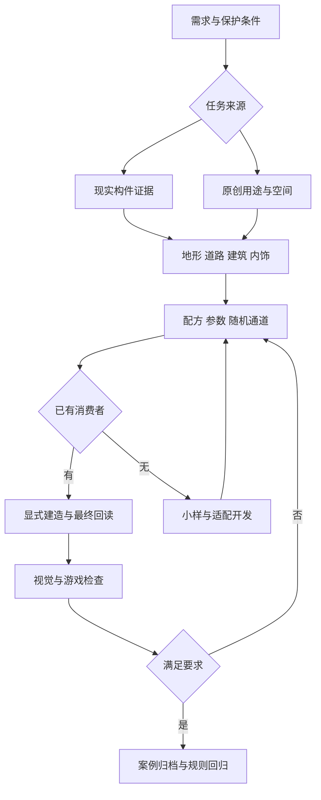

# Haibara’s Architect 0.7 完整工作流

统一顺序是：恢复现状和约束 → 研究 → 地形与空间 → 内饰与装饰 → 有边界的建造 → 最终回读 → 看图与游戏验证 → 归档和规则更新。来源事实、原创判断和程序检查分别记录。

这是一套有人参与的工作流。CLI 执行已接入的验证和建造；研究选择、风格判断、未支持的适配器和游戏体验仍需实际完成。

## 十二步交付合同

| 步骤 | 环节 | 做什么 | 留下什么 | 下一步条件 |
|---|---|---|---|---|
| 1 | 需求与约束 | 确认真实复原/原创/返工；固定对象、尺度、坐标、可改范围 | brief + fixed constraints | 人工确认用户已有意图，不重复索取授权 |
| 2 | 来源与案例归档 | 核对报告、原文件、代码、图片和历史反馈 | source ledger + hashes | 保留缺件、来源冲突和未关闭负例 |
| 3 | 构件研究 | 分解轮廓、内部层、空气层、接口、材质与用途 | component evidence | 没有资料的部位标推断 |
| 4 | 地形与场景 | 保护水系山体，组织道路、公共节点与地块 | terrain + keepouts + access | 先保护再选址；城市概念不冒充实测 |
| 5 | 功能与内饰 | 主用途、活动组、公私、后勤、墙地顶、净高、照明 | spatial handoff | 活动和接近面优先于填充数量 |
| 6 | 配方与随机 | 选受支持配方，固定ID、种子与随机通道 | typed request + candidate choices | 已认可门窗、主家具与地形锁定 |
| 7 | 计划校验 | 验证坐标、预算、承托、完整叶冠、碰撞与禁放区 | scene-plan / validate | 拒绝非法请求，不暗改尺寸解决 |
| 8 | 显式建造 | 在新run运行受控适配器 | NBT + owners + plan | scene-build/build-study/build-case各自范围明确 |
| 9 | 最终回读 | 从最终NBT核对方块、实体与接口；重放确定性结果 | readback + manifest | 不能用导出前对象替代最终检查 |
| 10 | 视觉与游戏 | 四向、正交俯视、眼高/细节、昼夜与目标客户端 | separate review records | 文件/几何pass不自动升级视觉/游戏/审美 |
| 11 | 返工与回归 | 把失败部位连接到新检查；保留旧反例与新输出 | failure → check → revision | 同机位、同尺度，不换案例掩盖问题 |
| 12 | 公开归档与技能化 | 整理规则、例子、消费入口、图片、下载和适用边界 | catalog + guide + reusable rules | 先验证再推广；个人skill安装另记录 |

## 三条可执行路线

| 路线 | 输入 → 消费者 → 输出 | 验证边界 |
|---|---|---|
| 0.7 组合小场景 | 明确高程网格和模块 → `scene-plan/build/verify` → NBT 与构件归属 | 固定尺寸配方、无旋转/缩放/自动平地；检查最终方块与元数据 |
| 专用案例 | 案例参数 → `build-case` 或 `build-study --case room06` → 对应工程结果 | 只支持已登记的适配器；不能更换名称生成任意建筑 |
| 0.6 规划修订 | handoff 0.4 + variation → `plan/dispatch/verify` → 规划 JSON | 不产出 NBT；完整协议见 [兼容流程](workflow06.md) |

## 把场景、内饰和植物一起设计

先把地面高程、水域、道路和固定建筑写入场地约束。房间先写用途、活动组和服务动线，再安排墙地顶、家具、门窗和灯；植物与家具同时设计，预留盆口、叶片体积、养护位置及通路。不能最后随机塞满空格。

随机分别控制建筑用途/变体、材质、维护状态、植物与允许的细节。种子不应改变已确认的道路、门窗、家具或灯位。0.7 当前只实现配方列出的随机项；0.5 二维布局实验不等于已接入体素聚落生成。

工业设施先区分厂房、管廊、罐体、铁路和电力设施，再描述物流/检修/管线接口。本版管廊仅提供端口记录，机器是装饰，固定顶罐不模拟液体；不能把视觉接近写成真实生产线连通。

## 每次完成时要报告

1. 实际采用的来源、规则与执行入口；未采用的证据及原因。
2. 相对基线改了哪些稳定 ID；随机允许变化的范围。
3. 新 run、最终 NBT、图片和逐层验收状态。
4. 用户否定、程序失败与未闭合问题；下一轮怎样验证修复。

机器可读规则见 [workflow07.json](../knowledge/workflow07.json)，配方和命令见 [快速开始](quickstart.md)。
