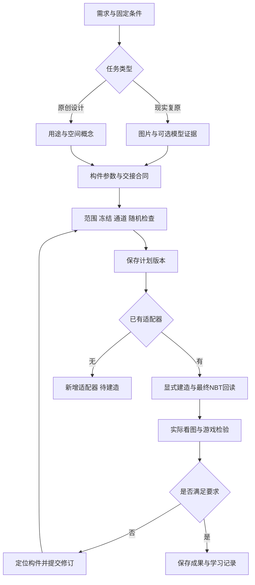

# Haibara’s Architect 0.6：从设计输入到可复查的运行记录

Haibara’s Architect 0.6 新增了一层可执行的规划流程：检查输入、选择受约束的随机结果、保存不可覆盖的 run、接收模型修改提案，再重新验证。它复用 HAF 0.4 的真实 handoff 消费者和已注册案例适配器。规划成功不会自动变成 Minecraft 建筑。

以下命令均在**完整仓库根目录**运行，使用 Python 3.10 或以上。新增规划层只使用标准库；原有案例建造器按仓库要求安装依赖。Windows 示例统一加 `-X utf8`，避免系统默认编码影响中文资料。

## 整条建筑工作流



这张图含人工、模型和代码步骤，不表示每个节点已经自动化。模型提案接入 F 前；0.6 的运行层负责 F/G 及修订验证，I 由已有专用适配器完成，K 仍需真实执行。

| 环节 | 应留下什么 | 进入下一步的条件 |
|---|---|---|
| 需求 | 现实/原创路线、用途、尺寸、坐标、已固定建筑/岸线/地形 | 不确定项已明确，不擅自移走固定条件 |
| 研究 | 来源、时间/视角、构件ID、观察与推断分开、模型单位和朝向 | 关键构件有证据；无资料的部分标候选 |
| 空间方案 | 平面/动线、主视/剖面/分层/立面概念、楼层与净高 | 用途能解释空间，门与路能接通；概念图不是实景证据 |
| 参数交接 | 每个字段的消费者、边界、冻结对象、随机通道与验收条件 | 没有消费者的字段标 pending，不宣称已作用于建筑 |
| 建造 | 新run、参数快照、适配器代码、构件归属、最终NBT | 适配器完成且产物可读取；旧run不改写 |
| 验收 | 最终文件回读、采样、统一视角、细节/夜景、实际游戏反馈 | 分项记录结果，失败可定位到构件和版本 |
| 归纳 | 保留成功与失败样本、解释修复、更新案例索引与规则 | 只有确实共用且被验证的改动才提升为共享能力 |

例如山溪聚落：先记录保护地形、水系与既有建筑，再提出道路和建筑布局。尚未建立对应执行器时，规划应标为概念，不能声称已生成可直接导入的完整场景。

## 先跑一次完整的小例子

示例是两层图书馆的局部规划：保持书架，允许调整阅读桌；分别为两个外墙面板选择材质和维护状态；已确认的窗户保留既有值。它是教学输入，不是测绘资料或完整室内成品。

```sh
python -X utf8 tools/haf.py --version
python -X utf8 tools/haf.py validate examples/workflow06/library-request.json
python -X utf8 tools/haf.py demo --runs-root runs/student-workflow --run demo-001
python -X utf8 tools/haf.py verify --runs-root runs/student-workflow --run demo-001
python -X utf8 tools/haf.py import-proposal examples/workflow06/desk-proposal.json --runs-root runs/student-workflow --parent demo-001 --run revision-001
python -X utf8 tools/haf.py verify --runs-root runs/student-workflow --run revision-001
```

预期结果：`demo` 和 `import-proposal` 返回 `state: "planned"`；两次 `verify` 返回 `status: "pass"`。各项输出仍明确记录 `generated_geometry: false`，几何为 `pending_adapter`，视觉和游戏验收为 `pending`。

`validate` 只读取并返回检查结果；`demo` 等价于对附带示例执行 `plan`。你自己的请求使用下面的命令：

```sh
python -X utf8 tools/haf.py plan examples/workflow06/library-request.json --runs-root runs/student-workflow --run own-plan-001
```

运行目录不可覆盖。再次执行相同命令会失败；练习重跑时使用新的 `--run`，或换一个新的 `--runs-root`。不要修改既有 run 来伪装成新版本。

## 每一步真正完成了什么

| 步骤 | 输入与输出 | 尚未完成的事 |
| --- | --- | --- |
| 研究与设定 | 确认现实证据或原创路线，记录尺度、用途、地形、授权范围 | 不能把未知尺寸写成已测量事实 |
| `validate` | 调用真实 handoff 消费者，检查房间、模块、范围和禁入区；编译可选随机计划 | 不测量地形，不读游戏碰撞，不放置方块 |
| `plan` / `demo` | 保存请求、计划、文件摘要和待验收状态 | 不生成 NBT，不算视觉验收 |
| `import-proposal` | 在父请求基础上替换完整模块列表，通过检查后保存新 run | 模型不能修改父请求的楼层、范围、冻结名单或随机策略 |
| `verify` | 校验文件清单、内容摘要、重算计划及父链约束 | 摘要不证明作者身份或原始授权 |
| 案例建造 | 显式运行已注册案例适配器，按原流程生成其支持的建筑 | 未接入通用 handoff 到任意几何的转换 |
| 回读与验收 | 使用原工程的 NBT 回读和对应视觉、游戏检查 | 只有实际完成的检查才能升级状态 |

## 请求文件的结构

最外层 `schema_version` 为 `"0.6"`；里面的 `handoff.schema_version` 仍为 `"0.4"`。这表示“新流程调用既有设计合同”，不是将所有旧字段重新命名为新引擎。

| 字段 | 作用 |
| --- | --- |
| `handoff` | 用途、风格、楼层、房间、模块、可编辑范围、锁定 ID、通行禁入区等 |
| `variation` | 可选。seed、通道、候选值、固定目标范围，以及冻结目标既有值 |
| `frozen_module_ids` | 模型修订必须原样保留的完整模块 ID |

坐标单位是 block，Y 向上，范围为半开区间 `[x0,y0,z0,x1,y1,z1]`。例如 `[0,3,4,1,8,10]` 包含 `x=0`，不包含 `x=1`。接触边界不等于体积相交。

handoff 的已知能力和限制来自 `hafusion/design_handoff.py`。例如它明确支持 `modern` / `medieval` 两套当前规则；不要仅添加一个新风格名称就宣称消费者已经支持。若要扩展，先补规则、样例和对应验收。

## run 里面保存了什么

| 文件 | 内容 |
| --- | --- |
| `request.json` | 本次完整请求快照 |
| `handoff_plan.json` | 真实 0.4 消费者编译结果与待处理事项 |
| `variation_plan.json` | 有 variation 时保存的逐构件、逐通道选择结果 |
| `model_proposal.json` | 模型修订 run 的原始提案；普通根 run 不包含此文件 |
| `manifest.json` | run ID、版本、时间、父引用、状态和各产物 SHA-256/字节数 |

manifest 最后写入。中途失败留下的目录不能作为完整 run 使用。每个 JSON 产物最多 8 MiB；验证会拒绝清单未列出的文件或子目录。笔记、截图和人工评语请放在 run 目录之外。

验证修订 run 时需要其完整父链；请连同父 run 一起保存。程序检查父引用循环，并将单条验证链限制在 64 个 run 内。超过上限时应整理新的、经过人工复核的根请求，保留旧链作为历史资料，不要修改旧记录。

## 运行已有建筑案例

```sh
python -X utf8 tools/agent.py --list-cases
python -X utf8 tools/haf.py build-case --case guangzhou_south --run station-demo-001
```

第二条默认只打印参数数组。确认选中的案例及其输入符合本次任务后，可显式执行：

```sh
python -X utf8 tools/haf.py build-case --case guangzhou_south --run station-demo-001 --execute
```

这里调用的是 `agent_config.json` 注册的原案例入口。案例必须确实支持输入和生成路径；未注册名称不会触发“通用生成”。此命令不会消费前面的图书馆规划，也不会把随机 choice 自动映射成方块。若需要这一步，应单独实现并测试明确的几何适配器。

## 如何理解验证结果

“pass” 表示当前文件和规则相互一致；输出同时明确标注 `source_authenticity: "not_verified"`。它不等于“设计好看”“游戏可用”“所有研究结论真实”或“来源可信”。如果有人同时重写了一个有效根请求、对应计划和所有摘要，内部一致性检查仍可能通过。需要来源认证时，宿主必须在 run 之外保护预期摘要、签名或审批记录；本仓库没有实现签名系统。

路径检查会拒绝带路径分隔符的 run ID、Windows 设备名、符号链接和 junction/reparse 路径。它是受控本地工具的边界检查，不是能够抵御其他本机进程并发改写文件的操作系统沙箱。

运行本层回归：

```sh
python -X utf8 -m unittest discover -s tests -p test_workflow06.py -v
```

下一步可阅读 [模型接入](model-integration.md) 和 [受约束随机](randomness.md)。
